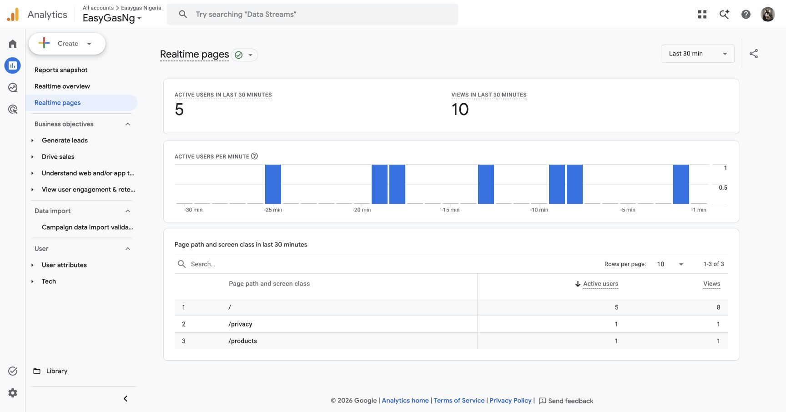

# GA4 Realtime acceptance —19November2026

**PASS: ANALYTICS-04 / ANALYTICS-G04.** Google Analytics received the actual consented client-demo visit. The existing deployment source remains `2eb4e17402b3be8a27e2416fd02ab32159710b01`; this continuation changes acceptance evidence only.

| Identity | Confirmed value |
| --- | --- |
| Analytics account | Easygas Nigeria /416957612 |
| GA4 property | EasyGasNg /565150618 |
| Web stream | EasyGas /16373512765 |
| Measurement ID | G-8Y34NXQMMK |
| Google container | GTM-KLJ8FM96 |
| Configured primary stream URL | https://easygasng.com (unchanged) |
| Actual received demo URL | https://easygas-client-demo.vercel.app/privacy |

Authenticated Google Analytics UI access was already available in Chrome. Canonical web-stream details confirmed the supplied measurement ID under the same property used for Realtime. No credentials, permissions, tags, streams or filters were changed. The existing setup wizard was navigated to reports; no new property or account was created.

At10:59:04 UTC, the signed-out demo browser changed from Essential only to Allow analytics. At10:59:19 UTC, a normal Privacy Policy link opened `/privacy` without query parameters. No form, purchase, private account visit or synthetic event injection was used.

At11:00:08 UTC, Realtime `page_view` → `page_location` showed the exact demo `/privacy` URL with1event. Views increased from8 to10, active users in30minutes from4 to5, and active users in5minutes from0 to1. Realtime pages independently showed `/privacy` with1active user/1view. These rolling totals include prior verification visits and are not an assertion that every event belongs to this single browser. The exact fresh URL and timestamped navigation corroborate demo receipt. The account's setup/48-hour summary warning still said no data; it did not override the actual receiver report.

After capture, the test browser returned to Essential only, reloaded and had0Google Tag Manager scripts. No application code, deployment, order, wallet, ledger, gas or inventory data changed. Previous27focused checks, build/types, browser and hosted business-preservation evidence remain valid for the unchanged source. The new receiver-evidence test validates the recorded UI artifacts; it does not make new live reporting requests.

[Structured confirmation](evidence/ga4-realtime-confirmation.json) · [Stream identity](evidence/ga4-stream-confirmed.txt) · [Before](evidence/ga4-realtime-before.txt) · [Received event/location](evidence/ga4-realtime-receipt.txt) · [Received page table](evidence/ga4-realtime-pages-confirmed.txt) · [Receiver validation](evidence/ga4-realtime-validation.txt) · [Matrix validation](evidence/ga4-realtime-matrix-validation.txt).

The [matrix](../traceability/google-analytics-rtm.md) now shows4/4requirements verified,2/2critical and4/4gates, with0exclusions. This closes bounded Realtime receipt only. Commercial production NO-GO, actual-import hold, retain-all, native/physical/provider gates and all unrelated phase gaps remain unchanged. Longer-period processed reports, ecommerce and advertising acceptance are not claimed.

Google documents [Realtime verification of collection](https://support.google.com/analytics/answer/9333790) and the [Realtime pages report](https://support.google.com/analytics/answer/17154557). The acceptance result above is based on observed account-side UI evidence.
