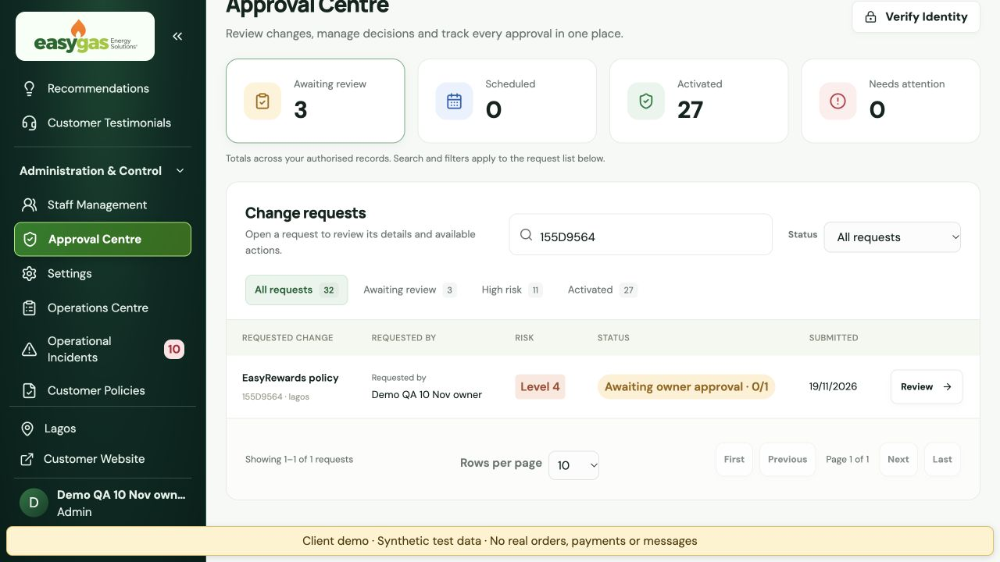

# Approval Centre clarity and single-owner EasyRewards policy

The requester name previously appeared without a clear label and a generic pending status. The Approval Centre now labels **Requested by** and shows revision-specific progress such as **Awaiting approvals · 0/2**. Counts use the same server checks as activation: current role/activity, branch, identity verification, delegation, distinct reviewers and request revision. Rejected/returned reviews are not approvals. Missing required roles and qualified safety reviews remain explicit.

EasyGas has one Admin/business owner. Under the existing enabled owner-authority policy, the business setting `loyalty.policy` now supports that owner's own verified authorisation. It shows **Awaiting owner approval · 0/1** and **Approve**. The named pending request `155D9564` remains pending until its requester explicitly acts. New owner submissions retain the existing audited automatic-approval behaviour. No second Admin account is created or required for this business policy.

This exception is specific to the business programme policy. Points adjustments, financial operations, access/payment changes and qualified safety reviews retain their existing controls. Owner authority still requires the existing explicit configuration switch, the same requester/current owner, recent identity verification, validation, expiry, base-version consistency and immutable audited authority. Original request/policy snapshots remain intact; current effective owner authority is shown separately. New requests and future activation continue through the existing setting/version engine. No rewards economics, technical issuance/redemption flag or existing request is activated by release.

Local verification: **58/58** governance, approval pagination/HTTP, owner policy, safety and EasyRewards tests passed, plus TypeScript and production web build. The revised-request test uses actual request-changes/revise/submit actions; immutable decisions are never rewritten. No native build is performed. Hosted verification and exact source release evidence are recorded in the [matrix](../traceability/approval-clarity-rtm.md).

Commercial production NO-GO, actual-import hold, retain-all and all unrelated phase gaps remain unchanged.

## Deployed result

Final source `35ed307b0e38477ad1d70adacd87a0f02f4949a5`, Ready deployment `dpl_7rBejjBZL91bqowRZBUAQsekjAJL`, is promoted to [the client demo Approval Centre](https://easygas-client-demo.vercel.app/admin/approvals).451 uploaded files exactly match archived Git bytes with no environment, local data or build artifacts. [Source integrity](evidence/reviewed-source-integrity.json) · [Stable identity](evidence/stable-identity.json) · [Promotion](evidence/reviewed-promotion.txt). Rollback baseline: `2eb4e17402b3be8a27e2416fd02ab32159710b01` / `dpl_3FENKwC96aryhXzA76q45pAv4heM`.

Final desktop and390px phone show Requested by, **Awaiting owner approval · 0/1**, a **Review** list action, and explicit single-owner guidance above the comparison. Actual final **Approve** was not submitted by verification. An existing active payment request retains its two real review records and restricted approval guidance. There is no pending dual-review record in this demo snapshot;0/2→1/2→2/2 and revision invalidation are covered by the isolated backend tests. No synthetic second Admin or new hosted financial request was created.

Normal authenticated product readback confirms all32requests/decisions, the rewards policy/version,13orders,ledger,inventory,gas and QA wallet equal the before-release snapshot. The named request remains pending, zero decisions, with its own-owner action available. This is not a claim that the proposed rewards economics have been accepted or activated.

[Actual browser observations](evidence/browser-checks.json) · [Hosted readback](evidence/hosted-readback.json) · [Executed hosted check](evidence/hosted-readback.txt) · [Browser evidence validation](evidence/browser-validation.txt) · [Final focused checks](evidence/final-focused.txt) · [Matrix validation](evidence/traceability-validation.txt).

Historical candidates and screenshots are retained. Only `final-*` browser screenshots/observations and the stable identity support final hosted acceptance. Verification also clarified that Review opens details, outstanding-review hints apply only to open requests, and qualified safety guidance remains separate. Final cloud build/types passed; no new native build, git push or commercial release was performed.

The bounded matrix is3/3implemented and verified requirements,2/2critical,3/3gates,0exclusions. Prior holds remain unchanged.
