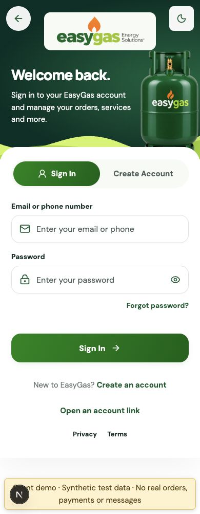

# EasyGas authentication redesign

The approved Sign In, Create Account and Account recovery design is implemented in the existing web and native applications. Existing reset, verification, invitation, manual account-link and assisted account-completion flows use the same presentation. Authentication authority remains on the existing server.

**Status: implemented, partially verified; release NO-GO.** Local web acceptance passed. The updated native preview, device keyboard/Back/safe areas, physical password managers and assistive acceptance remain open. Device Hub and Android Studio could not expose usable windows, and no Android emulator was attached. No native device result is inferred from component tests.

- [Audit](00-audit.md) and [existing contracts](01-contracts-and-permissions.md)
- [Design implementation and deliberate adaptations](02-design-handoff.md)
- [Security boundaries](03-security-regression.md)
- [Executed results and unresolved acceptance](04-test-results.md)
- [Rollback and release decision](05-rollback-release.md)
- [Requirements traceability](../traceability/auth-redesign-rtm.md)
- [User manual](../user-manual/authentication.md)

The broad local run passed 1,284 tests, including PostgreSQL, without failures or skips. Subsequent final authentication changes passed 43 focused tests and 49 historical-source checks. Web build/type checks and native type/dependency checks passed. These suites overlap; their counts are not a combined unique total or a GitHub Actions result.

Actual local browser checks cover all three core routes at seven viewport widths, plus dark mode, errors, recovery, account links, customer/staff routing and logout. Screenshots are browser evidence, not installed mobile screenshots.

The disposable local web preview uses port 3140. The existing Expo Go development preview uses port 8086; open `http://127.0.0.1:3140/launch` in the QA simulator to launch it. These processes may need restarting in a later session. No signed mobile binary, native bundle export, store upload, deployment or new OAuth integration was created. Apple/Google buttons are omitted as required by the handoff because no existing supported integration was found. Original production holds remain.
