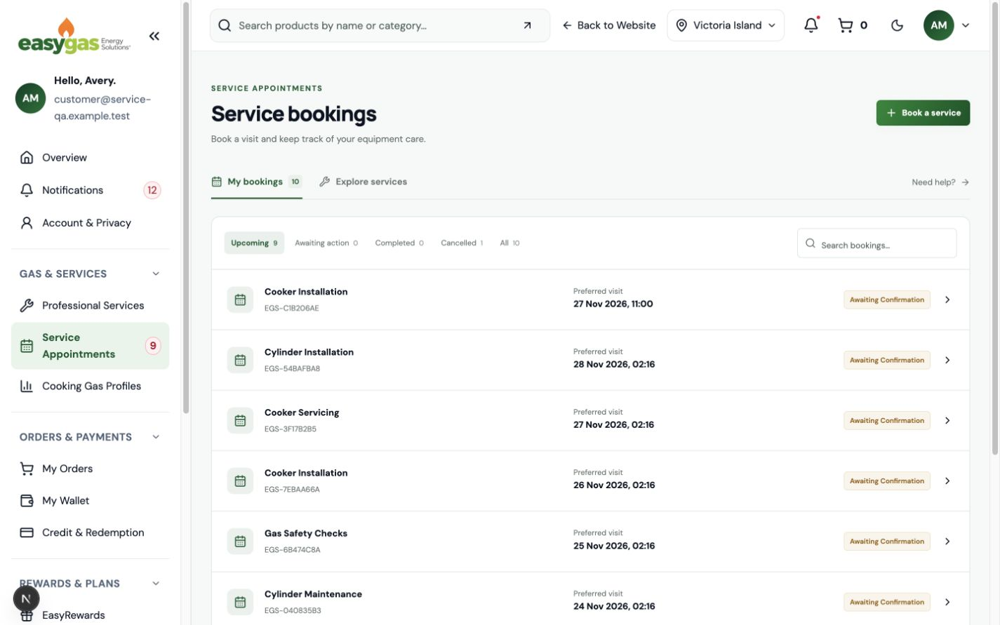

# Customer services and booking requests

Implemented locally on 19 November 2026. No hosted deployment or native build/install. Existing production NO-GO, retain-all, actual-import hold and unrelated changes preserved.

Bookings now open with searchable status summaries and six-row pagination. Service exploration is a separate compact view. Full address/contact, optional uploads, billing, reports and lifecycle controls appear in booking details. Service pages show configured price/duration and meaningful content; giant marketing/placeholder sections and empty configuration notices are removed. Existing service/product packages remain available in a disclosure.

The customer dialog collects a preferred Lagos date/time, saved or manual service address, phone and equipment details, then reviews and saves an Awaiting confirmation request. Draft edits and unsaved-close protection remain. Stable user/service-scoped operation keys recover an uncertain response without creating duplicate requests.

## Request model and operational boundary

`booking.create` accepts exactly one of real `slotId` or `preferredStart`. An approved active service/version and active branch/coverage are still mandatory. A preference is future, at most 180 days ahead. Migration 081 creates a blocked `request_only` service_slots record with no technician, followed by an owned pending service_bookings record and coordination notifications in the same operation. It reserves no personnel/calendar capacity. Identical preferred times may be requested independently.

An unassigned request cannot be confirmed, progressed to work or turned into a collectible invoice. Its preferred time may be changed with a current booking version, or withdrawn even after the preferred date. Staff use the existing real-slot allocation workflow before confirmation. Qualified execution, work authorisation, safety, report, cancellation/refund and ownership controls remain. Bundles retain the original qualified-slot path. The change supports intake when internal staff are unavailable; it does not implement an outsourced-provider integration or bypass provider qualification.

Apply migration 081 through the existing migration runner when deploying. Local runner revision 81 and generated database/bootstrap.sql/exporter include it. No hosted migration was applied. Existing scheduled slots retain provider and unique-start constraints; request-only records cannot be exposed/unblocked as selectable capacity. Invoice-source and customer widgets recognise pending preferences.

## Executed validation

- 75/75 focused tests, no failures/skips: customer service redesign, service details/recovery/governance, qualified appointments, invoices, cancellation/refunds, bundle/catalogue integration and dashboard/account regressions. [Log](evidence/tests.txt).
- 1/1 independent PostgreSQL concurrency test, no skips: duplicate operations, last-slot competition, and identical preferred-time requests with every technician unavailable. Disposable isolated schema only. [Log](evidence/postgres-tests.txt).
- Web build and typecheck passed: [build](evidence/web-build.txt), [types](evidence/typecheck.txt).
- Local browser checks at 390x844,768x1024,1280x720 and1440x900, including light/dark, search/empty/pagination, chooser, form/review/edit/discard, successful request and preferred-time change. All technicians unavailable; actual synthetic request EGS-C1B206AE saved and remained pending. [Observations](evidence/browser-observations.txt).

The requirements-matrix validator passed 2/2 checks with no failures: [log](evidence/traceability-tests.txt).

Run the focused suite with `node --import tsx --test --test-reporter=spec` and the test files mapped in the RTM. PostgreSQL test requires `EASYGAS_ENABLE_LOCAL_PG_TESTS=yes` and an isolated `EASYGAS_TEST_POSTGRES_URL`. Build then typecheck sequentially. Run matrix validation via `node --import tsx --test --test-reporter=spec tests/customer-traceability.test.ts`.

For browser reproduction, `node --import tsx scripts/prepare-customer-service-booking-qa.ts` prepares isolated temporary data and writes ignored `.data/customer-service-booking-qa.json`; select that data directory for the web preview. The fixture's independent service approvals and synthetic credentials/data are test-only, not evidence of operational readiness or actual completed service.

[Requirements traceability](../traceability/customer-service-booking-redesign-rtm.md) maps all five requirements, sources, controls, exact tests and acceptance gates. Prior SDR/SBV matrices record the approved scope change without dropping their broader requirements or gaps. Hosted rollout, installed native parity, formal screen-reader/physical-device checks and external provider integration remain unverified.

