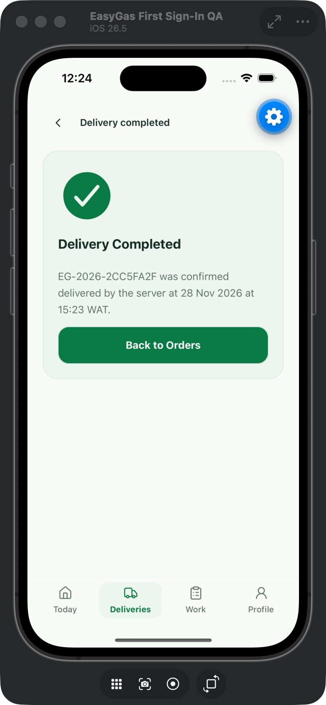

# iOS driver flow against the demo

Completed29 November2026 in **EasyGas First Sign-In QA / iOS26.5 / Expo Go58**. The normal app sign-in and native driver screens completed synthetic order **EG-2026-2CC5FA2F** against the existing Vercel demo. [Results](evidence/ios-hosted/results.json), [request evidence](evidence/ios-hosted/native-requests.json), [traceability](../traceability/daily-ios-rtm.md).

| Step | Observed result |
|---|---|
| Office reassigns to today's driver |12.5kg reserved automatically on a separate25kg QA delivery day |
| Driver signs in and accepts | Actual restricted account; no reason, pickup, meter or LPG load step |
| Driver starts and arrives | Canonical current-attempt transitions succeeded |
| Scale refill |8kg before,20.5kg after;12.5kg recorded once |
| Native photo | Consent and synthetic description; user tapped the green system-picker photo; encrypted queue showed1 before native multipart upload200 |
| Completion | Full handover confirmed; native Complete Refill200 and visible **Delivery Completed** |
| Authoritative checks | Customer Delivered, driver History with proof, one private photo, one refill debit and completion audit |
| Office close |12.5kg remaining, zero variance, no outstanding order commitment |

## Repairs verified

Order-list actions now open the current status or refill/photo stage directly. Alert selection establishes the Orders context. A second synthetic3kg assignment confirmed acceptance stays open with Start delivery available; it was retired through the normal failure/cancellation path without supply, with its synthetic wallet refund retained.

Accepted-order notices no longer appear over another selected delivery. Successful synchronization now uses a success message instead of an error with Try again. Pending-photo copy changes to server-verified feedback only when canonical daily proof is ready and the encrypted queue is empty; pending new evidence and capture errors remain visible. The final empty-sync success message was observed on iOS. The final proof-copy repair was tested through the actual component renderer after the positive device journey; no second full physical or signed-device journey is claimed.

[14 final focused component checks](evidence/ios-hosted/final-components.txt) passed with zero failures/skips, including current-attempt/consent metadata, pending versus verified feedback, capture-error retention and cross-order notice isolation. The earlier canonical daily/refill/photo run passed19 checks. Native types passed. [Final source hashes](evidence/ios-hosted/runtime-verification.json) match the shared preview and isolated source. [Final iOS sync feedback](evidence/ios-hosted/11-final-sync-observation.txt).

## Simulator accommodation and limits

The shared demo's gallery approval flag was false. This simulator cannot capture a physical camera photo. A loopback-only adapter allowed gallery selection solely for the generated QA driver after canonical actor/branch verification. It changed only that driver's `driver.snapshot.galleryApproved` read response. Business writes, upload content, consent, paid quantities, attempt/version checks and completion authority went unchanged to deployed handlers. The demo camera policy and all other users' permissions were unchanged. Anonymous, Admin and previous-driver adapter access were denied; the generated current driver was allowed. One system-picker image tap required the user's assistance because Device Hub exposes the picker image but cannot click it.

All test weights, funding, addresses and the green proof were clearly synthetic. This is simulator/gallery acceptance, not physical camera/scale, signed TestFlight or full offline acceptance. The runtime deployment remained16160a1 / Ready dpl_7DrsEXcvd7HVS6Ndw3cJmLWawAjq. No web runtime deployment, migration, signed native build or store upload was required or performed. Parent DAY-05 and original production NO-GO/provider/import/retention holds remain.

## Guards, preservation and cleanup

Premature completion, incorrect refill quantity, missing consent and prior-driver proof access were rejected. After completion, authorized Admin/current-driver/customer photo reads returned200 with private,no-store caching; previous-driver404 and anonymous401. Duplicate completion under a new identity returned409 without another stock debit. Each main-order reservation/refill/completion audit occurred once.

All32 original order snapshots, other-branch stock, Lagos day figures and Lagos settings matched baseline. The QA day closed with zero variance, previous QA trip ended, test delivery area hidden/inactive, QA wallet/delivery disabled and generated driver access suspended. Known current test sessions were revoked; native logout returned200. Synthetic order/photo/audit/history remains retained and labelled. The local gallery adapter was stopped and the normal HTTPS demo API restored; the simulator was observed signed out on the normal guest home. [Cleanup](evidence/ios-hosted/cleanup.txt), [restored preview](evidence/ios-hosted/12-restored-demo-guest-ax.txt).
