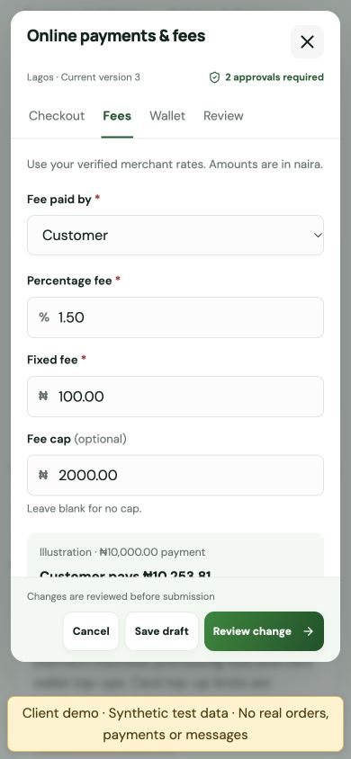

# Web/API publication — 21 November 2026

**Complete: GitHub publication, client-demo web/API deployment and final verification passed.** The 49 previously unpublished commits through `dc13af109f0b1b172bd0b6b1539127d6592a4021` are pushed to `codex/technician-saas-redesign`. No history was rewritten. The existing client-demo project is `prj_cFSaJuN9r4x93RLov1LLVO3cdVA2`; its stable URL is [the client demo](https://easygas-client-demo.vercel.app).

The candidate `dpl_AXjGjA3VPmKi8aqRpGBwZohyvw4a` is Ready. All 435 web/shared upload files match committed bytes and Vercel dry-run upload hashes; native, private, prototype, documentation, test and operator paths are excluded. The cloud web/API build succeeded. The stable alias now resolves to this exact candidate. Both candidate and stable passed 36 seven-role checks with matching snapshots. Four actual browser observations and all 13 hosted ledger cross-branch follow-up checks passed; final full CI passed.

The original workflow checked out only the triggering commit, but retained release tests verify historical file hashes using `git show`. The web checkout now fetches full history in commit `713e500454a93c981a9c0d9a2ddc4051ceb671d4`. The first run had 17 failures, including missing history. Full-history rerun reduced this to five: two older hash guards did not yet follow the existing approved native/logo continuation manifests, and three host-rendering tests relied on a machine-specific `/tmp` package. Commit `d4fe9931913c856ac8cfe0bd1775094e81fbb73e` follows each original-to-current approved hash transition (including historical-commit verification), pins the existing React/renderer versions in an isolated Node-only test package and installs that package explicitly in CI. All 37 targeted checks passed. No assertion or baseline was discarded, no test skipped and no application/native source changed. Every candidate upload file is byte-identical to this CI commit. See [GitHub checkout documentation](https://github.com/actions/checkout#checkout-v4) and [source equivalence](evidence/ci-source-equivalence.json). The mobile job is unchanged: type/dependency/security checks run, while export remains skipped unless separately dispatched with explicit export authorisation. No EAS, Xcode or Gradle build, mobile export/install/distribution is performed by this release.

The protected candidate passed 36 checks using seven existing labelled QA accounts. Existing Vercel Deployment Protection stayed enabled; authenticated CLI transport reached the pinned candidate. Checks cover Settings visibility, canonical definitions/approval authority, grouped categories without duplicate keys, account lookup/error boundaries, gateway sandbox controls, owner-only readiness and ledger scope. Owner sees all 11 verified payments; finance sees its original 10 and cannot use the foreign synthetic cursor. Five other roles cannot read the ledger. Normal authentication/read audit records are expected; own temporary sessions are revoked.

Before/candidate snapshots match for 77 Settings definitions and active values, 42 approval requests, staff role/branch/active projections, 15 orders, 12 inventory rows, all 11 ledger entries, published policies and production readiness gates. These are scoped API projections, not a claim that every database table was independently fingerprinted. No business proposal, approval, stock/funding/payment mutation, new fixture or qualification renewal is authorised or needed for this rollout. There are no database/schema source changes in the 49-commit range.

Rollback target: Ready `dpl_9iRB6FomxHHXqwNvjChTsnFgty4z` / `easygas-client-demo-c35k4omke-onaopemipos-projects.vercel.app`. If post-promotion checks fail, promote that existing deployment in the same project, retain the database/immutable records/current project configuration and repeat authenticated checks. This is an alias rollback, not a data rollback.

The 1-kobo synthetic cross-branch ledger fixture from HLED-03 remains retained in its inactive branch with inactive customer and cancelled order. Do not activate, fulfil or delete it. The hosted follow-up checks its existing state only.

Production **NO-GO**, actual-import hold, retain-all and all prior incomplete native, signed-device, physical safety/provider and 300-feature requirements remain unchanged. This bounded web/API rollout does not distribute committed native screens to installed phones or upgrade those wider acceptance gates.

## Current hosted/browser evidence

[Candidate](evidence/candidate-hosted.json) and [stable](evidence/stable-hosted.json): 36/36 checks each, seven existing role identities and all temporary sessions signed out. [Ledger follow-up](evidence/ledger-cross-branch.json): 13/13, owner 11 / finance 10, original financial rows and business records unchanged. The verifier accepts a separate report output path so this release does not overwrite historical HLED evidence. [Browser observations](evidence/browser-observations.json): active Settings item visible, one consolidated Payments & Wallet group, tabbed fee editor in readable units, a 390×844 phone dialog/actions within the viewport and a working delivered-order Items view. No form fields changed or settings/order writes submitted; browser signed out afterward.

[Native artifact preservation](evidence/native-preservation.json): all three retained hashes and modification times match. Original 300-feature, signed/native/physical/provider gates remain separate; this release does not certify them.

## Final acceptance

[Release validation](https://github.com/Onaopemipo/easygasng/actions/runs/44802393642) on `d4fe9931913c856ac8cfe0bd1775094e81fbb73e` passed both jobs: **1,137/1,137 tests, zero failures and zero skips**, web build, web typecheck, production dependency audit, native type/dependency/audit checks. Native export was explicitly skipped. [CI summary](evidence/ci-test-summary.json), [job/step results](evidence/ci-final-jobs.json), [raw web job](evidence/ci-web-job.log), [regressions](evidence/ci-tests.txt), [build](evidence/ci-build.txt), [types](evidence/ci-types.txt), [dependency audit](evidence/ci-dependency-audit.txt). The downloaded immutable CI artifact SHA-256 matches GitHub's artifact digest; [artifact provenance](evidence/ci-artifact.json).

All four bounded requirements and gates pass. The core release checks passed 3/3 and the final native/CI closure check passed 1/1; these are four distinct release checks. The 37 targeted repair checks are a subset of the full suite and are not added to its count. Six documentation/traceability validations pass. Native artifact hashes and modification times were rechecked at closure and remain unchanged. Initial failures and their specific fixes are retained in [initial failure evidence](evidence/ci-initial-failures.json) and [history-fix follow-up](evidence/ci-history-fix-followup.json).

The original 49 commits, the two CI/test-infrastructure repair commits and this release's verification scripts/tests/documentation are published on the existing branch without a force push. The deployed web/API source remains `dc13af109f0b1b172bd0b6b1539127d6592a4021`; CI and final evidence commits change excluded CI/test/operator/document paths only. All 435 deployed application/upload files remain identical. No additional cloud build is needed for the evidence-only follow-up.

Production NO-GO, actual-import hold, retain-all and every prior incomplete product/native/provider/physical acceptance gate remain unchanged. This is a verified client-demo web/API rollout, not a commercial production or mobile-binary release.
