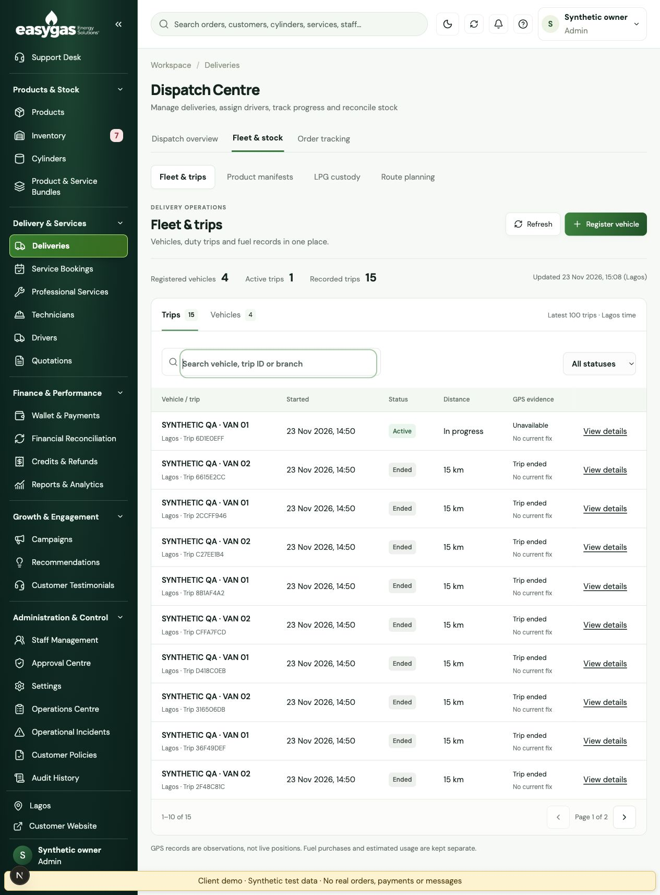

# Dispatch and fleet redesign

Screenshot audit: the operational workspace combines four unrelated accordions, an always-present oversized registration form and unstructured repeated vehicle headings. Users must scroll past sensitive forms to find trips; repeated labels do not identify distinct trip records.

The new design separates fleet, manifests, LPG custody and planning. Fleet records come first; registration, full GPS/fuel evidence and trip actions open focused dialogs. Search and local pagination cover the latest 100 server-returned trips, explicitly labelled. No server pagination, deduplication, GPS live tracking or unseen data is claimed.

Initial screenshot-only estimates: accessibility65/100, usability40/100, content55/100, mobile/layout45/100; overall51/100. These estimates cannot establish screen-reader behaviour, performance or runtime correctness. Executed checks will be recorded separately.

Implemented and locally verified24November2026. Five bounded UI requirements/gates pass; no hosted rollout or production readiness claim.

## Result

- Compact workspace tabs: Dispatch overview, Fleet & stock, Order tracking. Queue KPIs/date controls appear only in overview, so they do not imply filtering fleet history.
- Purpose tabs for Fleet & trips, Product manifests, LPG custody and authorised Route planning. Overview shortcuts use explicit targets rather than searching collapsed summaries.
- Search/status filters and10-row pagination over the existing latest100trip response; Trips and Vehicles are separate. Distinct trips retain IDs despite repeated vehicle names.
- One focused owner registration dialog, driver start/manage dialogs, hidden trip request context, dirty/pending protections and single-flight fuel retry. Kilograms map exactly to existing gram fields; no sub-gram rounding accepted.
- GPS evidence, upload times/accuracy/history and actual fuel receipts remain available on demand. Zero values, absent estimate rates and unverified suitability remain explicit.

## Executed verification

[Focused suite](evidence/focused.txt), [actual isolated browser observations](evidence/browser-observations.json), [native/server-preserving source continuation](reviewed-source-changes.json), [types](evidence/typecheck.txt) and [web build](evidence/build.txt). Ten browser observations pass, including actual wrong-password/correct-retry registration, draft/focus handling, desktop/phone/tablet light/dark and correct shortcut targets. Seven role boundaries and stale/denied/delayed response, unit precision, duplicate/idempotent write exceptions are executed in component/backend tests. Independent PostgreSQL trip concurrency remains the original explicitly skipped case; PGlite is not concurrency evidence.

The browser checks found and repaired demo-banner overlap, narrow-page overflow and stale accordion shortcuts. The local synthetic registration12.5kg remained LPG-unverified. No hosted records, actual safety approvals or mobile assets were changed.

[Manual](../user-manual/dispatch-fleet.md) and [stable phase matrix](../traceability/dispatch-fleet-redesign-rtm.md). Existing complete-scope DDI and production NO-GO/import/retain-all/native/provider/physical holds remain. Physical browsers, screen readers, every role/browser permutation and client-demo deployment are unclaimed.

## Final check results and retained limits

Current focused rerun: **25passed,0failed,0skipped** ([log](evidence/final-focused.txt)); actual browser cases:10/10; current web build and typecheck pass.

The [initial broad run](evidence/initial-full-regression.txt) retained1,226cases:1,196passed,1failed source-proof assertion and29environment-dependent skips. The assertion caught the fleet CSS missing from the explicit continuation map. Added its exact committed baseline/current hash to the four-file allowlist; the final25-case rerun includes that failing assertion and passes. The complete broad suite was not rerun and is not represented as green. [Structured verification](evidence/verification-summary.json) and [all retained skip reasons](evidence/retained-skips.txt). Totals overlap and must not be added.

No current runtime defect remains identified in the bounded local redesign. Deployment/hosted checks, physical browsers, actual mobile software keyboards and screen readers remain untested here; original independent PostgreSQL and production gates are not accepted by these UI results. All original historical evidence files and native binaries remain unchanged.
