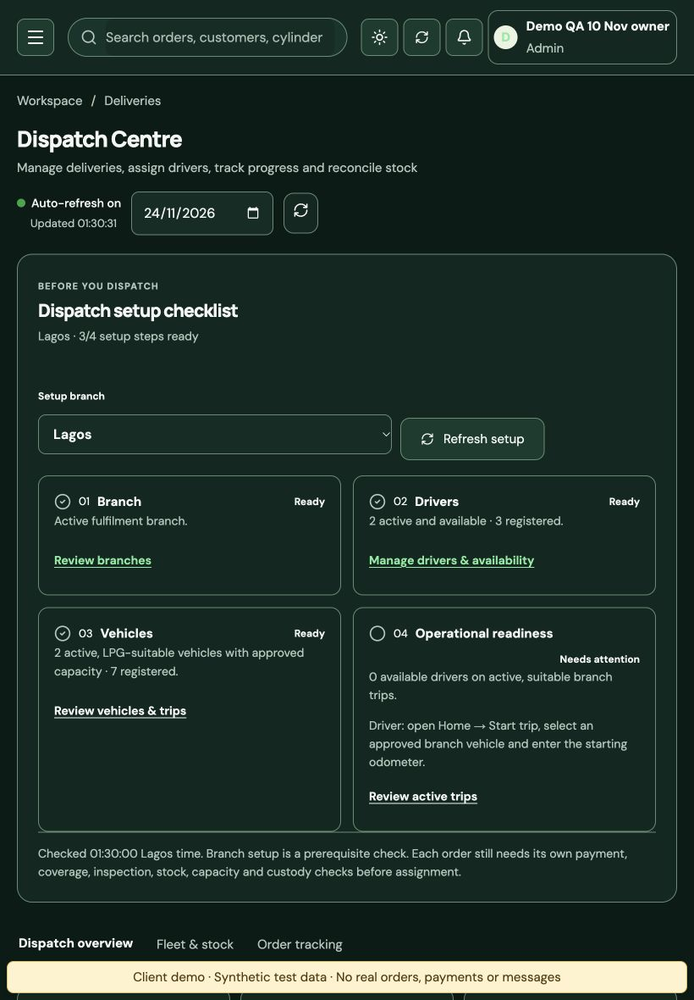

# Dispatch setup checklist and ready-first assignment

Dispatch Centre now has one branch-scoped checklist for branch, drivers, vehicles and operational prerequisites, with direct actions to the existing workspaces. Ready drivers appear first in both Orders and Dispatch assignment; blocked/unchecked drivers start in a compact expandable section with their original exact requirements and responsible roles.

The new setup read aggregates canonical branch/user/vehicle/trip/settings/delivery-location records independently of the order queue. It starts no trips, makes no business changes and clears stale results after scope changes or failed reads. Role, branch and individual dispatch.manage revocations apply; vehicle registration remains owner-only. Delivery settings links select the correct branch and Delivery & Dispatch category. No order-specific payment, coverage, inspection, stock, capacity, custody or final assignment check is bypassed. Four setup steps ready is not a production release approval or proof that every order is eligible.

[33 focused checks](evidence/focused.txt), [five actual local browser cases](evidence/browser-local.json), web build and types pass. They cover canonical missing/ready prerequisites, wrong roles/branches, individual privilege denial, unchanged business data, release controls, stale/failed request recovery, ready-first/disabled blocked/null choices, existing final stale-eligibility rejection, exact source continuation and documentation. Actual owner/manager desktop, 390 px phone and 820 px tablet/light/dark checks cover both assignment entry points and direct destinations. No physical or assistive acceptance is inferred. All 77 sensitive-action guard sites remain.

Browser acceptance caught the initial delivery-window array assumption; setup now reads the same comma-separated text as ordering. A final audit added inheritance of individual Dispatch access revocations, with a negative regression. The initial test-fixture table assumption was corrected; retained initial failures are not mapped as accepted evidence. Seven explicitly reviewed web continuations preserve their committed baselines; two new runtime modules implement the read and checklist. Original native/final-guard source and all prior evidence remain.

Application `8bb1627ad91e0494ca1d3b62b6a284ab2d078ce5`, Ready `dpl_12Wsg86xEFfYy8hG16Nn2di7nC7N`, is verified on the [existing demo](https://easygas-client-demo.vercel.app/admin/deliveries). [All 448 remote source hashes](evidence/source-integrity.json) match Git; setup server, checklist and assignment source were additionally downloaded/byte-compared. [Five candidate](evidence/candidate-hosted.json) and [five stable](evidence/stable-hosted.json) groups verify owner/manager reads, five lower-role/anonymous/foreign/missing/malformed denials, original candidate authority and unchanged current order/inventory/vehicle/trip/driver snapshots. [Four actual final hosted browser cases](evidence/browser-hosted.json) show Lagos 3/4 setup steps and compact blocked drivers on the existing order. The remaining operational task is a driver starting a suitable branch vehicle trip. Positive selection was tested on disposable local data; no hosted account/configuration/trip/assignment state was changed to manufacture readiness. Own verifier and browser sessions were signed out.

The initial full CI found one historical source comparison that stopped before the reviewed Dispatch continuation (1,247/1,248 tests passed). Test-only `2ccc15d` composes the approved comparison without changing historical hashes or native/server exclusions; all 33 focused checks pass. Full GitHub rerun [45298859532](https://github.com/Onaopemipo/easygasng/actions/runs/45298859532) passes: **1,248 regressions, zero failures/skips**; web build/types/audit and native types/three dependency tests/audit pass, mobile export skipped. All 448 application files at that CI commit match the deployed source. All four requirements/gates are verified, zero excluded. Final documentation/operator evidence publication changes no deployed application bytes. Initial 1f83a40 rollout evidence is retained [separately](evidence/initial-release/README.md). Rollback: pre-phase Ready `dpl_4fDG9cPQu847x5hvkqT9etxU1sVz`, same project, preserving all data/settings. No new mobile binary/export, migration or environment override. Original production NO-GO and native/provider/physical/import/retain-all holds remain.

[Manual](../user-manual/dispatch-setup.md) · [Matrix](../traceability/dispatch-setup-rtm.md)

