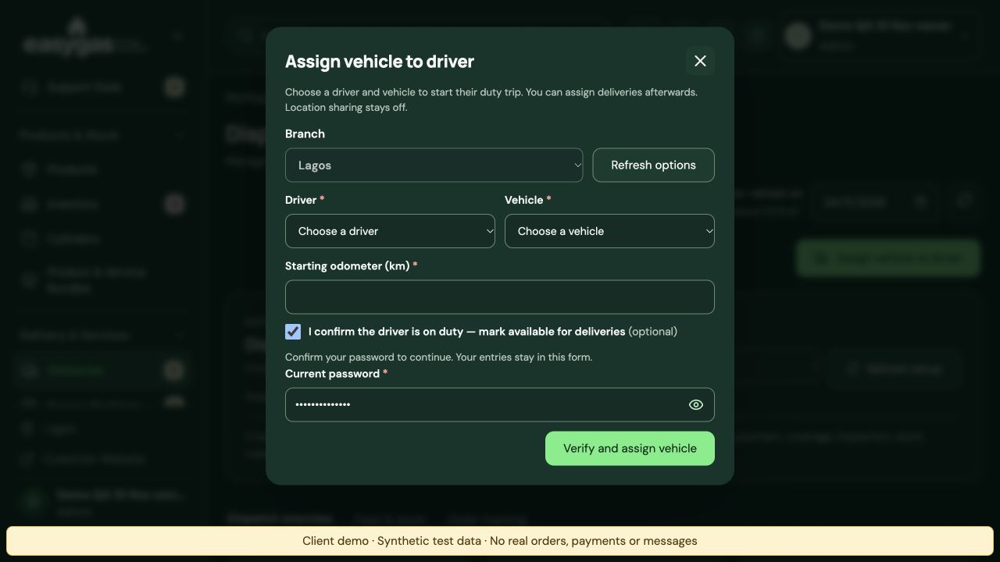

# Direct vehicle assignment in Dispatch

Owners and branch managers can choose **Assign vehicle to driver** in Dispatch, select an active driver and available suitable branch vehicle, enter the true starting odometer and verify their own password. The explicit on-duty checkbox optionally marks the driver available using existing staff authority. The result is an actual duty trip, shown on the driver Home screen; Dispatch setup and order eligibility refresh. The missing-trip warning in Orders and Dispatch also opens this form. Order assignment remains separate.

No driver impersonation, account/session substitution or location consent occurs. GPS stays off. Existing active trips must be reconciled before changing a driver or vehicle. Server role/branch/privilege/password/release checks, strict input, stable operation keys and driver/branch/vehicle locks prevent stale or concurrent assignment. Optional availability and trip creation commit atomically; failed vehicle checks roll back availability. Existing driver self-start, order safety/payment/inspection/stock/custody guards and all native files remain unchanged.

[48 focused tests](evidence/focused.txt), build/types and [six actual local browser cases](evidence/browser-local.json) pass. Independent disposable PostgreSQL17 transactions cover admin vs driver self-start, two drivers competing for a vehicle and same-key retry. Real local browser acceptance verifies an off-duty driver becomes available on a new trip without driver login, setup reaches 4/4 and candidate eligibility updates. Wrong password preserves fields; duplicate submit, uncertain response, expired verification, revoked authority, branch/role denials, occupied records and release-off states are covered. Initial oversized field margins and same-page shortcut handling were corrected during browser acceptance; primary actions fit above the demo banner. No physical/native/assistive acceptance is inferred.

Eight explicitly reviewed existing files retain committed historical hashes through the [strict continuation](reviewed-source-changes.json). The original driver self-start module and final order/custody guard modules are outside this allowlist. The source inventory retains 78 sensitive-action guard sites across 35 modules, 367 browser request entries and 11 direct fetch sites. No migration, environment override or mobile binary/export.

Application `99fd4d0aeb2e92a70dc354105e9233f0b71f7f58`, Ready `dpl_DQDFeJanVfLgf3pzBaH2uaKyecSB`, is live on the [existing demo](https://easygas-client-demo.vercel.app/admin/deliveries). All **450 remote source hashes** match Git/clean export/dry upload; four critical files were additionally downloaded and byte-compared. Six candidate/six stable groups verify all seven roles, anonymous/foreign/malformed denials, fresh-password enforcement and denied missing-driver writes, preserving order/inventory/vehicle/trip/driver business snapshots. Four actual hosted UI cases verify owner/manager forms, narrow phone layout and own-session cleanup. Positive mutation and independent concurrency remain local fixture evidence.

Initial [full CI 45309774585](https://github.com/Onaopemipo/easygasng/actions/runs/45309774585) passed 1,256 of 1,257 tests with zero skips. Its single failure was the historical guard-count assertion expecting 77 instead of 78. Test/inventory-only `e6d8af0` preserves all 77 historical IDs and explicitly requires new `SVERIFY-SITE-078`; regeneration is stable and both targeted security checks pass. All 450 application files match the deployed source. Corrected [full CI 45312122235](https://github.com/Onaopemipo/easygasng/actions/runs/45312122235) succeeds: **1,257 regressions, zero failures/skips**, including PostgreSQL16 concurrency; web build/types/audit and native types/three dependency tests/audit pass, mobile export skipped. All four bounded requirements/gates are verified, zero excluded. Final documentation/operator evidence publication changes no application bytes. Rollback: pre-phase Ready `dpl_12Wsg86xEFfYy8hG16Nn2di7nC7N` in the same dedicated demo project, preserving all data/settings. No hosted business mutation is needed to manufacture readiness. Original production NO-GO and native/provider/physical/import/retain-all holds remain.

[Manual](../user-manual/dispatch-setup.md#assign-a-vehicle-directly-as-an-administrator) · [Matrix](../traceability/dispatch-vehicle-rtm.md)

