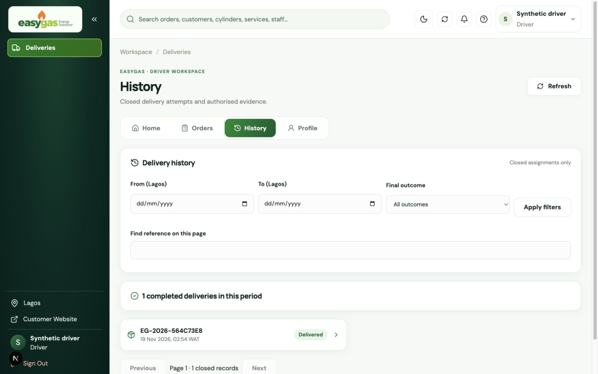

# Vehicle-dispensed LPG workflow repair

Implemented and verified locally on 19 November 2026. No hosted release, native build or mutation of EG-2026-7BB8640B. Existing commercial NO-GO, retain-all, import hold and unrelated work preserved.

## Cylinder identification

The internal cylinder ID is a generated UUID (`id()` calls Node randomUUID), created by `gas.cylinder.intake` for a customer cylinder or `cylinder.create` for company/supplier inventory. It is not a manufacturer number or the order reference. The serial must be read from the physical cylinder; a demo's SANDBOX/test serial is synthetic evidence only.

Orders and Gas settings now use the shared OrderCylinderInspection component. It lists this customer's or this order's reserved cylinders in the correct branch/capacity, displaying marked serial, size and condition. It auto-links the ID. New customer intake generates/selects the record in quarantine; qualified physical inspection and then the order's verified additional-fill allowance remain separate steps. Inline reauthentication retains the entered registration data. Cylinder IDs are passed as hidden API context, not typed by staff. Driver custody shows the linked serial to compare at the customer address.

## Complete normal workflow

1. Register/select the physical cylinder by marked serial, record qualified inspection and verified safe filling allowance; confirm delivery coverage where required. Existing pre-dispatch inspection/ownership/capacity rules remain.
2. Assign the gas order to an eligible driver's active suitable vehicle trip. Authorised loading staff use Deliveries → Operations or Inventory's existing Operations Centre → Bulk LPG loading, dispensing and returns. Choose the reserved order, active trip and current calibrated meter; enter actual loaded mass and cumulative meter reading. Original branch reservation remains canonical; only additional vehicle buffer is newly reserved.
3. Driver independently acknowledges actual load mass and meter reading from Home or the order. New pickup and departure API gates reject gas without matching active acknowledged custody.
4. Driver records inspected pickup, departs and records arrival. At the customer, verify the marked cylinder serial and record the actual cumulative mass reading after dispensing. Delta must equal the full reserved quantity; buffer cannot be sold through this action. Payment/invoice, current qualification/calibration, branch/vehicle and cylinder eligibility are rechecked.
5. Upload current consented proof and complete actual handover with the customer's six-digit code. Only canonical successful handover debits stock once. Cash orders can record actual collection for separate authorised finance reconciliation; drivers cannot verify payment.
6. Back at depot, driver declares the measured remainder, separate qualified staff independently receive/reconcile it, and only then can the trip close. Discrepancies stay held for governed inventory recovery.

## Recover an already-departed order missing custody

`bulk.load.recover` is distinct from normal `bulk.load.issue`. Select the affected order in the same staff loading panel. Recovery requires exactly one current picked-up/arrived attempt and tracking version, an active suitable trip without an existing load, valid calibrated meter, independently qualified/recently verified loading staff, fresh observed custody within 15 minutes, and explicit confirmation that no gas has yet been dispensed for this order.

It creates current issued custody/allocation and immutable `load.recovered` / `bulk.missing_custody.recovered` evidence. It does not backdate a load, rewind arrival, verify payment or record dispensing. The assigned driver must still independently acknowledge, physically dispense and record the exact meter delta before proof/code handover.

If LPG was already dispensed without records, or the trip already holds another load, do not invent readings or duplicate custody. Use independent operational investigation/return reconciliation. This repair deliberately does not claim to reconstruct unobserved prior physical activity.

## Implementation and safeguards

Uses existing058 bulk tables and immutable events; no new schema migration for this phase. Earlier pending customer-service migration081 remains its own deployment dependency in the dirty workspace. `bulk.summary` adds scoped staff trip/order/meter choices and authoritative required/enabled flags. Drivers retain only their own loads and delivery session permissions. Inventory can reach existing loading/receipt authority through Operations Centre without granting new roles or financial powers. Read failures retain no actionable stale custody; Refresh LPG records retries. Stable operation keys, load/tracking versions and original ledger transactions prevent duplicate recovery/dispensing/debits.

`gas.cylinders` is an authenticated scoped GET, included in the actual HTTP read allowlist; POST is denied. Intake, physical inspection and filling eligibility support the existing business-operation ledger for safe retries while keeping legacy callers compatible. Historical protected-source hashes are not overwritten: reviewed change manifests retain the prior notification/technician lineage and the explicitly approved LPG and earlier customer-service changes.

## Executed acceptance

- 51/51 focused tests, no failures/skips: normal and recovered vehicle-dispensing journeys, actual customer checkout/registration/qualified inspection, production-mode field/tracking/retention checks, proof/code/payment controls, return/trip closure, scoped HTTP reads and idempotent registration, existing meter/custody/governance/driver regressions and protected source lineage. [Log](evidence/tests.txt).
- 1/1 real PostgreSQL concurrency test, no skips: rollback, competing load issue, duplicate missing-custody recovery on independent connections and stock/event conservation. Disposable schema only. [Log](evidence/postgres-tests.txt).
- Web build and typecheck passed: [build](evidence/web-build.txt), [types](evidence/typecheck.txt).
- Local browser scenario EG-2026-564C73E8: arrived/no-load → verified staff recovery → driver measured acknowledgement → exact6kg dispensing → consented synthetic proof → customer-owned code → Delivered history →4kg declared/independently reconciled return. Separate registration QA-CUSTOMER-CYL-006 → quarantine → qualified inspection → order filling eligibility recorded. Desktop and390px mobile checked. [Observations](evidence/browser-observations.txt).

Reproduce isolated fixture with `node --import tsx scripts/prepare-driver-lpg-qa.ts`; ignored `.data/driver-lpg-qa.json` contains its temporary data path and synthetic accounts. Run the web preview with that path and explicit local bulk/field/tracking flags. Never use the fabricated fixture measurements, qualifications, payment or proof placard as physical operational evidence.

Run the test files listed in the matrix via `node --import tsx --test --test-reporter=spec`. Real PostgreSQL test additionally requires `EASYGAS_ENABLE_LOCAL_PG_TESTS=yes` and an isolated local `EASYGAS_TEST_POSTGRES_URL`. Build and typecheck sequentially. Matrix validation: `node --import tsx --test --test-reporter=spec tests/customer-traceability.test.ts`.

The matrix validator passed2/2 checks: [log](evidence/traceability-tests.txt).

[Traceability matrix](../traceability/driver-lpg-workflow-rtm.md). Implementation4/4; local verification4/4; critical3/3; local gates4/4. Browser route coverage3/4; the Settings route's shared form is built/tested but entire route browser acceptance was not repeated and stays counted. Hosted deployment/flags, current real qualification/calibration, actual named-order completion, physical/native/formal accessibility acceptance remain unverified. DWT-05 DEFECTIVE/DWT-06 PARTIAL remain for the deployed version.

