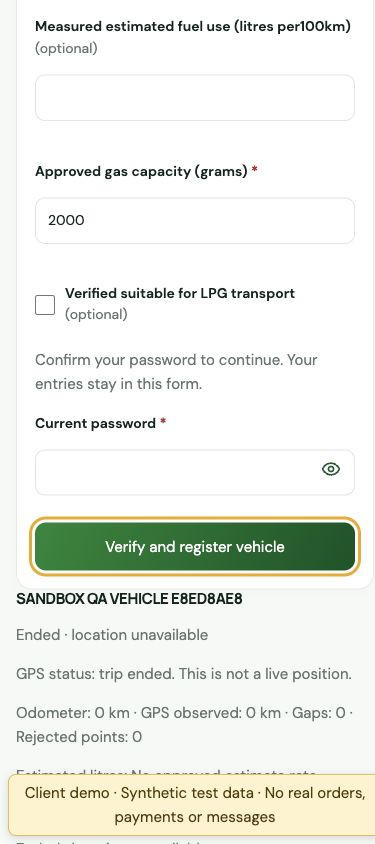

# Fleet form password verification — 22 November 2026, Brisbane

**PASS: 4/4 bounded requirements and gates; 0 excluded.** [Matrix](../traceability/fleet-verification-rtm.md) · [Current user guide](../user-manual/driver-assignment.md#verify-your-password-when-registering-a-vehicle).

The missing verification field was reproduced on the hosted vehicle registration form. The server correctly rejected an unverified owner, but the form only displayed the error. Vehicle registration now shows a required, masked **Current password** field up front and one **Verify and register vehicle** action. Other shared operation forms open inline recovery when the server returns `REAUTH_REQUIRED`.

An incorrect password preserves the vehicle/operation fields and the original retry key, clears only the password, and does not submit the operation. Successful verification submits the original operation once and removes the password input. The password goes only to `reauth`; it is excluded from mutation payloads, request fingerprints and browser storage. The server's five-minute rule, role/branch, active-branch, suitability and idempotency controls are unchanged.

## Executed verification

- Actual desktop and 390px phone registration UI: required masked field, normal password autocomplete, visible action above the demo notice and keyboard access.
- Actual incorrect-password rejection preserved the labelled QA vehicle fields and cleared the password; correct verification then saved exactly one synthetic vehicle with capacity 2,000g and LPG suitability **false**. A fresh form offered verification again; its second QA draft was not submitted.
- Hosted normal APIs reject an unverified owner, dispatcher and restricted driver with 403; anonymous fleet read remains 401. The one QA vehicle is the only new vehicle. All 22 existing orders, inventory, ledger, existing vehicles and trips remain unchanged. No user-supplied vehicle was registered.
- Actual component tests cover mounted-field/retry-key preservation, wrong password, verification expiring again during submit, request mapping and rapid repeats. Service-dispatch tests cover unverified/expired owners, verified nonowners, invalid branch and single idempotent creation without raising suitability.
- **12/12 focused/source/documentation checks**, web build and typecheck pass. Final source [CI44913198139](https://github.com/Onaopemipo/easygasng/actions/runs/44913198139) passed **1,168/1,168 web tests and 3/3 native dependency tests**, zero failures/skips. Native types/audit passed; mobile export was skipped. Final documentation/traceability checks also passed.

[Form audit](evidence/form-audit.json) maps 19 direct shared forms plus delegated vehicle-manifest forms to this recovery. Direct driver fuel capture has no server recent-verification requirement and was not changed. This verifies the shared recovery component and registration journey; it is not a blanket acceptance of every separate operational workflow.

## Release and preservation

Final app source `dd5bbc7f1da55423eba746448cf4fca815772d67` is Ready at `dpl_4itAxT5TKq2UPro9Z8FeYAVEu3hJ` on the [client demo](https://easygas-client-demo.vercel.app), project `prj_cFSaJuN9r4x93RLov1LLVO3cdVA2`. All 439 uploaded application files match committed source, clean export and dry-upload hashes. Three candidate and three stable grouped checks passed without business changes. [Source proof](evidence/source-integrity.json) · [stable identity](evidence/stable-identity.json) · [hosted reconciliation](evidence/hosted-final.json).

A narrow one-file continuation extends existing source proofs while retaining original baselines and tamper rejection. Only `operations-completion.tsx` changed in application source; server guards and native code remain unchanged. Immediate rollback is `dpl_Gci51BMxmVPk4mPU8gK9DQhgxsiZ`, previous source `eb3913e`.

Own QA browser session signed out; phone override reset and light theme retained. All three run-owned API tokens were revoked and subsequently returned 401. The clearly labelled synthetic QA vehicle and its audit trail are retained. Existing native artifact hashes/sizes/mtimes remain unchanged; no mobile binary, export or install occurred.

Initial red component logs are preserved. The first renderer harness needed a minimal window shim; the subsequent confirmed red run reproduced all three missing-verification assertions before correction. Current tests and hosted checks pass. Browser automation reconnections were handled without changing user extensions, security settings or unrelated tabs.

The current guide includes the verification field and recovery steps. Historical Word/PDF editions, prior requirement IDs/denominators and production NO-GO/native/provider/physical/import/retain-all decisions remain unchanged. No outstanding work remains in this bounded phase.
