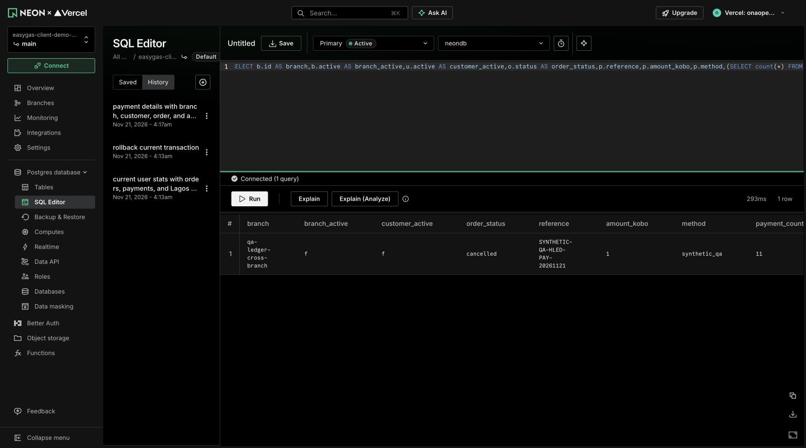

# Hosted cross-branch ledger acceptance

**HLED-03 / HLED-G03 passes.** The remaining hosted exception is now exercised against the deployed client demo using user-authorised synthetic data. All four HLED requirements and gates are verified; the expanded original hosted check denominator is **30/30**, with no exclusions. Production NO-GO and unrelated gates remain unchanged.

| Hosted check | Actual result |
| --- | --- |
| Original baseline | Owner 10 ledger entries; existing Finance/Inventory QA account 10 Lagos entries |
| Owner after fixture | HTTP 200, all 11 entries, including the labelled foreign-branch payment |
| Finance after fixture | HTTP 200, exactly the original 10 Lagos entries; identical pre-seed fingerprint and exact owner branch subset |
| Finance uses the foreign payment ID as cursor | HTTP 400 at limits 1 and 500, no rows; same error as an unknown cursor |
| Finance supplies foreign `branchId`, `branch_id`, payment `id`, or `role=owner` | HTTP 400; no rows or expanded access |
| Finance requests foreign order directly | HTTP 200 with empty array |
| Owner uses the same foreign cursor / requests the fixture order | HTTP 200; record exists and owner access succeeds |
| Seven-role repeat | Owner/finance correct scope; manager, driver, technician, customer and commercial denied (403); restricted driver/technician workspace sessions also denied |
| Preservation | Original 10 payments, 14 orders, three credits and 12 inventory rows unchanged; existing owner/finance identities and branch assignments unchanged |
| Cleanup | Two baseline, two detailed-check and nine full-regression sessions signed out; no native build or app deployment |

The [detailed HTTPS verification](evidence/verify-results.json) passed **13/13** checks. The [full repeated sweep](evidence/hosted-results.json) passed **30/30**, including the previously unavailable foreign-cursor case. Both use the supported `GET /api/finance.ledger` and fully traverse cursor pagination at limit 1, compare large-page fingerprints and enforce `no-store`. The verifier performs no financial writes; the separately authorised fixture insertion is recorded below.

## Retained synthetic fixture

The existing Neon owner console was used only for the reviewed seed in `easygas-client-demo-db`, project `silent-sun-90759854`, branch `br-old-cloud-baisdpke`. Secret download was unavailable; a read-only attempt to switch to `easygas_demo_runtime` was denied and rolled back. No grants were changed. Hosted acceptance uses the application's existing restricted runtime and existing QA sessions, not the console owner's permissions.

The [seed SQL](../../../scripts/seed-hosted-ledger-cross-branch.sql) atomically inserts one inactive branch `qa-ledger-cross-branch`, one inactive customer without a usable password, one cancelled order, one **1-kobo synthetic verified-payment entry** (`SYNTHETIC-QA-HLED-PAY-20261121`, method `synthetic_qa`), and one explicit synthetic provisioning audit event. The order is not a real sale, delivery, refund or provider transaction. No stock, selling configuration, driver assignment or external payment was created. Existing accounts and staff roles were not altered. The nine-table before/after assertions protect existing branches, users, orders, verified payments, wallet entries, credits, inventory, gas stock and settings during provisioning.

The payment is append-only and **retained**. The branch/customer remain inactive and the order remains cancelled. Do not delete the payment, disable immutable triggers, activate the branch or interpret this QA row as a real commercial receipt. Its extra kobo is test data in the demo's global ledger; branch-scoped finance totals remain unchanged. [Provisioning/readback record](evidence/provisioning.json).

One tooling issue was found: the initial read-only SELECT after COMMIT lost its transaction-local private-schema search path. The insertion transaction had already committed successfully. The readback now uses fully qualified schema names, and a local test covers execution from a public search path. The corrected readback confirms branch/customer inactive, order cancelled, amount 1, payment count 11 and synthetic audit true. No application authorization defect was found or permission widened.

## Reproduction and validation

Provisioning was explicitly authorised in this chat. Review the SQL and confirm the named dedicated demo project before executing it in that console. It refuses missing labelled QA identities or altered/colliding fixture data, preserves existing rows, serialises reruns and does not create duplicate payments. No generic seed route was added to the application.

`node scripts/verify-hosted-ledger-cross-branch.mjs baseline` creates a fresh private baseline only if the fixture is absent. It refuses to overwrite its baseline. `node scripts/verify-hosted-ledger-cross-branch.mjs verify` compares hosted reads against that retained private baseline. Credentials, tokens and payment row contents are not written to tracked evidence. Both commands create and revoke only their own temporary sessions. Existing baseline/result evidence must be retained; do not rerun the baseline after provisioning.

[Executed acceptance tests](evidence/acceptance-tests.txt) include seed atomicity/idempotency/collision and target-negative tests, restricted dispatcher/tied-cursor regression, the original hosted evidence checks and the new hosted proof. [Documentation checks](evidence/documentation-tests.txt) retain all stable IDs, evidence links, old observations and production decisions. Original first-pass evidence remains unchanged in the parent evidence directory.
