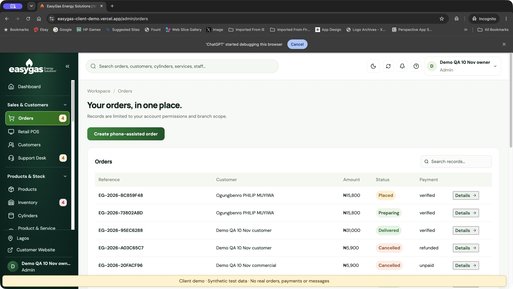

# Loading performance repair — 24 November 2026

The Admin Orders screenshot showed a loaded workspace with a records panel that never finished. Two initial hosted probes returned 24 orders in **20.365 and 20.603 seconds**; Staff took 0.727 seconds and Navigation 1.809 seconds. [Original measurements](evidence/hosted-before.json).

Orders hydrated each row through sequential queries for gas, attempts, drivers, events, manifest items/serials, evidence and history. Network latency accumulated across hundreds of small queries. Fleet trips and product manifests had similar per-record reads. The shared web GET transport also had no overall deadline, allowing a stalled response or body to keep a loader running indefinitely.

## Implemented repair

Related rows now load in batches after the existing role, branch, customer and driver filters select authorised records. Full responses, delivery-code stripping, manifest ordering, versions, evidence and customer GPS privacy/freshness checks are preserved. Staff lookup waits until order details open, and Fleet no longer makes an unused Orders request.

Shared web API GET reads now have a **20-second deadline covering headers and body**. The records hook aborts obsolete requests, ignores delayed results from an old identity/scope and exposes **Try again**. Mutations retain their existing transport; no automatic read or mutation replay was added. No schema, stock, safety, payment or approval control changed.

## Executed verification

- [Published-source comparison](evidence/order-query-comparison.json): full responses match the actual implementation extracted from `c7babcf` across owner, manager, finance, driver and customers. The latest 100 owner orders require **10 queries instead of 803**; 25 orders with richer related data require 12 instead of 205. Cross-branch/customer, malformed-ID and privilege denials are exercised. Synthetic query-delay timings are not hosted benchmarks.
- [Fleet/manifest comparison](evidence/custody-query-comparison.json): 21 trips use **6 queries instead of 26**; 13 manifests use **7 instead of 31**, with unchanged scoped responses, serials, custody and metrics.
- [Focused acceptance](evidence/focused.txt): 60 checks passed, with [12 final followups](evidence/final-followup.txt), [types](evidence/typecheck.txt) and [build](evidence/build.txt). [Four actual local browser cases](evidence/browser-local.json) cover a deliberately stalled read, timeout/retry recovery, items/history and Fleet without a hidden Orders read.
- [GitHub validation](https://github.com/Onaopemipo/easygasng/actions/runs/45276033368): **1,236 passed, 0 failed, 0 skipped** for exact application source `e3ac270`. Web/native jobs succeeded; native export was skipped. [CI evidence](evidence/ci.json). Focused checks overlap with CI and are not additive.

All 77 stable sensitive guard IDs across 34 files remain; the inventory only updates source locations/entry points. The [initial failed focused run](evidence/initial-focused.txt) is retained: the loading source continuation was moved after the existing historical chain, with five exact reviewed paths and committed baseline validation. Historical/native proofs remain intact. Failed output is not mapped as accepted evidence.

## Hosted result and publication

Earlier explicit client-demo push/deploy authority was retained, and **LOAD-R04** added to track publication separately from local acceptance. Source **`e3ac2709d4b145c6251dd9325b235a05514aef87`** is pushed and Ready deployment **`dpl_5c9a2tgJfRdsySpwQBhbKG5mWs23`** promoted to [the existing client demo](https://easygas-client-demo.vercel.app/admin/orders). Rollback remains `dpl_59Y5HPQtW9ghk39TNku7J66fQgdq`. [Release metadata](evidence/release.json) and [actual remote archive](evidence/source-integrity.json) verify all **446 uploaded files** against committed bytes, project identity and source metadata. No migration or environment override was used. The pending Product manifests redesign is also published.

[Direct hosted comparison](evidence/hosted-comparison.json): the same **24 orders and full 81,155-byte response** took **20.782/20.746 seconds before**, then **1.884/1.889/1.985/1.840 seconds after**. Median **20.764 → 1.8865 seconds**, a **90.9% reduction**. Candidate CLI measurements include CLI/protection overhead and are not substituted for these direct stable probes. These are bounded demo measurements, not production load/concurrency acceptance.

[Candidate](evidence/candidate-hosted.txt), [stable](evidence/stable-hosted.txt) and [Orders](evidence/orders-hosted.txt) checks passed all seven role outcomes, actual other-branch/customer/driver ID denials, malformed UUID 400, anonymous 401 and fresh-password/nonowner vehicle-registration denials. Canonical Orders, inventory, complete current ledger response, vehicles, trip state, LPG custody and policies match before/after. Only temporary authentication sessions and denied writes were used; no successful business mutation.

[Four actual hosted browser observations](evidence/browser-hosted.json) verify the owner table, delivered QA order items and 14-event history, Fleet's seven vehicles/five ended trips and honest zero-active-trip manifest prerequisites. Hosted positive stock/payload submissions were not manufactured; local synthetic positive, password, phone and tablet evidence remains separate. Initial fullscreen capture was stale; restoring the new QA window resolved the control surface before rendered content was verified. Safari's locked private session stayed locked. The isolated browser owner signed out, and [all seven operator sessions were revoked](evidence/cleanup-hosted.txt); existing user sessions were untouched. [Orders HTML and all 13 referenced assets](evidence/hosted-assets.json) returned 200.

**Four requirements and four gates are verified, with zero exclusions.** [Matrix validation](evidence/traceability.txt) runs separately from its feature evidence to avoid a circular reference. Full production load, physical/assistive/native/provider acceptance, import/retain-all holds and the original production NO-GO remain in their existing matrices. No mobile binary or export was created.

[User manual](../user-manual/dispatch-fleet.md) · [Requirements matrix](../traceability/loading-performance-rtm.md)

