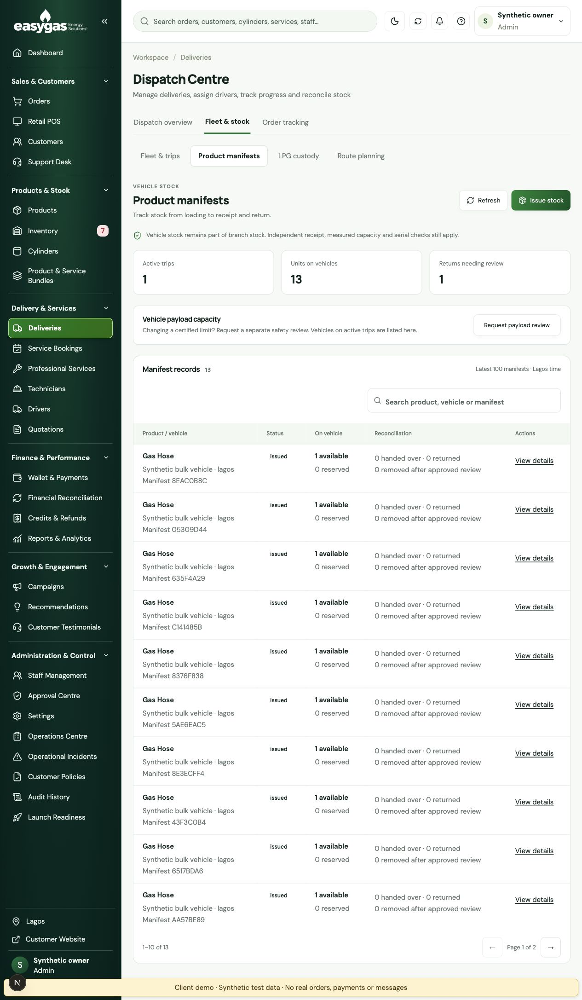

# Product manifest workspace redesign — 24 November 2026

The supplied screenshot shows two full-width forms whose card edges meet, extensive vertical spacing, repeated long headings and no clear distinction between routine stock loading and a governed capacity change. The page's goal is to help authorised staff inspect vehicle stock and start one task at a time.

Screenshot-only estimates before implementation: accessibility 70/100, usability 45/100, content 60/100, mobile/layout 45/100; overall 55/100. These are design estimates, not measured performance, screen-reader or device results.

Implemented a records-first workspace with clear summary counts, one primary **Issue stock** action, a separate **Vehicle payload capacity** review card, search, ten-row pagination and focused dialogs. Payload vehicles are deduplicated from the existing active-trip summary; product choices are limited to available stock. Empty prerequisites explain the next step rather than presenting an empty actionable form. Both sensitive entry points request password verification immediately.

Manifest receipt, return, discrepancy and history remain available from individual records. IDs and numeric versions travel as hidden context; exact existing API field names and independent safety/custody contracts remain. Owner/finance actions, manager read access and driver-owned actions retain their original boundaries. No backend, schema, hosted policy, mobile asset or binary changed.

## Executed evidence

- [Focused tests](evidence/focused.txt): component interactions, role/prerequisite states, scoped denied/delayed refresh, retained draft/retry keys, real HTTP driver restrictions and backend stock/return custody exceptions.
- [Browser observations](evidence/browser-observations.json): five actual Next.js UI cases on a disposable local synthetic database. Separate forms, incorrect-password recovery, keep/discard draft behaviour, search/pagination, return context, phone banner clearance and tablet dark presentation.
- [Types](evidence/typecheck.txt), [web build](evidence/build.txt) and [traceability validation](evidence/traceability.txt).
- [Reviewed source continuation](reviewed-source-changes.json): two presentation files continue from the published `c7babcf` source. Previous fleet release/historical evidence remains unchanged, with exact path/baseline validation retained.

The initial focused run failed one assertion expecting the old visible heading. The approved new heading is **Product manifests**; the assertion now checks that heading and that no inline forms render on first load. [Initial result](evidence/initial-focused.txt) is retained, and the subsequent suite passes. No failed result is mapped as accepted evidence. An initial matrix check also caught a circular reference to its own running output; the report is now recorded separately from feature evidence. That [initial result](evidence/initial-traceability.txt) is retained; the final validation passes.

Local browser checks use loopback 3132 and existing real APIs against disposable synthetic data. Fixture stock/qualifications are synthetic setup only; the browser submits no successful stock, financial or safety change. Full hosted, physical-device, assistive-technology and whole-app acceptance remain separate. Existing production NO-GO and native/provider/physical/import/retain-all holds remain.

[User manual](../user-manual/dispatch-fleet.md), [requirements matrix](../traceability/manifest-workspace-rtm.md).

