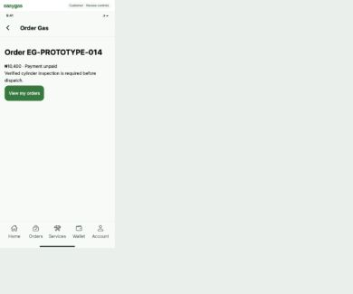

# Role-based mobile prototype acceptance

20 November 2026 · [Private mobile review](https://easygas-complete-experience.philipmuyiwa.chatgpt.site)

The acceptance pass covered all six roles and visitor entry, every catalogue screen, all proposed business tabs/forms, shared journeys, native checkout/service/support/POS interactions and negative cases. The prototype remains a design review artifact. It does not establish installed-device, real identity, provider or physical business acceptance.

## Findings fixed

| Finding | Reproduced failure | Fix and executed evidence |
| --- | --- | --- |
| MACC-D01 | A checkout without a UI-supplied total fell back to ₦15,800; invalid/empty quantities could create an order. | Calculate from configured gas/product prices, validate quantity/capacity/availability/address, reject stale quote versions and inactive rewards. Native 3kg checkout reads ₦10,400. MACC-PRICING/FINANCIAL/EMPTY-CHECKOUT/STALE-QUOTE. |
| MACC-D02 | Card orders appeared verified; insufficient wallet funds could throw outside the response handler. | Card stays unpaid, provider calls stay guarded, failed validation returns an error with no order/debit. MACC-PAYMENT-STATE/WALLET-INSUFFICIENT. |
| MACC-D03 | Retrying checkout could create another order/debit; reused POS keys could silently accept changed input. | Bind retry keys to exact input; identical retry returns the original result, changed input conflicts. MACC-CHECKOUT-ONCE/POS-ONCE. |
| MACC-D04 | Visitor service creation and some foreign invoice/support/field reads were accepted by local handlers. | Explicit persona and record ownership checks, no first-order invoice fallback, field support limited to its creator. MACC-AUTHORITY/CUSTOMER-OWNERSHIP/SUPPORT-OWNERSHIP/FIELD-SUPPORT-SCOPE/GOVERNANCE-SCOPE. |
| MACC-D05 | A driver could change an unassigned order; arbitrary or terminal stages could be rewritten. | Check assignment, role and valid stage progression. Delivered orders cannot reopen. MACC-DELIVERY-OWNERSHIP/TRANSITION-SEQUENCE/TERMINAL-ORDER. |
| MACC-D06 | NaN tendered cash was accepted; local sales did not reduce POS availability. | Validate finite safe monetary values and derive available quantities from local sales. Self-review and cash variance remain blocked. MACC-POS-FINITE/POS-STOCK/POS-CONTROLS. |
| MACC-D07 | Report date inputs only changed the scope label. | Filter the actual local rows; reject reversed date ranges. Unknown profit remains null. MACC-REPORT-FILTERS. |
| MACC-D08 | Parameterized native service availability returned an incompatible shape, leaving no useful message/form. | Return the native status/version/slots shape. Eligible examples use explicitly synthetic future slots; no-slots, unqualified and outside-coverage conditions block requests. MACC-SERVICE-EXCEPTIONS and native service UI evidence. |
| MACC-D09 | Service creation ignored the selected service/address and reused a fixed story template; cancellation only showed a generic success. | Preserve chosen service/configuration/address, fixed-price billing and idempotency. Local cancellation validates ownership, reason and state. MACC-SERVICE-CREATE/SERVICE-CANCEL. |
| MACC-D10 | Completed work could stay in the driver's next-order panel; field history filters were incomplete. | Terminal orders leave upcoming work; driver outcome/date and technician active/past queues filter local records. MACC-FIELD-TERMINAL/DRIVER-HISTORY-FILTERS/TECHNICIAN-QUEUES. |
| MACC-D11 | Proposed review submissions accepted missing fields or unknown actions; generic previews claimed a save. | Validate each configured form; label unimplemented actions as interaction previews. Heartbeat polling no longer creates noisy save notices. MACC-REVIEW-VALIDATION/PREVIEW-TRUTH. |
| MACC-D12 | Exceptions could carry into a fresh guided journey; only payment/calibration had explicit controls. | Reset conditions on fresh journeys/reset. Add offline, session expiry, empty lists and service availability controls with recovery. MACC-OFFLINE-SESSION-EMPTY/RESET and browser evidence. |
| MACC-D13 | Mixed checkout could discard appointment requests while creating the product order. | Block the unsupported combined execution explicitly and preserve all balances/orders. Separate service request remains usable. MACC-MIXED-GUARD. Full linked checkout remains outstanding. |

| MACC-D14 | A persistent calibration error notice intercepted the desktop Reset button. | Make status notices non-interactive; direct Reset now restores Customer and the eligible condition. MACC-NOTICE-RESET. |

The initial targeted run had 26 cases with 19 failures, retained in [before evidence](evidence/before-tests.txt). Correlated failures are grouped above; D14 was reproduced during hosted exception testing. The final 38 model checks and six evidence/publication checks pass; all 19 prior prototype checks also pass. No original mobile or website application source was changed.

## Executed UI acceptance

- **117 screens**, six roles plus visitor: zero screen errors and zero app horizontal overflow.
- **73 tabs and 36 configured actions** across all 20 proposed workspaces: opened, entered valid sample values and submitted local review records. Invalid receipt quantity was rejected; actual stock remains unchanged.
- **Five journeys / 29 steps**: delivery, service, refund, independent/owner review and stock/custody. These remain guided simulations, with shared local references/readbacks.
- **Native checkout:** 3kg × ₦1,800 + ₦5,000 = ₦10,400; card order reads unpaid.
- **Native service:** Cooker Installation selection, area/date/time, review and request retained in bookings; cancellation changes its status. Normal slots are synthetic examples, not proof of available qualified personnel.
- **Native support:** customer request and reply appear in the conversation. Ownership, empty message and field-role boundaries have negative model tests.
- **Native POS:** manager opens till, records ₦26,000 sale from ₦27,000 tendered, sees ₦1,000 change, submits ₦26,000 cash-up; owner independently verifies the local shift. Inventory has no Open till action. Identity entry used a synthetic placeholder only.
- **12 phone checks:** six roles at 390×844 and 360×844, no body/app horizontal overflow, bottom tabs within app bounds. Customer dark/light switching and Escape dismissal passed.
- **Exceptions:** rejected payment, insufficient funds, invalid/empty quantities, stale quotes, duplicate/conflicting submissions, unknown/foreign records, invalid/terminal transitions, cash variance/self-review, negative receipts, offline/session expiry/empty lists, no service slots/unqualified technician/outside coverage, expired calibration and mixed-checkout guard.

Raw evidence is in [evidence](evidence/). Hosted release acceptance is recorded separately in [publication](publication.json).

## Functional sign-off and retained gaps

A complete functional sign-off remains **OPEN**. The original **300 feature items are all retained** in [feature acceptance](feature-acceptance.json): **20 verified within the synthetic prototype scope, 162 partial, 14 blocked and 104 not individually tested**. All 36 families have design representation; this does not convert their unexecuted subfeatures into passed behavior.

Remaining work includes full linked product/service checkout, underlying execution for proposed stock/governance/growth/finance tools, complete native trip/custody/assessment/report/settlement behavior, other untested account/refill/cart controls, installed-device behavior, genuine qualification/calibration/physical evidence and provider/identity/message/payment acceptance. Generic forms explicitly say preview; proposed submissions stay pending review. The 14 blocked items remain in the denominator. No scope exclusions.

The phase matrix keeps customer, business operations and field functional sign-off partial. The executed testing, exception repairs, private release and traceability requirements can pass independently. Existing MEXP design-delivery history is retained. Production **NO-GO**, actual-import hold, retain-all and unrelated gates are unchanged; no client-demo data or native binary was deployed.

## Final private release

Exact source `23ef3d5567c16bd975098af331a59bd5229acd1c` published successfully with owner-private access unchanged.117 hosted screens,all five journeys/29 steps and eight exception conditions were exercised. The final notice-only CSS follow-up retains identical application JavaScript and passes direct Reset after a calibration error, native ₦10,400 unpaid-card checkout and390px phone fit.44 focused checks,19 prior regressions and2 matrix checks pass.

[Requirements matrix](../traceability/mobile-acceptance-rtm.md):6/9 verified and3 partial,2/2 critical,6/9 gates passed,zero exclusions. Full functional sign-off remains open for the retained gaps above.

