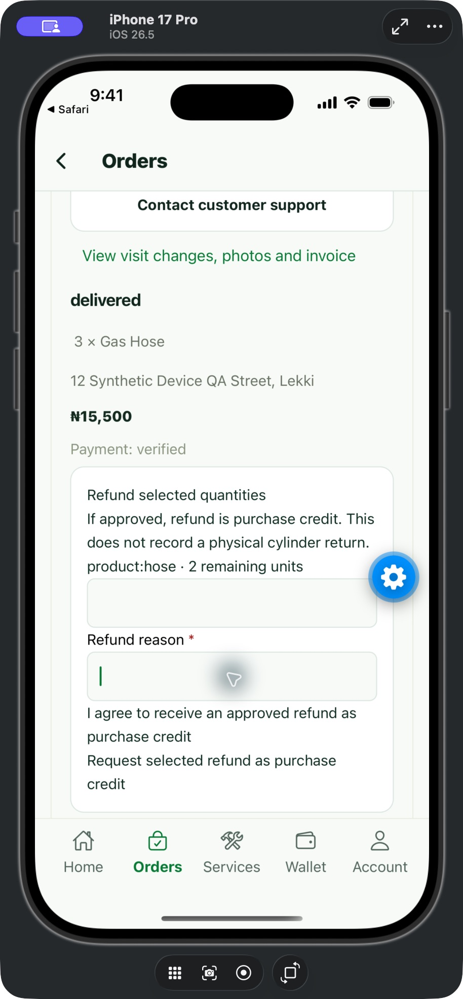
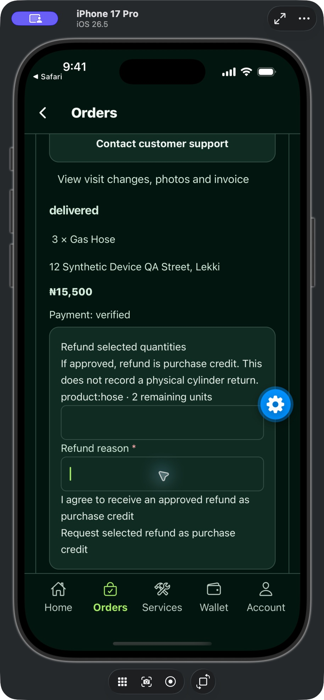

# Sequential native device acceptance

21 November 2026, Australia/Brisbane. The four authorised stages were carried out in order using current native source in the existing iPhone 17 Pro / iOS 26.5 Expo Go SDK 58 runtime. **All four scoped stages pass; all seven findings are repaired.**

Refund submissions, decisions and forced failures used a disposable loopback API backed by the existing real dispatcher and an in-memory SQL database. Hosted client-demo reads and restoration were checked separately. No hosted balance, stock, payment, refund, approval or qualification was changed. No new hosted accounts, native binary, installation or private-prototype publication was created.

## 1. Customer and commercial refunds

Both roles signed in through the actual mobile UI and saw their own synthetic delivered, paid order. Customer acceptance covered a failed quantity lookup and Retry, zero/negative/fractional/excess quantities, missing purchase-credit consent, an uncertain response after the server had created the request, and retrying unchanged details. The retry left exactly one pending request.

Commercial acceptance covered an excess quantity, explicit consent, a failed submission before dispatch, retained input and successful retry. Both successful forms locked submission and showed independent review pending. [Readback](evidence/stage1-complete.json) confirmed two pending requests and unchanged wallets. [Stage 1 results](evidence/stage1-results.json).

## 2. Staff review and access

Finance reviewed the customer request, encountered recent-verification enforcement, failed an incorrect password, then verified correctly with its review details retained. Approval posted **350,000 kobo / ₦3,500** once. The owner rejected the commercial request after verification; its wallet stayed unchanged.

Manager navigation excluded Credits & refunds. Driver and Technician sessions used their restricted native workspaces without financial review actions. Real API checks denied review reads and writes for manager, driver, technician, customer and commercial; self-review was denied and replaying the approved decision posted no duplicate credit. [Stage 2 results](evidence/stage2-results.json), [API checks](evidence/stage2-api-checks.json), [approval readback](evidence/stage2-finance.json), [rejection readback](evidence/stage2-owner.json).

## 3. Seven sibling components

| Component | Native acceptance |
|---|---|
| CustomerNotifications | Populated list, approved-refund notice, unread count change and pagination |
| DriverWorkspace | Required assignment reason, synthetic acknowledgement/pickup/status progression and guarded proof entry |
| DriverProof | Missing-consent rejection, unavailable-camera message and disabled completion without payment/proof |
| NativeBusinessWorkspace | Failed load, Refresh and 25 authoritative records across two pages, exercising the former whitespace branch |
| Services / Appointment | Assigned-stage work/payment restrictions and evidence-consent guard through normal navigation; issued/usage-recorded material branches in a labelled native props harness |
| TechnicianScreens | Forced Jobs lookup failure, Retry Jobs and assigned-job readback |
| DriverOperations | Real legacy component rendered natively with canonical fleet/queue reads; missing trip fields rejected; no trip or location permission created |

**Six components were reached through current app navigation.** `DriverOperations` is bypassed by the current DriverWorkspace return in App, so it was exercised through a separate, clearly labelled Expo native harness. This is component acceptance, not a claim that a legacy route exists. The Services material props were explicitly synthetic rendering variants; no material issue, usage or stock operation was submitted. [Stage 3 mapping](evidence/stage3-results.json).

## 4. Repairs and rechecks

| Finding | Repair | Executed recheck |
|---|---|---|
| MDEV-F01 | EasyRewards surfaces/text follow selected app appearance | Refund card and caption inspected in light and dark preferences, including a dark system with a light app |
| MDEV-F02 | Currency labels match naira-formatted values | Native record shows Amount (₦) and ₦1.00 for source 100 kobo |
| MDEV-F03 | Successful reauth clears obsolete feedback without resetting the form | Reviewed record, decision and reason retained; warning gone; no automatic resubmission |
| MDEV-F04 | Assignment renewal warning limited to the assigned, unpicked attempt state | Picked-up fixture opens without a false renewal warning |
| MDEV-F05 | Failure evidence has its own state, cleared on opening an order | Earlier acknowledgement text does not populate failure evidence; failure submission disabled until new evidence |
| MDEV-F06 | Visible required fields validated before API | Legacy trip form shows Choose Vehicle rather than Invalid UUID; zero odometer and optional false consent remain valid in component checks |
| MDEV-F07 | Selected older credit/refund refreshed through scoped exact-ID search | Older record stays bound beyond the first 20 choices; missing/unavailable record fails closed instead of selecting another record |

[Findings](findings.json) retain stable IDs. [32 regression tests](evidence/regression-tests.txt), [five prototype-preservation tests](evidence/prototype-preservation.txt), [device-evidence validation](evidence/device-evidence-tests.txt) and [mobile typecheck](evidence/typecheck.txt) pass. Regression coverage uses actual React components with native host adapters and disposable dispatcher fixtures; these tests supplement the native screenshots, not physical-device certification. Initial test-fixture issues (notification schema and missing mock exports) were corrected before the successful final runs.

The temporary component harness restored the original `index.ts` package entry and removed its generated entry file. The original iOS bundle, Android APK/export hashes, sizes and nanosecond timestamps and original private prototype remain [unchanged](evidence/artifact-preservation.json).

The disposable API and temporary Metro/harness servers were [stopped](evidence/cleanup.json) after readback. The normal hosted-demo Metro on port 8081 remains available. The app preference was restored to Light before returning to the hosted owner session. The in-memory fixture database was closed and discarded.

## Hosted restoration and remaining limits

The simulator was restored to `exp://127.0.0.1:8081`, using the HTTPS client-demo API and the original Demo QA Admin / Business Owner. Orders and delivered-order invoice `EGI-0000000008` load; no misplaced customer refund controls or native text error appeared. Hosted before/after fingerprints match for **14 orders, three credit/refund records and 12 inventory rows**. The attempted GET `ledger` returned 405 in this original run; that frozen observation is historical. The [HLED follow-up](../hosted-ledger-acceptance/README.md) verified the supported GET `finance.ledger`, all 10 payments, complete pagination and seven-role restrictions, closing the original endpoint gap (4/4). Hosted foreign-branch isolation subsequently passed (1/1) in the [user-authorised synthetic follow-up](../hosted-ledger-acceptance/cross-branch/README.md); original unavailable evidence is retained. Owner sees 11 ledger entries while finance retains exactly its original 10. [Restoration evidence](evidence/hosted-restoration.json).

Coverage is **7/7 representative roles**, **7/7 native components**, **6/7 current navigation paths plus one legacy native harness**, and **7/7 resolved findings**. These results do not individually certify all 300 features, physical fulfilment, actual camera/GPS capture, background native providers, Android visuals, signed physical-device/store builds or commercial production. The legacy navigation gap remains in its denominator. The historical wrong-endpoint ledger check and expanded hosted foreign-branch case are now resolved by HLED, with original observations preserved. Production **NO-GO**, actual-import hold, retain-all and unrelated release gates remain unchanged.

See [traceability](../traceability/mobile-device-acceptance-rtm.md), [source continuation](reviewed-source-changes.json), [all observations](evidence/device-observations.json) and the [manual addendum](../user-manual/mobile-device-acceptance.md).

## Reproduce safely

Start `node --import tsx scripts/mobile-device-acceptance-server.ts` from the repository root. It refuses production/external DB configuration and binds only loopback port 3107 with disposable fixtures. Serve existing Expo Go source with `EXPO_PUBLIC_API_URL=http://127.0.0.1:3107 EAS_BUILD_PROFILE=preview npx expo start --go --localhost --port 8082` from `apps/mobile`. Test credentials are synthetic and defined only in the fixture script; they grant no hosted access.

`scripts/verify-mobile-device-api.mjs`, `prepare-mobile-device-pagination.mjs` and `prepare-mobile-device-driver.mjs` require the disposable health marker before business writes. `mobile-device-screen-harness.mjs` temporarily selects a generated native entry on port 8083 and restores it on exit; stop it before typechecking, committing or restoring the normal preview. Do not build or install a binary for this procedure. `verify-mobile-device-hosted.mjs` uses existing ignored private QA credentials for read-only business snapshots and signs out only its temporary authentication session; credentials/tokens are never written to evidence.
