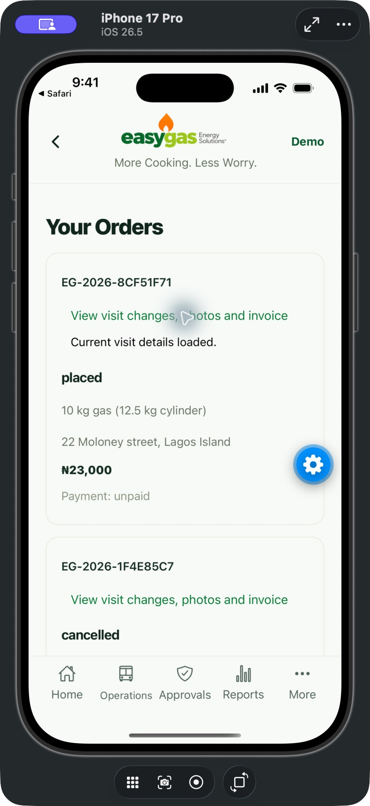

# Native Orders text rendering repair

21 November 2026. The reported iOS Orders error is repaired in native source and verified in the existing Expo Go simulator preview after a full source reload. No native binary was built or installed, and no client-demo web/API deployment is needed for this JSX-only change.

`OrderVisit` rendered an explicit `{" "}` child directly inside a native `View`. React Native rejects that child. Removed nine such spacers in eight files; spaces inside text components remain. The [reviewed source continuation](reviewed-source-changes.json) retains the exact baseline commit, file hashes and original locations. No API contract, approval, payment, refund, permission or delivery rule changed.

## Executed acceptance

- [Selected regression suite](evidence/regression-tests.txt): 24/24 pass, including reproduction against the original component, ten customer/driver status combinations, loaded photos/invoice/amendments with overpayment variants, failed reads and a source-wide text-host guard. The renderer executes actual `OrderVisit` state/branches with synthetic API responses; native hosts and `NativeForm` are test adapters, so it does not certify all child form workflows.
- [Traceability/manual checks](evidence/traceability-manual-tests.txt): 6/6 pass; historical manual artifacts and all prior phase IDs retained.
- [Mobile typecheck](evidence/mobile-typecheck.txt): pass.
- [Prototype preservation](evidence/prototype-preservation.txt): 5/5 pass. Original manifests and compiled prototype retained.
- [Artifact preservation](evidence/artifact-preservation.json): existing iOS bundle, Android APK and Android export hashes, sizes and nanosecond timestamps unchanged. Zero binary builds/installs.
- [Simulator observation](evidence/simulator/observation.json): existing Demo QA Admin / Business Owner session, iPhone 17 Pro / iOS 26.5 / Expo Go SDK 58, Business Overview → Operations Summary → Orders. Restarted the stopped Metro service, reloaded Expo Go, opened Orders, and loaded visit details successfully. No text-error overlay/toast after the reload. No business mutation or sign-out performed.



An initial test run used an ambiguous Pressable selector when driver controls rendered. [Its failed harness output](evidence/initial-test-selector-failure.log) is retained. Selecting the visit-read button by its text corrected the harness; the final suite passes.

## Limits and outstanding finding

Historical scoped repair requirements and gates: **3/3 pass**, with source-pattern coverage **8/8 files** and original live coverage 1/8. The [subsequent sequential device pass](../mobile-device-acceptance/README.md) now renders all seven sibling components natively and exercises driver guards. Six sibling components use current navigation; legacy DriverOperations uses a labelled native harness, so its inactive route remains in the current-navigation denominator. No physical delivery is certified.

**Historical finding ORDTXT-F01:** delivered-order refund forms displayed “Order not found” under the existing owner session. No refund was submitted in that observation. It is now resolved in source/Expo preview by the [Orders authority follow-up](../native-order-authority/README.md), with role/ownership guards and refund exception coverage. The original observation remains historical evidence. Production NO-GO, actual-import hold, retain-all and unrelated native/provider/operational gates remain in force.

See [traceability](../traceability/mobile-orders-text-fix-rtm.md).

## Reproduce the component regression

The test uses the existing isolated React 19.2.0 / react-test-renderer 19.2.0 harness at `/tmp/easygas-native-component-test`. To reproduce on a fresh machine, install those exact development test packages into an isolated directory and set `EASYGAS_NATIVE_TEST_PACKAGE` to its absolute `package.json` path. The renderer dependency is deprecated upstream; the native text-host invariant plus actual iOS observation are the acceptance evidence, not renderer snapshots alone.

Run from the repository root:

```sh
node --import tsx --test tests/mobile-orders-text.test.ts
npm run typecheck --prefix apps/mobile
node scripts/validate-mobile-prototype.mjs
```

Preview uses the existing Expo Go app and Metro at `exp://127.0.0.1:8081`, with `EXPO_PUBLIC_API_URL=https://easygas-client-demo.vercel.app` and `EAS_BUILD_PROFILE=preview`. Reload Expo Go after restarting Metro; an old LogBox entry can remain in memory until reload.
