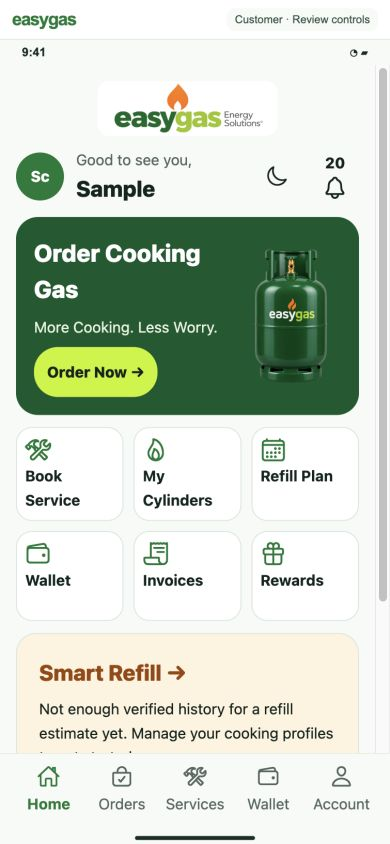
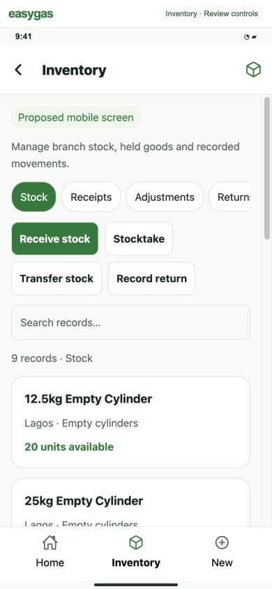

# EasyGas mobile app audit and interactive prototype

20 November 2026 · Corrected scope: mobile app for every user role. The earlier web prototype is historical work and is not counted as mobile acceptance.

## Result and review scope

The private review prototype uses the actual React Native application designs: customer, business owner, Service Manager, Inventory, Driver and Technician, plus visitor entry screens. There are **117 role/screen entries: 78 existing native entries and 39 proposed entries across 20 business workspaces**. The directory maps 36 canonical workflow families and retains all 300 named feature items in [feature-coverage.json](feature-coverage.json). These counts describe design coverage, not 300 independently passed functional tests.

Use bottom tabs and back controls inside the app. **Review controls** provides persona switching, the screen catalogue, five guided journeys, activity and reset. On phones the app fills the viewport; desktop review uses a phone frame. iPhone/Android choices are presentation modes, not installed app builds. The private link requires the owner's ChatGPT sign-in.

## Authoritative design and data audit

- Inventoried 57 top-level mobile TypeScript/TSX modules, 48 main screen keys and 70 API action families. The final bundle hashes 97 original inputs: 55 native code files, six native asset inputs and 36 shared business-rule sources. [Inventory](evidence/source-inventory.json), [original hashes](../../prototypes/easygas-mobile/source-manifest.json).
- Existing app components supply typography, green/lime branding, themes, bottom navigation, cards, forms and contextual sheets. Three build adapters select the initial app/driver/technician screen; original mobile and website application files were not edited.
- Sanitized fixtures derive from the existing labelled demo role snapshots. Contact values and coordinates are scrubbed; one representative business owner is shown. This does not alter actual staff records or approval authority.
- Core flows share browser-local order, booking, wallet, ledger and activity state. Profile/address/preferences, support, POS and reports also have local state. Generic forms record an interaction preview. Proposed workflow submissions create pending-review examples; they do not execute inventory, policy, finance or safety changes.
- Requests are handled by the local network adapter with no forwarding fallback. Content Security Policy prohibits connections and form submission. Camera/GPS/push, hosted payment, sharing/printing and secure storage use guarded review adapters. All evidence is synthetic; browser storage is not production authentication or secure native storage.

## Findings and resolution

| ID | Finding | Resolution and remaining acceptance |
| --- | --- | --- |
| MOB-A01 | The previous deliverable reproduced the website, despite the mobile intent. | Replaced the active review build with actual mobile components and native navigation. Historical EXP coverage retained separately. |
| MOB-A02 | The current app delegates several business tools to browser URLs. | Added 20 explicitly labelled proposed mobile workspaces. In the prototype, Inventory and other supported handoffs remain inside the app. These are proposed app designs, not released native implementations. |
| MOB-A03 | Native components expect specific API response shapes. | Fixed local refund, support, account-session and approval-list adapters. All 117 catalogue entries render without a screen error or horizontal overflow. |
| MOB-A04 | Cross-role examples could show stale assignment or completion state. | Shared state now assigns technicians only at the manager step, derives completed jobs/driver history and keeps terminal appointments out of upcoming work. Model tests verify order progression, single refund and assignment scope. No synthetic delivery is labelled genuine physical proof. |
| MOB-A05 | Opening forms in a desktop portal or using desktop width broke mobile fidelity. | Sheets/dialogs stay within the app frame; dimensions derive from its bounds. Input focus remains stable. Native tabs, controls and proposed stock receipt form were exercised. |
| MOB-A06 | Financial and safety failures must remain visible. | Rejected payment creates no order/debit; expired calibration blocks preparation. Unknown cost/profit evidence remains unavailable, inactive rewards retain their state and restricted actions stay guarded. Original production NO-GO/import/retention gates remain. |
| MOB-A07 | Rendering a screen cannot establish all its business behavior. | Screen observations and feature catalogue explicitly distinguish design coverage, executed interactions and untested native/provider/physical behavior. No route or screen visit alone is treated as feature acceptance. |

## Mobile feature coverage

| Users | Mobile scope |
| --- | --- |
| Visitor / customer | Entry and recovery, gas/product/service discovery, cart and checkout, orders/tracking, service bookings, wallet/credit, invoices, cylinders, rewards/refill/recurrence, support, notifications, profile/privacy and appearance. |
| Business owner | Overview, operations, approvals, finance/reporting, business controls, branches, organisation, staff/access, audit and support; proposed tools for the remaining catalogue, stock, growth, governance and readiness workflows. |
| Service Manager | Dispatch/orders, customer lookup, POS, services, bookings and technician management; proposed customer records, catalogue/bundles, quotations, reports, growth and incident tools. |
| Inventory | Finance overview, permitted POS view, audit and support; proposed inventory, purchasing, product/cylinder/bundle, credit/reconciliation, reports and equipment tools. Sale and verification authority remains role-scoped. |
| Driver | Existing Home, Orders, History and Profile designs; trip/vehicle, custody, delivery stages, meter and proof-related controls remain simulations or guarded previews. |
| Technician | Existing Home, Jobs, History and Profile designs; assignment, assessment, authorised work and completion examples. Qualifications and genuine work evidence remain separate. |

See [screen coverage](screen-coverage.json) for every catalogue entry and [feature mapping](feature-coverage.json) for every retained feature item. A proposed workspace does not establish production parity for its subfeatures. Website-only navigation is translated to mobile tabs/back/sheets; the web sidebar is not reproduced as app navigation.

## Executed verification

- Fourteen isolated model tests: roles, delivery, rejected payment, expired calibration, refund once, service completion, role denials, actual network adapter isolation, native response shapes, profile/support, POS cash-up/independent review, proposed review records, reports/assignment and reset/persistence.
- 117 actual browser screen observations, seven perspectives: no runtime screen error or horizontal overflow.
- Five guided journeys / 29 steps: order-to-delivery, service-to-completion, cancellation/refund, owner/independent review and stock/custody. Guided step progression is explicitly simulated.
- Actual native checkout: 3kg at ₦1,800/kg + ₦5,000 delivery = ₦10,400; cash-on-delivery order appears in native Orders. Local proposed stock receipt submitted through the app sheet; actual stock balance remains unchanged.
- Twelve phone checks: all six roles at 390×844 and 360×844. No body/app horizontal overflow; bottom tabs within the app. Mobile controls dismiss with Escape; Inventory handoff stays in app.
- Artifact/publication checks validate original source hashes, catalogue counts, retained feature denominator, network guards and executed browser evidence. See [evidence](evidence/) for raw observations and successful test logs.

## Private release acceptance

The exact mobile source `3065ebea5fb080c945cbabba0b697ce1789c7a1c` was privately published successfully. Normal ChatGPT owner sign-in reached the mobile UI without an access bypass. Six role homes at 390px, the eight-step delivery journey, delivered-order customer readback and local activity reset were observed on the hosted build. All 19 model/artifact/publication checks and two matrix checks pass. [Publication provenance](publication.json); [hosted screenshot](evidence/hosted-customer-phone.jpg).

## Review screenshots

## Remaining boundaries

This is an interactive design/review deliverable. It does not deploy a native binary, certify all 300 feature behaviors, prove real identity/permissions, validate payment/provider receipt, perform a physical delivery, issue qualifications/calibration or establish camera/GPS/background/offline/push acceptance. Full production mobile engineering and device acceptance remain outstanding. No client-demo business data, policy, qualification, payment or production gate was changed. Commercial production **NO-GO**, actual-import hold, retain-all and unrelated requirements are preserved.
