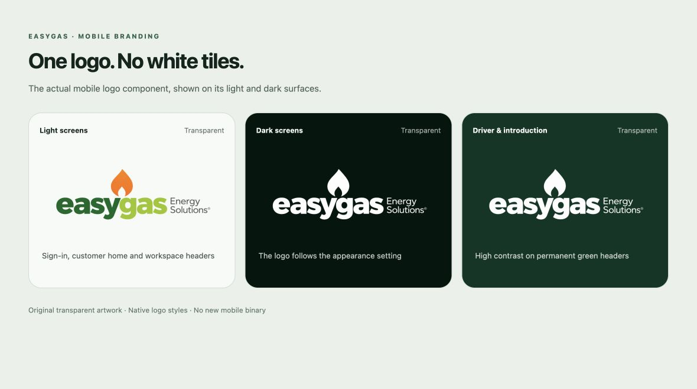

# Transparent native mobile logo

All nine in-app logo placements now use `apps/mobile/BrandLogo.tsx`. The original high-resolution transparent asset is reused unchanged (SHA256 `75a7740a4adf72a24578e4571fa74f26189ac64dac34468617eaf176a3d58d51`). It has alpha transparency, 1,226,158 fully transparent pixels and no opaque white pixels; corner alpha is0/0/0/1 on the0–255 scale. No image generation, crop or brand-artwork edit was necessary.

| Source | Placements | Treatment |
| --- | --- | --- |
| App.tsx | Shared customer/business header; common sign-in/register | Theme-aware original/inverse |
| CustomerHome.tsx | Customer dashboard | Theme-aware original/inverse |
| DriverSignIn.tsx | Dedicated driver sign-in/recovery | Theme-aware original/inverse |
| TechnicianSignIn.tsx | Dedicated technician sign-in/recovery | Theme-aware original/inverse |
| TechnicianScreens.tsx | Technician workspace header | Theme-aware original/inverse |
| DriverWorkspace.tsx | Green workspace header; session restoration | Fixed inverse header; theme-aware restoration |
| Onboarding.tsx | First introduction scene | Fixed inverse on green |

The shared component preserves original image dimensions/contain fitting, accessible labels and decorative onboarding intent. White/pale logo-only backplates were removed. Light surfaces retain original brand colours; dark surfaces use a white inverse tint for readable text. Fixed green onboarding/driver surfaces use the inverse even when the general app theme is light. Platform launcher icons and existing artwork files remain retained.

## Verification

Mobile typecheck and 20 existing regression checks passed. Five historical mobile-prototype checks passed with explicit source-continuation hashes; original manifests/build records were not rewritten. The actual shared component was rendered with React Native Web (only theme context adapted), inspected on light/dark/fixed-green surfaces and at 390px. All images load, logo containers are transparent, labels persist and the phone preview has no horizontal overflow.

The source inventory records all nine placements. Original native bundles/APK/export metadata retain their hashes, sizes and exact original nanosecond timestamps. The historical private prototype manifest/bundle remain unchanged.

This updates the native source; no new mobile binary, native bundle/export or installed build was produced, following the existing no-new-mobile-binaries instruction. The browser preview is component verification rather than screenshots of a newly installed app. Installed full-screen appearance remains unverified for all nine placements until a future permitted build. It is retained separately in [traceability](../traceability/mobile-transparent-logo-rtm.md), alongside unchanged production NO-GO and unrelated device/provider gates.
