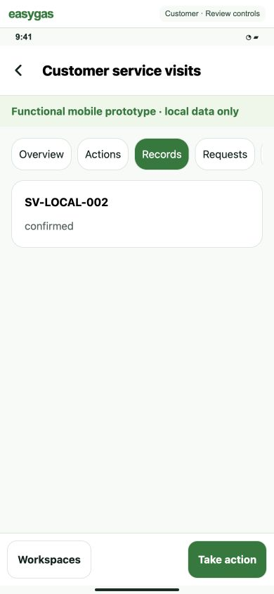

# Functional mobile prototype continuation — 20 November 2026

The approved scope is working, browser-local mobile workflows. This phase extends the existing private prototype and its original React Native designs; it does not change `apps/mobile` or deploy the client-demo backend. All 300 original FEATURE IDs and MACC-01–09 remain in scope. The 14 previous external/physical/identity blocks remain separately tracked.

## Review the implementation

Open the private review, choose **Review controls → Workflows**, then a workspace. The phone presents **Overview**, **Actions**, **Records**, **Requests** and **Activity**. Overview cards show current data, Actions open native-style sheets, and Records show committed readbacks. Switch persona to perform the next authorised step. Data persists in the same browser across personas and reloads; Reset restores the sanitized fixture.

Use sample information only. The sample password is `prototype-only`; email verification uses `PROTOTYPE-VERIFY`, recovery uses `PROTOTYPE-RESET`, and the synthetic delivery customer code is `123456`. These are public simulation values, not authentication credentials. Mark synthetic-provider/proof/verification switches explicitly. No provider, device, email, SMS or business effect occurs.

## Connected customer workflows

- Order gas and products with exact totals, availability, one delivery fee, wallet/card/COD state and retry protection. Card initialization remains pending until explicit synthetic verification.
- Add products to the persistent cart and services to saved requests, then submit linked checkout atomically. Invalid coverage, changed pricing or insufficient funds leaves all linked records and balances unchanged.
- Request a preferred service visit; operations schedules and assigns it, a technician assesses, a manager drafts the quote, an independent reviewer approves, and the customer accepts the current scope and amount.
- Manage profile/addresses/preferences/sessions, privacy requests and owned-data export. Identity and recovery examples expire. Retain-all prevents destructive erasure claims.
- Fund the wallet, submit bank evidence for independent review, redeem issued credit once, request selected refunds, manage recurring budgets/refill profiles, consented feedback and support conversations.

## Connected business workflows

Inventory receipts, counts, returns, transfers, purchasing, product revisions, serial records, coverage, quotations, credit/document corrections, campaigns, recommendations, testimonials, policies, equipment, mail and readiness use shared local entities. Requests record their maker, current revision and review decision. Revised data invalidates previous approval. Apply an approved change to update the canonical local record; submitting a request alone does not change stock or money.

The fixture has one business owner. Eligible owner-origin commercial proposals use the sole-owner route. Stock, financial, quotation and synthetic equipment/qualification operations retain their independent checks; no second owner is fabricated.

Reports use current local records and requested date/branch/status/payment scope. CSV and XML downloads contain actual generated rows. Invoice specimens support HTML download and browser print/save-PDF. Historical profit and acquisition value stay unavailable where source evidence is incomplete. Synthetic import changes only the prototype catalogue; the actual-import hold stays active.

## Connected field workflows

Driver: availability → prepared/inspected/coverage-checked assignment → acknowledgment → trip and measured custody → pickup → arrival → current synthetic qualification and meter checks → bounded dispensing → customer code and explicit synthetic proof → cash review, measured returns and independent reconciliation → trip end.

Technician: assignment acceptance → assessment → reviewed quote → customer authority → current synthetic qualification → work/material custody → usage/return reconciliation → report → customer acknowledgment or concern → payment/settlement/follow-up. A new quote revision invalidates prior work authority.

Safety and finance guards reject self-review, stale revisions, invalid/over-capacity quantities, expiry, duplicate redemption/refund/funding, unmatched cash, missing consent/proof, premature closure and cross-persona access. An offline/expired-session UI action does not commit local work.

## Evidence and limits

See `evidence/all-model-tests.txt` for all named feature, exception and prior-regression cases; `feature-results.json` preserves the individual 300 IDs. Browser evidence separately records the 36 workspace families, 117 screen entries, sample committed actions and phone-fit checks. First-run failures are retained as history and are not passing evidence.

The stable requirements matrix is `docs/traceability/mobile-acceptance-rtm.json`; the feature matrix is `docs/mobile-acceptance/feature-acceptance.json`. The final owner-private release is source `6e5b5914a268454f477489a962fe70d6651983c7`; deployment succeeded and hosted checks passed. See `publication.json` for the exact version/deployment and intermediate revision history. The full117-screen hosted scan precedes a Records-only deduplication correction; the final revision passes its direct readback and390px layout check. All9bounded prototype gates now pass; the three partial local gates are closed.

**Remaining developed-app work:** port these added prototype workspaces into the installed native app; connect the real APIs and persistent server data; complete signed iOS/Android, accessibility, offline/background GPS, push, camera/proof, real identity and provider acceptance; complete qualified operational/physical trials and production release review. Native business tasks that currently hand off to the web are not converted by this isolated prototype phase. Production NO-GO, retain-all and actual-import hold remain unchanged.

## Reproduce

From the repository root:

```sh
node --test --test-reporter=spec scripts/test-mobile-workflows.mjs scripts/test-mobile-workflow-negatives.mjs scripts/test-mobile-acceptance.mjs scripts/test-mobile-prototype.mjs
node prototypes/easygas-mobile/build.mjs
node prototypes/easygas-mobile/server.mjs
```

The source manifest preserves 97 original source/asset/rule inputs and the three existing initial-screen adapters. No website UI is substituted for mobile screens.

## Confirmed private phone view



The sample visit is a persisted local record, with Actions, Requests and Activity available in the phone. The review was reset after verification so no test receipt, funding or trip remains in that review browser.
