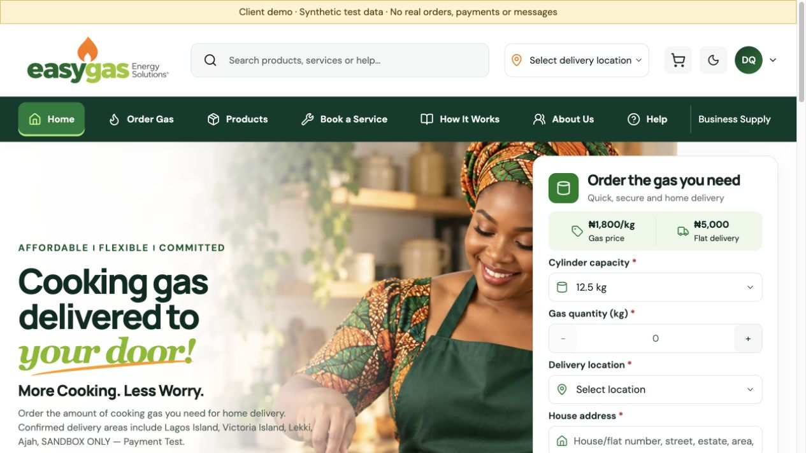

# Native continuation — client-demo web/API release

20 November 2026. Deployed and verified at [the client demo](https://easygas-client-demo.vercel.app).

- Application/upload source: `405fb5da501fc7828946ab4de425de2a7a7d088c`. All 426 upload files matched the commit byte-for-byte and matched the CLI upload hashes. The reviewed ignore list now excludes separate prototypes, generated outputs and CI/hosting metadata, alongside existing private, native, documentation, test and operator exclusions.
- Ready deployment: `dpl_6T2z5s4xnjmpeWMBfwTgMoMZUhaw`, [candidate](https://easygas-client-demo-3txj0mfys-onaopemipos-projects.vercel.app). The stable alias resolves to this exact source-verified candidate. Promotion reused that candidate; no second web build.
- Previous Ready rollback: `dpl_Ewd4EFdg7QEGbaAgqxAzBZ4MBiVN`. Roll back application code by promoting that deployment to the same demo alias; preserve the database, runtime settings, audit history and all business records. No schema rollback is required.

The user explicitly clarified **no new iOS/Android binaries; allow web/API build**. Only the existing linked demo project's Next.js cloud build ran (compilation/types passed). No mobile build/export/install/distribution, new project, database migration, seed, qualification renewal or runtime/environment-flag change was performed. Three previously built native artifacts retain the same SHA-256 hashes and modification times. Their loopback API/simulator limitations remain. The private review prototype was not republished.

## Verification

[Candidate](evidence/web-release/candidate-hosted.json) and [stable alias](evidence/web-release/stable-hosted.json) each passed 21 actual hosted checks: public homepage/demo notice/no-index/robots; existing owner, manager, finance, driver, technician and customer sign-in/owned identity; owner-only readiness boundaries; anonymous/method/recent-verification/schema rejection; and the exact new readiness handler's invalid-gate response. A nonexistent gate was used, so no valid evidence-review or business approval was created. Local native/API acceptance already covers the valid evidence-intake write; this rollout does not newly claim a successful hosted business mutation.

[Before](evidence/web-release/before-hosted.json), candidate and stable snapshots match for 13 orders, 12 inventory rows, the financial ledger, published policies and release gates. Snapshots cover those API projections rather than every database table. Normal authentication/read auditing and auth-attempt counters retain their existing behavior. Production recommendation remains NO-GO. Actual browser reload showed the loaded homepage, catalogue, delivery selector and synthetic-data banner; no order or form was submitted.

The candidate is protected by Vercel Deployment Protection. Direct access correctly reached that protection layer; candidate checks used authenticated Vercel CLI access without disabling protection. Stable public URL checks used ordinary HTTPS. An old bootstrap credential manifest was rejected, and verification was corrected to use the current canonical private demo guide, including its updated customer identity. No password reset, account recreation or access expansion was used. Initial harness failures remain separate from the passing final evidence.

## Evidence and limits

[Source integrity](evidence/web-release/source-integrity.json) · [Cloud build](evidence/web-release/cloud-build.txt) · [Candidate identity](evidence/web-release/candidate-identity.json) · [Promotion](evidence/web-release/promotion.txt) · [Stable identity](evidence/web-release/stable-identity.json) · [Native artifact preservation](evidence/web-release/native-artifacts-unchanged.json) · [Final release/matrix checks](evidence/web-release/final-checks.txt).

Reproduce hosted checks with `node scripts/verify-native-web-release.mjs stable` using the existing canonical private demo guide and linked project. Candidate checks additionally require the locally archived source/project state and authenticated Vercel CLI. Credentials, native bearer tokens and protected-request configuration are excluded from source and evidence.

The 10 final source/security/release/matrix checks passed with zero failures or skips. The source validator’s initial 1 MB output-buffer limit was increased to read an existing large brand image; this was a verification-harness limit, not a cloud application failure. [Final input equivalence](evidence/web-release/final-source-equivalence.json) confirms all 426 deployed inputs still match before the evidence commit, and subsequent changes are excluded operator/test/documentation files. No second application build is needed.

The bounded web/API deployment request is complete. The native matrix still retains all 36 families, 300 feature IDs, 14 external blocks and original six native gates. Physical-device/store/provider/operational and exhaustive per-feature acceptance remain open; production NO-GO, actual-import hold and retain-all remain.

