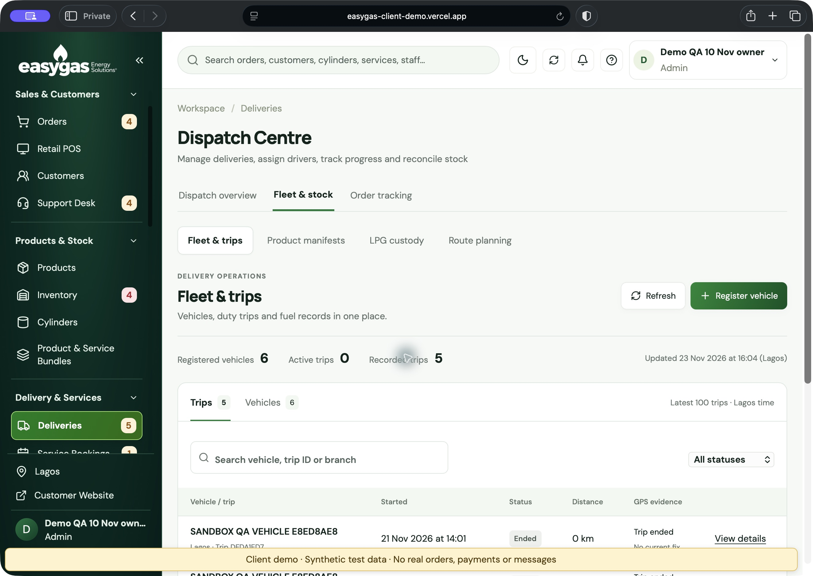

# Client-demo publication — 24 November 2026

All pending authorised fleet redesign, approved native icon, tests, manual and traceability changes were pushed to `codex/technician-saas-redesign`. Application commit **`c206b6cc18ba0d59d13bb2388dcca00a4d25534b`** is deployed READY at the [client demo](https://easygas-client-demo.vercel.app/admin/deliveries#driver-fleet), deployment **`dpl_59Y5HPQtW9ghk39TNku7J66fQgdq`**. The subsequent publication commit contains documentation, evidence and the verification script; all deployed application files remain identical. [Publication validation](evidence/publication.txt).

The existing dedicated demo project and team were checked. A clean Git archive supplied the deployment. **All 443 files retrieved from Vercel's actual uploaded source archive match committed bytes.** Private data, environment files and mobile sources/build artifacts were excluded. The candidate passed verification before promotion, and the stable hostname resolves to the accepted deployment. [Source proof](evidence/source-integrity.json), [deployment record](evidence/deployment.json).

## Executed acceptance

- [GitHub Actions run 45197385447](https://github.com/Onaopemipo/easygasng/actions/runs/45197385447): web and native jobs succeeded. **1,226 tests passed, zero failed and zero skipped**, with the independent PostgreSQL 16 service enabled. Build, types and dependency audits passed. Native export was **SKIPPED**. [CI summary](evidence/ci-validation.json).
- [Before](evidence/before-hosted.txt), [candidate](evidence/candidate-hosted.txt) and [stable](evidence/stable-hosted.txt) probes cover all seven canonical roles, anonymous denial, branch-scoped fleet reads, restricted driver own-trip access, custody/planning restrictions and valid but denied vehicle creation. A fresh unverified owner receives `REAUTH_REQUIRED`; the other six roles are denied. No vehicle was created.
- Orders, inventory, the complete current ledger response within the 500-entry limit, vehicles, trip state, LPG custody and policies match before/after and baseline hashes. No schema, environment, qualification, financial or stock policy was changed.
- [Hosted browser smoke](evidence/hosted-browser.json): isolated Safari owner checks covered the new tabs, kg/password dialog, empty-search recovery and dark trip detail. An existing Chrome QA driver session showed the separate delivery-only workspace. No business writes were submitted. The seven verifier-created API sessions were revoked and only our private Safari owner login was signed out. Existing browser logins were left intact.
- The [manual](../../user-manual/dispatch-fleet.md) now distinguishes the production delivery-only Driver workspace from management fleet/fuel access. The initial probe incorrectly expected a driver fleet-summary read; that expectation was corrected, preserving the permission boundary. The [initial failed probe](evidence/initial-before-hosted.txt) remains recorded; all three subsequent stages passed.

## Scope and retained gates

The [five-requirement release matrix](../../traceability/push-deploy-20261124-rtm.md) and existing fleet, icon and VDEMO matrices were updated without dropping IDs. Approved mobile icon source is pushed, but **no new mobile binary, Expo export, installation or store upload** occurred. `APPICON-R04` remains PARTIAL pending installed-icon acceptance. Earlier local phone/tablet checks retain their bounded evidence; this release adds hosted desktop smoke, not new hosted phone/tablet or assistive-technology acceptance.

Rollback deployment: `dpl_G8rxXxwGYrFWHobgnpevrLfxf68W`. Commercial production remains **NO-GO**, and existing native, provider, physical, import and retain-all holds remain. The date is 24 November in Brisbane; CI and hosted timestamps may read 23 November UTC/Lagos.
