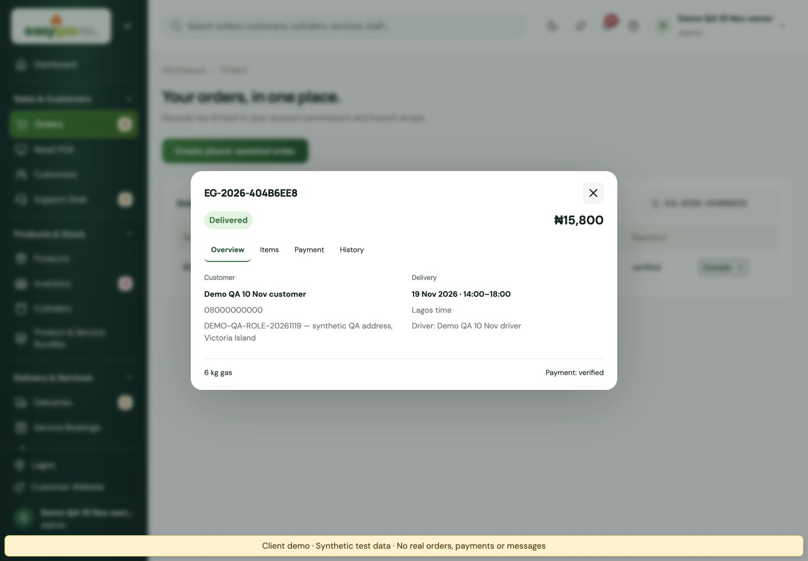
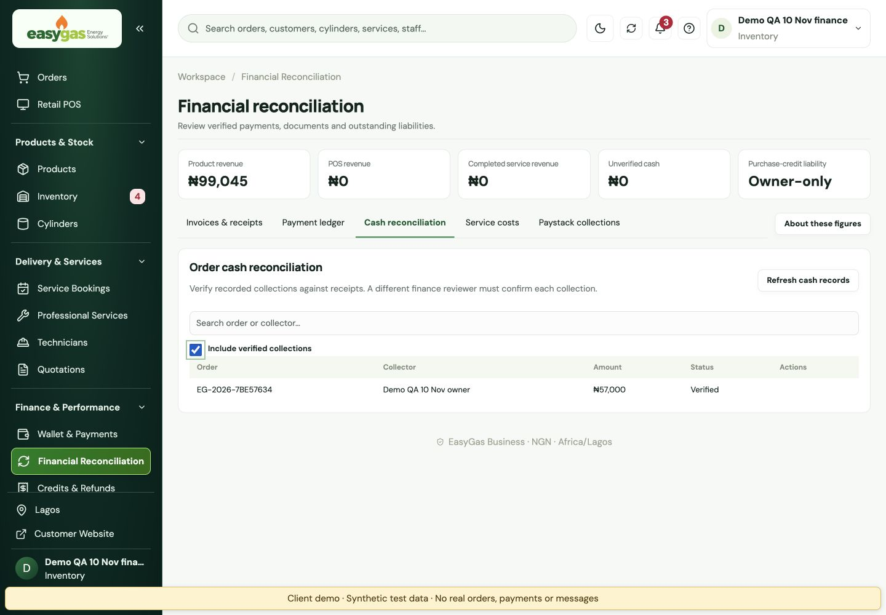

# Role-based order-to-delivery acceptance — 19 November 2026

**PASS for the approved synthetic client-demo scope.** All 10 requirements and acceptance gates, 8 critical requirements, and 9 functional web routes are verified. Responsive checks cover 8/9 routes; the added cash-reconciliation route was functionally tested on desktop, and its phone interaction remains untested. [Requirements matrix](../traceability/role-order-acceptance-rtm.md) · [Machine matrix](../traceability/role-order-acceptance-rtm.json) · [Final reconciliation](../deployment/evidence/20261119-role-acceptance/final-reconciliation.json).

The stable [client demo](https://easygas-client-demo.vercel.app) runs source `8e0e5843e6989792f16a38971b02e22ee702ac0e`, Ready deployment `dpl_Bj5pEYpjY4wToJ9sNFo7a5x7MyE2`. [Verified deployment identity](../deployment/evidence/20261119-role-acceptance/invoice-stable-identity.json). Later commits contain acceptance scripts, evidence and documentation; application code is unchanged after this deployment.

## Defects found, fixed and deployed

| Defect | Resulting behaviour | Implementation and verification |
|---|---|---|
| Public empty-cylinder availability used aggregate stock even when no eligible serial existed | Catalogue availability is capped by eligible, inspected, company-owned serials, excluding reserved/issued/vehicle-held serials. Checkout and catalogue use the same eligibility predicate. | `apps/web/lib/cylinder-allocation.ts`, `apps/web/lib/service.ts`; [local regression](../deployment/evidence/20261119-role-acceptance/catalogue-after.txt), [hosted readback](../deployment/evidence/20261119-role-acceptance/fix-hosted-after.json). |
| Finance redesign made cash-reconciliation controls unreachable | Financial Reconciliation has a dedicated Cash reconciliation tab and a focused review dialog, with identity verification and independent collector/reviewer controls. | `apps/web/components/cash-reconciliation.tsx`, `reconciliation.tsx`, `admin.tsx`, scoped collector context in `lib/service.ts`; [component/regression checks](../deployment/evidence/20261119-role-acceptance/fix-regression.txt), actual finance UI verification. |
| Partial refund request returned HTTP500 under the restricted runtime database role | Refund allocation, fingerprint and operation key are inserted atomically. No immutable-source UPDATE or permission expansion is needed. | `apps/web/lib/commerce.ts`; [restricted-role regression](../deployment/evidence/20261119-role-acceptance/refund-runtime-after.txt), [hosted refund and invoice readback](../deployment/evidence/20261119-role-acceptance/refund-approved.json). |
| Cancelled wallet orders retained the original payment in invoice balances despite an automatic wallet refund | Shared invoice balances subtract the exact order/customer cancellation-credit entry, preserving original payment and invoice records. Independent void is permitted after a full refund, without a fictional excess refund. | `apps/web/lib/invoice-corrections.ts`, `apps/web/lib/invoices.ts`; [restricted runtime cancellation regression](../deployment/evidence/20261119-role-acceptance/cancel-invoice-regression.txt), hosted independent review and readback. |

The first two fixes were deployed in `130f8d3` / `dpl_7s6sLo9HHAMRLxD516UabksFaoMS`; the refund fix followed in `2e3affb`; the final deployment adds cancellation-credit accounting in `8e0e584`. Exact git-byte source archives excluded local credentials, databases and build output. Orders, ledger and stock were compared before/after all three promotions. No schema migration, direct hosted database mutation, new grant or weakened business control was used.

## Executed journeys

| New test order | Executed outcome |
|---|---|
| `EG-2026-404B6EE8` — 6 kg gas, wallet | Customer checkout; qualified customer-cylinder intake/inspection; sales preparation; separate dispatch; finance invoice; independent load issue; actual restricted driver UI custody, pickup, arrival, simulated metering, labelled proof and customer handover. Delivered/verified; ₦15,800 invoice paid; exactly 6,000 g deducted; zero remaining load independently received and reconciled. |
| `EG-2026-7BE57634` — two empty cylinders, COD | Sales/dispatcher preparation; driver UI acknowledgement, serial pickup, arrival and labelled proof; authorised owner-supervised handover collected ₦57,000 of simulated cash. It stayed collected/unverified until a separate finance user reauthenticated and reconciled it. One settlement and two serial transfers. |
| `EG-2026-E02D78B1` — one empty cylinder, wallet | First attempt failed with customer unavailable. Held goods blocked cancellation/reassignment. Driver self-return and incomplete return rejected. Independent exact return preceded rescheduling and a new attempt. Driver completed second pickup, arrival, attempt-specific proof and handover through the phone viewport. One ₦31,000 wallet debit and one serial fulfilment across both attempts. Dispatch incident resolved after successful retry; original failure/return history retained. |
| `EG-2026-C1D1199D` — abandoned card checkout | Remained unpaid; customer cancellation released its 500 g reservation once. No provider success, payment or receipt was fabricated. |
| `EG-2026-1F4E85C7` — prepaid cancellation | Customer cancelled before pickup. The wallet debit and 500 g reservation reversed once. Invoice explicitly required review and rejected a new payment request; independent finance/owner review then voided it, preserving its issued snapshot. |

On the COD order, a partial refund was first requested/replayed and independently rejected; wallet and stock stayed unchanged. A second one-cylinder request was submitted through the actual customer UI and approved through the separate finance UI. It credited **₦26,000 once**, rejected pending/conflicting/over-refund requests, and did not pretend that goods had been returned. An independently approved credit note preserved the original ₦57,000 invoice snapshot and reconciled its effective total/net settlement to ₦31,000, due ₦0.

## Exception and role coverage

- Wrong role, other customer, restricted driver finance access, stale version, incorrect handover code and missing handover attestation/proof rejected without committing stock or payment.
- Wrong dispenser role, stale load version and incorrect meter delta rejected. Premature pickup/fulfilment blocked.
- Insufficient wallet and tampered gas quote rolled back. Nonexistent verification, foreign/staff/cancelled payment targets, client-forged success/amount fields and unsigned success webhook could not create payment success. Local provider tests cover failed/mismatched provider outcomes, duplicate processing and signatures. No live provider transaction was attempted.
- Exact checkout, collection, refund and delivery retries produced one committed effect. Changed operation contents conflicted. A final refund decision could not be overwritten; collector self-reconciliation and invoice-note self-approval failed.
- Ten labelled QA accounts authenticated. Functional sales/dispatcher accounts are canonical **manager** users; inventory/finance accounts are canonical **finance** users. These are the demo's consolidated roles, not a claim that separate sales/dispatcher permission roles were implemented.

## UI verification

Actual browser sessions exercised customer, sales, dispatch, owner, inventory, finance and restricted driver interfaces. Eight targeted routes were checked at **1440×1000 and390×844**: `/`, `/orders`, `/track`, `/admin/orders`, `/admin/deliveries`, `/admin/finance`, `/admin/credits`, `/admin/inventory`. The delivery route was checked as both dispatcher and driver. The added ninth functional route, `/admin/reconciliation`, was exercised through actual finance cash-verification UI on desktop; its phone interaction is untested and remains counted in separate responsive coverage 8/9. Browser evidence precedes the final accounting-only release; its application component/CSS files are unchanged, and final invoice/data behaviour is verified through the hosted product API after promotion. Settled pages have no horizontal page overflow; wide operational tables scroll within their containers.

The completed-order modal has one dialog, four tabs and **zero forms**. History is paged; the active sidebar item is visible. [Browser observations and actions](../deployment/evidence/20261119-role-acceptance/browser-evidence.json), [executed UI evidence checks](../deployment/evidence/20261119-role-acceptance/role-ui.txt). Initial immediate-resize observations were repeated after layout settled and are excluded from acceptance selections.

## Final reconciliation and cleanup

Eight pre-existing orders are byte-for-byte equal to their baseline scoped readbacks. Five new labelled test orders remain retained, giving 13 total. No original record was reset or removed.

- QA wallet: ₦50,000 synthetic purchase credit + ₦26,000 partial refund − ₦15,800 gas − ₦31,000 product = **₦29,200**. The separate ₦5,900 cancellation debit/refund nets to zero. Unique wallet references and replay checks pass.
- Empty6kg inventory:20→17, reserved0; three newly labelled company serials transferred once to the QA customer. Financial refund did not restore physical stock.
- Gas:5,985,000→5,979,000 g; original13,000 g reservations preserved. New gas custody fully reconciled.
- Simulated COD collection: ₦57,000 independently verified once. Three delivered invoices are paid with due 0; the cancelled prepaid invoice was independently voided with due 0.
- Failed-delivery incident resolved with an explanatory note; its history remains. QA trip ended with unchanged synthetic odometer, GPS consent off, and driver availability restored to its initial false value.

## Executed checks and limits

| Evidence | Result |
|---|---|
| [Operational/security regression](../deployment/evidence/20261119-role-acceptance/operations-regression.txt) |51 passed;0 failed/skipped. |
| [Catalogue/cash/UI regression](../deployment/evidence/20261119-role-acceptance/fix-regression.txt) |20 passed;0 failed/skipped. Overlaps the operational run. |
| [Refund/commerce/invoice regression](../deployment/evidence/20261119-role-acceptance/refund-regression.txt) |21 passed;0 failed;2 disposable-local-PostgreSQL checks explicitly skipped because that service was not enabled. Includes the restricted runtime-role regression. |
| [Cancellation accounting regression](../deployment/evidence/20261119-role-acceptance/cancel-invoice-regression.txt) |41 passed;0 failed/skipped. Includes order isolation, independent invoice void and no duplicate cancellation/excess credit. Overlaps other runs. |
| [Payment regression](../deployment/evidence/20261119-role-acceptance/payment-regression.txt) |19 passed;0 failed/skipped. |
| Hosted suites and final readbacks |All mapped scenario suites pass; individual assertions and JSON outcomes are linked in the matrix. Hosted business operations use the existing remote database through product HTTP APIs. |
| Production web build and source/deployment identity |Pass. [Build](../deployment/evidence/20261119-role-acceptance/cancel-invoice-build.txt), [source integrity](../deployment/evidence/20261119-role-acceptance/invoice-source-integrity.json). |
| [Traceability validator](../deployment/evidence/20261119-role-acceptance/traceability-validation.txt) |2 passed; all phase matrices checked, including unchanged customer requirement/route denominators. |

Failed initial reproduction logs and corrected harness assumptions are retained for investigation, not mapped as successful test evidence. The refund defect was reproduced red under restricted permissions before the atomic-INSERT fix. Harness corrections covered read-only HTTP methods, actual returned-state/cash field names, privacy-related omission of a completed order's handover secret, and transient resize observations; these did not weaken business controls.

**Production remains NO-GO.** Actual-import hold, retain-all, native build/device, GPS/background/offline, live-payment/provider and physical safety/calibration/delivery gates remain in their existing matrices. This acceptance pass concerns synthetic hosted web behaviour only; it does not assert real gas, funds, travel or certification.

The user explicitly approved two-hour, demo-only qualification and sandbox meter renewals. Four labelled QA qualifications were independently verified through normal product APIs (the meter verifier was qualified by a second owner). They and the existing meter expire **19 November2026 at11:53:44.767 UTC**; no automatic extension or production control change was made. [Renewal evidence](../deployment/evidence/20261119-role-acceptance/qa-renewal.json). Expiry will correctly block future gas runs until a separately authorised renewal.

Immediate prior Ready deployment `dpl_DYWrmvy6WxFVXrnkjZn6Q9TA89J3` is available for rollback; the pre-pass baseline is `dpl_53xp97q2UbSFcUuhpu3yssNjjtoU`. Retain synthetic operational and financial histories on rollback; do not restore an older database or reset orders.
