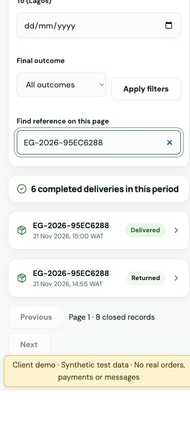
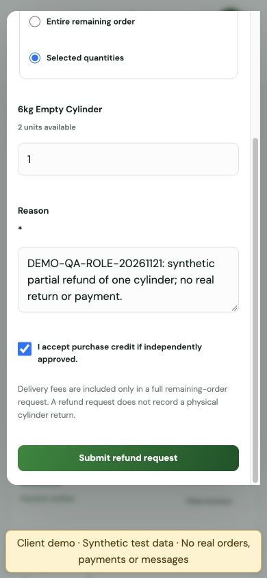

# Hosted role order-to-delivery acceptance — 21 November 2026

**PASS: 11/11 bounded requirements and gates; 0 excluded.** [Traceability](../traceability/role-order-acceptance-20261121-rtm.md) · [Illustrated role guide](../user-manual/order-to-delivery.md) · [Final reconciliation](evidence/final-reconciliation.json).

This is current synthetic acceptance on the existing client-demo project. Existing production NO-GO and wider native/device/provider/physical/actual-import/retain-all gates remain unchanged. It is not a claim that the entire application is ready for production.

## Executed coverage

- 14 existing labelled identities authenticated, including a second existing driver;7 canonical roles mapped. No accounts, credentials, grants or independent-review bypasses created.
- 23 hosted node:test scenario tests plus8 additional post-assertion operator groups and22 actual browser observations:53 grouped checks. These group multiple assertions/rejections; they are not a count of every HTTP request. [Executed journal](evidence/acceptance-checks.json).
- All 9 registered functional/responsive routes exercised through actual desktop/390px UI, including customer/business customer, owner, manager/dispatch, inventory, finance, driver and technician perspectives. `/track` resolves to the scoped customer Orders view. Technician assigned-work empty state/boundaries were checked; this is not acceptance of a separate physical service job.
- Source CI 44910750813 passed 1,162/1,162 web regression tests and 3/3 native dependency checks,0 failures/skips. Web build/types/audit and native types/audit passed. Native export was skipped. [CI evidence](evidence/ci-validation.json).
- Local focused regression suites, genuine PostgreSQL competing driver/vehicle starts, web builds/types and 6 documentation/traceability checks passed. Initial red reproductions and corrected operator assumptions remain in separate logs.

## Six fresh scenarios

| Scenario | Reference | Final outcome |
| --- | --- | --- |
| Abandoned card checkout | EG-2026-185AED4E | Customer cancelled; unpaid; reservation released exactly once. |
| Two serialized cylinders, COD | EG-2026-6928994E | Actual driver pickup/arrival/proof and owner handover; separate finance phone cash verification; delivered/verified. One rejected partial refund and one independently approved ₦26,000 credit; immutable invoice plus independent credit note. |
|6kg gas, wallet | EG-2026-F068343F | Qualified inspection, independent load/custody, actual restricted driver UI metering/proof/code handover; delivered/verified; zero return independently reconciled. |
| Failed delivery and retry, wallet | EG-2026-95EC6288 | First attempt failed; exact independent return; sales reschedule and dispatch new attempt; actual driver phone proof/code handover; delivered/verified without another debit/reservation. Both attempts remain in History. |
| Pre-pickup wallet cancellation | EG-2026-A03C65C7 | Cancelled/refunded once; issued invoice independently voided, original snapshot retained, due 0. |
| Business customer's unpaid order | EG-2026-20FACF96 | Own checkout/read/cancel/replay; unpaid; other-customer access/cancellation and insufficient wallet denied. |

Exception checks include unavailable/no-trip drivers, wrong roles/branches/customer/driver, negative odometer, missing vehicle, occupied vehicle, duplicate trip, unmet order preparation/custody, stale versions, forged prices/payment verification, unsigned webhook, expired qualification/calibration, wrong meter quantity, wrong pickup/return manifest, premature cancellation/reassignment, collector/self-approval, absent/incorrect handover, absent proof/consent/future photo timestamp, duplicate proof, over-refund, changed replay payload and immutable invoice corrections. Canonical state, ledger, stock and replay assertions were checked at the relevant stages.

## Defects corrected and released

1. **Duplicate active trip returned 500**, exposing a unique-constraint failure. Added serialized driver/vehicle conflict checks and actionable 409 messages. Existing uniqueness, role/branch, suitability, capacity, idempotency and custody rules remain. Both real PostgreSQL race cases pass: same driver/different vehicles and different drivers/same vehicle.
2. **The demo notice visually obscured phone form actions.** Customer refund submit was at 775.86–813.86px under the notice beginning 774px. The same problem was reproduced on compact finance review. Added demo-only positioning/height clearance for customer Orders and compact review dialogs. Actual customer refund submission and separate finance approval succeeded after rollout. Final customer button bottom 687.86; finance Save bottom 674.89 inside dialog 708, both above notice 774. Screenshots and geometry retain before/after evidence.

Final application source **`eb3913e775fb7d520a1c7fe9341b031bc6808832`** is Ready on **`dpl_Gci51BMxmVPk4mPU8gK9DQhgxsiZ`**, project `prj_cFSaJuN9r4x93RLov1LLVO3cdVA2`, [client demo](https://easygas-client-demo.vercel.app). All 439 uploaded application paths match committed source, the clean export and Vercel dry-upload hashes. Four candidate and four stable grouped release checks passed with orders/ledger/inventory/trips/LPG state unchanged by probes. [Source manifest](evidence/source-integrity.json) · [stable identity](evidence/stable-identity.json) · [stable probes](evidence/stable-release.json).

Earlier trip-fix release b09c00f/dpl_CzA2eujVppuKAAVkyq5pruGuQmU3 is retained under [evidence/initial-release](evidence/initial-release/source-integrity.json). Customer-refund release d6bf8c9/dpl_CjNBL34AtUVvofDe7d97NHqoi7wZ is retained under [evidence/customer-refund-release](evidence/customer-refund-release/stable-identity.json), and is the immediate rollback deployment. Both earlier sourceCI runs also passed 1,162 tests. Final documentation/operator changes are excluded from the439-file application deployment.

The explicit two-file reviewed source continuation preserves historical source hashes and tamper rejection. Native code, original19November acceptance and previous broader matrices are retained. No mobile binary build, export or install occurred; three retained native artifact hashes, sizes and mtimes remain unchanged.

## Reconciliation and cleanup

- All 16 original orders remain identical to the full recorded baseline snapshots;22 orders total after the six new scenarios. Original customer-wallet and finance-ledger rows remain unchanged. Business-customer wallet unchanged.
- QA wallet: ₦29,200 baseline + ₦50,000 independently approved synthetic credit − ₦15,800 gas − ₦31,000 retry product + ₦26,000 partial refund = **₦58,400**. Wallet cancellation nets zero; entries sum and unique references reconcile.
- Physical 6 kg cylinders: 17→14; three labelled new serials sold once; reserved 0 restored. Partial financial refund does not restock goods.
- Gas: 5,979,000→5,973,000g; baseline reserved 35,500 g retained. Own 6 kg load reconciled. These are synthetic system movements, not physical measurements.
- Independent COD collection ₦57,000 verified once; delivered invoices paid/due 0, refunded cancellation invoice voided/due 0. Issued snapshots retained.
- Only the run-owned failed-delivery incident was resolved after successful retry. Own trip ended at simulated 1000 km; original unavailable duty preference restored. Driver Home confirmed no active trip/assignments.
- All 14 run-owned API tokens revoked; each old bearer subsequently returned 401. Own browser sessions signed out, temporary phone viewport reset, initial light theme retained; other user tabs/sessions untouched. Only the run-created disposable PostgreSQL fixture was removed.

User expressly approved one two-hour demo-only renewal of the four existing labelled QA qualifications and existing sandbox meter. Normal independent product APIs applied it from 2026-11-21T13:08:06.517Z until **2026-11-21T15:08:06.520Z**. All evidence states synthetic QA only. Expired inspection 403 and calibration 409 were exercised before renewal. This is not genuine certification or physical meter verification and is not automatically extended. [Approval scope](QA-SAFETY-RENEWAL.md).

## Evidence limitations and corrections

The immutable initial logs include the true trip500 reproduction and initial phone obstruction. Operator harness corrections are separately retained: a settings read needed scope; driver.location is the authoritative trip/vehicle projection; the already-delivered order correctly returns409to authorised candidate readers instead of the earlier preparing-order 200; refund status is`pending`; availability cleanup requires a stable operationKey and correctly rejected the first unkeyed request 400. Reruns passed without changing those controls or replaying business effects.

Browser diagnostics include injected extension warnings/style failures and message-channel closures; no corresponding Chrome runtime APIs/messages occur in application source. These are recorded as browser/injected-script diagnostics, not a reproduced failed business action. No extension or user security setting was changed. Initial clipped/full-page screenshots remain audit evidence; the seven selected current manual figures were separately visually checked.

No remaining work or user approval is required within this bounded acceptance pass. Genuine operational qualifications/calibration, actual delivery/cash/meter observations, signed-device/native/GPS acceptance, live payment-provider acceptance, production hosting/recovery and commercial go-live approval remain governed by their original open gates.
