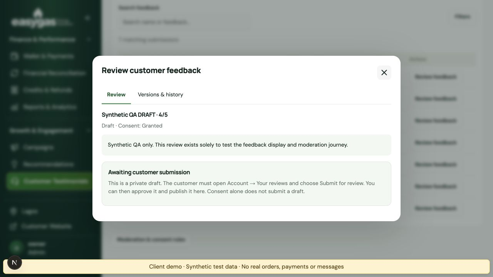
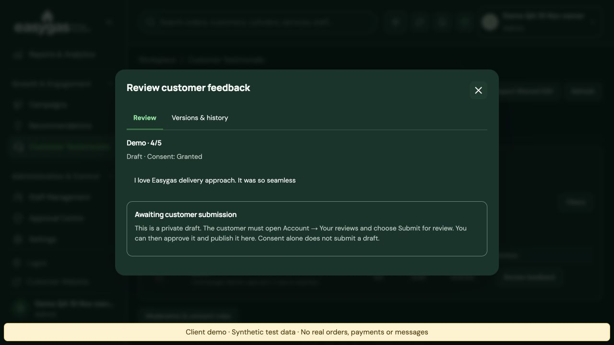

# Testimonial dialog and publication repair — 24 November 2026

The screenshot showed a top-aligned **Draft** review, granted consent and no available action. The shared demo-notice style deliberately aligned compact dialogs to the top. Drafts legitimately have no moderator transition: only the customer may submit them. The generic “Approval does not publish” line gave no useful next step. Separately, successful approval closed the review, hiding the subsequent Publish action until it was reopened.

The repair scopes centred layout to the testimonial review, filter and moderation dialogs. Symmetric viewport clearance keeps long dialogs above the demo notice, with internal scrolling. Other application modal layouts are preserved. Each state now explains who acts next; approval/publication have explicit primary labels. Successful moderation reloads the same record and current revision, exposing Publish after approval. Missing consent disables approval/publication and explains why. Customer drafts also explain their existing Submit for review action.

Testing found a real recovery defect: a failed moderation write used the list's read-error state, so cancelling it hid the records. Decision and details errors are now separate; failed details reads offer explicit retry. Pending decisions are guarded against duplicate submission/dismissal. Browser testing also caught completion focus returning to BODY after nested identity verification; the testimonial review restores focus to its close action after loading completes.

Only two runtime presentation files changed: `apps/web/components/testimonials.tsx` and `apps/web/app/product-ui.css`. Server transitions, customer ownership/submission, consent withdrawal, current-version approval, transaction eligibility, recent password and revision controls remain unchanged. Historical source proofs use a strict two-file continuation from committed `0333e6e`; no existing source proof or native baseline is replaced. All 77 stable sensitive guard IDs remain.

## Executed local evidence

[Focused tests](evidence/focused.txt): 33 passed, zero failed/skipped. These include real React management/customer interaction tests, backend publication/privacy/consent/version/ownership/rate-limit cases, shared read recovery and historical source continuity. [Types](evidence/typecheck.txt) and [web build](evidence/build.txt) pass. An initial test harness omitted Empty/document support; the retained [initial result](evidence/initial-focused.txt) is not accepted feature evidence. Subsequent recovery testing caught and fixed the separate real list-error defect.

[Four actual browser cases](evidence/browser-local.json) use the real Next.js app/APIs and disposable loopback-only synthetic data. They cover the draft explanation, wrong-password recovery and separate approval, public appearance after Publish and removal after Hide, plus dark phone/short phone and light tablet history. All five measured layouts have zero vertical centre offset; every dialog bottom clears the demo notice. Short-screen actions scroll internally and keyboard focus stays inside. The local fixture uses a valid daily limit of ten solely to stage seven states; no hosted setting, qualification, stock or feedback record is changed. Browser viewport overrides were reset.

Application `639cafd7871c78f2f8da6a09a1ec46e7c7c85ce9` is deployed to Ready `dpl_4fDG9cPQu847x5hvkqT9etxU1sVz` and promoted to the [existing client demo](https://easygas-client-demo.vercel.app/admin/testimonials). [Source proof](evidence/source-integrity.json) matches all 446 remote source content hashes against Git; both changed runtime files were additionally downloaded and byte-compared. Four candidate and four stable grouped hosted checks verify owner reads, six lower-role and anonymous denials, seven-role forbidden draft-publication denials and unchanged current feedback content/status/revisions/full versions/events/public projection. The only hosted review remains Draft and the public feed remains empty. [Actual hosted browser checks](evidence/browser-hosted.json) verify centred draft/filter dialogs, clear customer-submit guidance, focus/banner clearance and own QA sign-out. All seven verifier bearer sessions were revoked. [Release record](evidence/release.json); rollback is prior Ready `dpl_5c9a2tgJfRdsySpwQBhbKG5mWs23`, same project, preserving all data/settings. [Full application CI](https://github.com/Onaopemipo/easygasng/actions/runs/45291436426) passed **1,241 tests, zero failures/skips**, web build/types/audit and native types/dependency/audit; mobile export skipped. [Recorded CI evidence](evidence/ci.json). All four bounded requirements/gates are verified, zero excluded. Final documentation-only changes do not alter the deployed application bytes. No hosted customer review is published by this task. No mobile binary/export. Existing production NO-GO and native/provider/physical/import/retain-all holds remain.

[Manual](../user-manual/testimonials.md) · [Matrix](../traceability/testimonial-publishing-rtm.md)

