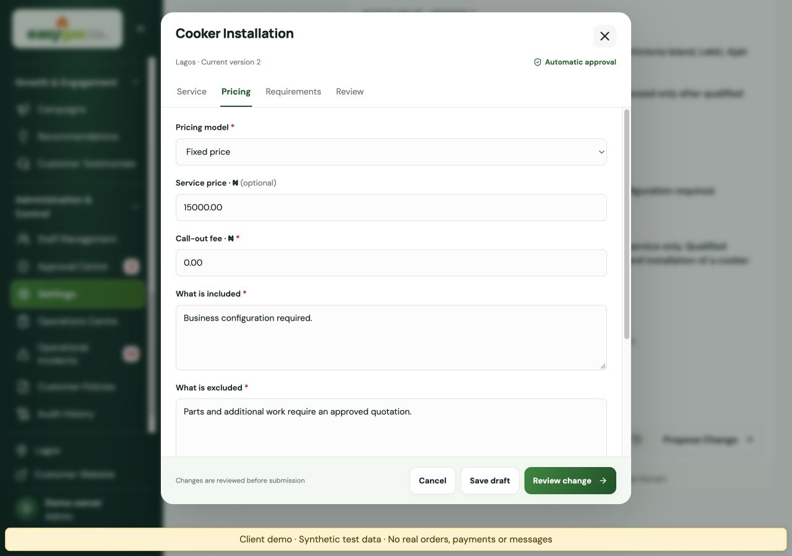

# Admin Settings: roles, editors and acceptance testing

Use the [current nine-category guide](admin-settings-navigation.md) to locate a control. Category names organise permitted settings; they do not grant access. The current live Lagos inventory has 77 settings. The disposable fixture has 76 because it excludes one existing labelled sandbox delivery area.

| Account role | Admin Settings access | How to interpret actions |
| --- | --- | --- |
| Admin (`owner`) | All nine categories | Automatic approval for eligible business rules; protected payment/access/adjustment rules keep their current review requirements. Safety activation still requires qualified independent review. |
| Service Manager (`manager`) | Seven categories, 59 live controls | Only proposal-role controls have edit actions. Routine changes can apply immediately; governed requests need independent approval. Drafts always stay inactive. |
| Inventory (`finance`) | Eight categories, 59 live controls | Some controls are view-only. Reading history or being an eligible approver does not grant the right to request restoration. |
| Driver | No Admin Settings workspace | Direct Settings route is unavailable. Separately permitted operational reads retain their existing API authority. |
| Technician | No Admin Settings workspace | Assigned service work and qualified-review eligibility are separate from Settings access. |
| Household customer | No Admin Settings workspace | Use personal Account Settings for customer preferences. |
| Commercial customer | No Admin Settings workspace | Business customer access does not grant staff permissions. |

Former role names are consolidated by the existing identity system: administrator/safety_officer → Admin; inventory/auditor → Inventory; sales/sales_rep/dispatcher/service_manager → Service Manager. This does not create additional people or change independent-review requirements.

## Editing services, safety steps and terms

**Services & Safety → a service offering:** use **Service** for name, description, areas, availability and duration; **Pricing** for the pricing model, service/call-out amounts in naira, inclusions and exclusions; **Requirements** for qualification code, preparation, safety, warranty and cancellation notice. Separate areas with commas. Blank service price means unconfigured; zero means no charge. An active service requires areas and, for fixed pricing, a price. Review the values before saving. Exact amounts such as ₦1,200.29 remain 120029 kobo internally.

**Services & Safety → safety checklist:** add or remove inspection steps, keep existing identifiers when retaining a check, and mark mandatory steps. Identifiers must be unique and at least one step must be mandatory. The server rejects an empty or wholly optional checklist. Admin automatic approval does not replace independent qualified safety review.

**Policies & Terms → a policy:** **Content** edits the title and reviewed text. **Publication** controls public visibility and its effective date in Lagos. Publishing requires at least 100 characters of reviewed text and an effective date. That publication date is distinct from **Schedule for later**, which schedules when the setting change may activate. Saving a draft publishes nothing.

Other setting types retain their existing typed editors and review controls. A read-only definition has no edit action. Legacy controls remain collapsed and searchable; changing a legacy field does not enable the current rewards or delivery engines.

## History and restoration

Open the history icon next to a setting. A view-only user can read permitted versions but has no restoration button. If your current role can propose this setting, **Request restoration of previous value** uses the same server validation, identity, version, approval and activation rules as a new change. It creates a new version when applied; it does not erase old versions.

Wait for the request to finish. The button is disabled while pending. An error stays visible inside the history dialog, and an unsuccessful result is not reported as applied. Pending and scheduled restorations leave the current value active. Missing/unconfigured historic values may fail today's validation and require a valid new proposal instead.

## Safe acceptance checklist

1. Use labelled synthetic local/demo identities. Confirm role and branch. Search by current/old name and stable key; restricted rows must not appear.
2. Open a permitted editor, change values and choose **Save draft**. Review the draft, then use the separate final Save draft action. Confirm the active value/version did not change.
3. For service pricing, use an exact two-decimal amount. For terms, choose a Lagos effective date. Inspect the review; saving a draft must not publish or activate either configuration.
4. Test malformed values and invalid time windows. The editor should show the server error, retain the proposed values and allow correction. Close/discard protects unsaved work.
5. Test stale versions, revoked/expired sessions and cross-branch attempts in disposable data. Refresh and review the current value after a version conflict; sign in again after session expiry.
6. Test submission, independent approval, activation, scheduling and restoration only in disposable fixtures. Do not use real customers, payments, qualifications or operational changes for these tests.

All seven canonical roles are covered in isolated API and browser acceptance. Hosted verification uses the six existing labelled demo identities; there is no supplied Commercial demo credential, so Commercial sign-in is demonstrated locally rather than claimed as live acceptance. Historical PDF/Word manuals have not been regenerated. Production NO-GO, import hold, retain-all and unrelated provider/native/physical-operation gates remain unchanged.

[Acceptance matrix](../traceability/admin-settings-acceptance-rtm.md) · [Findings and repairs](../admin-settings-acceptance/DEFECTS.md).

Editor previews from acceptance: [service pricing on desktop](../admin-settings-acceptance/evidence/local-service-editor.jpg), [phone editor](../admin-settings-acceptance/evidence/local-service-phone.jpg), [Inventory read-only history](../admin-settings-acceptance/evidence/local-view-only-history.jpg) and [inline restoration error](../admin-settings-acceptance/evidence/local-restoration-error.jpg). The previews use disposable synthetic data.

If an already-open demo tab still shows the old editor after deployment, refresh it once. The final acceptance confirmed the new bundle on the stable demo.

Live previews: [policy publication editor](../admin-settings-acceptance/evidence/release/stable-policy-editor.jpg) · [phone service editor](../admin-settings-acceptance/evidence/release/stable-service-phone.jpg).
