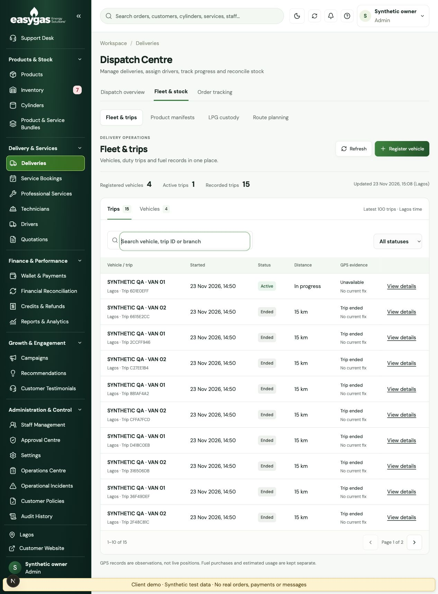
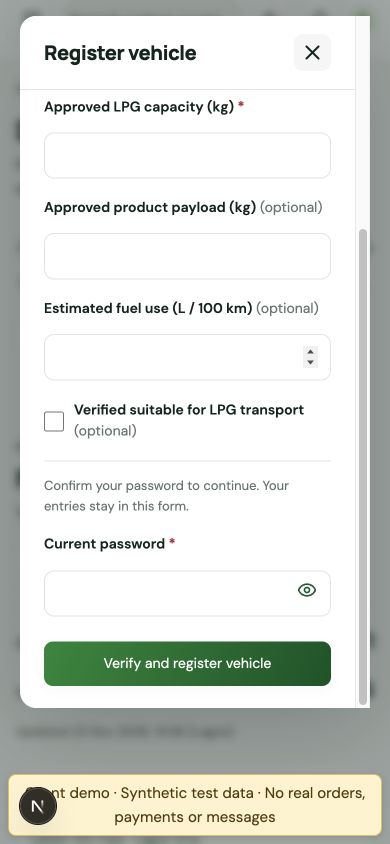

# Dispatch Centre: fleet and trips

Open **Deliveries → Fleet & stock → Fleet & trips**. Existing links to `/admin/deliveries#driver-fleet` open the same workspace.

**Dispatch overview** contains the selected-date queues, delivery KPIs, driver overview and shortcuts. Its date control applies to dispatch, not fleet history. **Order tracking** retains the existing order actions.

| Fleet & stock tab | Purpose |
| --- | --- |
| Fleet & trips | Search trip history, view registered vehicles and open trip/GPS/fuel details. |
| Product manifests | Existing physical-stock issue, acknowledgment, payload review and returns. |
| LPG custody | Existing bulk loading, meter, dispensing and reconciliation controls. |
| Route planning | Destination confirmation and road-plan recommendations; available to authorised owner/manager roles. |

The tabs separate existing workflows; they do not grant new authority or bypass an approval, inspection, current qualification, meter calibration or inventory check.

## Find a trip or vehicle

Use **Trips** for the latest 100 trip records returned by the server, ten per page. Search by vehicle label, trip ID or branch; choose Active or Ended to narrow the list. Clear filters if there are no matches. Identical vehicle names can represent different trips: compare the trip reference and start time. Earlier trips beyond the server's 100-record limit are not included in this view.

Use **Vehicles** to see branch, activity, approved LPG/product capacity and LPG suitability. Capacities display in kilograms. Active does not mean LPG-suitable: **Not verified** remains explicit. These counts describe records in your authorised scope, not a guarantee of present availability. The server rechecks a selected vehicle at trip start.

**View details** opens one trip. Odometer distance, GPS observed distance and estimated fuel usage are distinct. Fuel purchases list actual litres, cost and receipt reference separately from estimated usage. Zero remains zero; an absent approved estimate is shown explicitly. GPS observations retain recorded/received times, age, accuracy, offline delay and available history. They are not live positions. All displayed trip times use Lagos time.

## Register a vehicle

Only the business owner sees **Register vehicle**. The focused dialog requests registration/name, an active branch and approved LPG capacity. Product payload and estimated fuel use are optional. Enter capacities in **kg**, to at most three decimal places; for example **12.5 kg = 12,500 g** in existing server records.

Leave LPG suitability unchecked unless it has actually been verified. Confirm the current password and choose **Verify and register vehicle**. Incorrect passwords leave your vehicle entries intact and clear the password. A failed save keeps the dialog open for correction; it does not grant suitability or create another vehicle automatically. Pending saves block dismissal and repeat submission.

Closing an edited dialog asks whether to **Keep editing** or **Discard changes**. Escape follows the same protection; keyboard focus stays in the dialog and returns to its opening action on close.

## Driver trip actions

Drivers see their own trips. If there is no active trip, **Start duty trip** opens a focused form for an active, LPG-suitable branch vehicle, starting odometer and location consent. If none is eligible, ask the owner to register/verify a suitable vehicle. The server also prevents two active trips for one driver or vehicle.

For an active owned trip, use **Manage trip** to record a fuel receipt or end the trip with its closing odometer. Driver-only actions do not appear to managers or finance. Fuel retries preserve the same operation key after an uncertain failure. Ending a trip still requires the existing custody/reconciliation controls.

## Phone, tablet and refresh behaviour

Phone forms use one column and an internally scrolling dialog. The password and save action stay clear of the demo notice; the heading/close control remains at the top. Wide record tables scroll within their panel. Light/dark colours follow the workspace theme.

**Refresh** updates fleet records; it does not change a vehicle or trip. On a failed refresh, the previous snapshot is labelled as such. A permission failure removes records, and a delayed response from a previous identity cannot restore them.

This redesign is locally verified with synthetic data. Hosted deployment, physical-browser/screen-reader coverage and broader production acceptance are separate. Existing production NO-GO remains.
