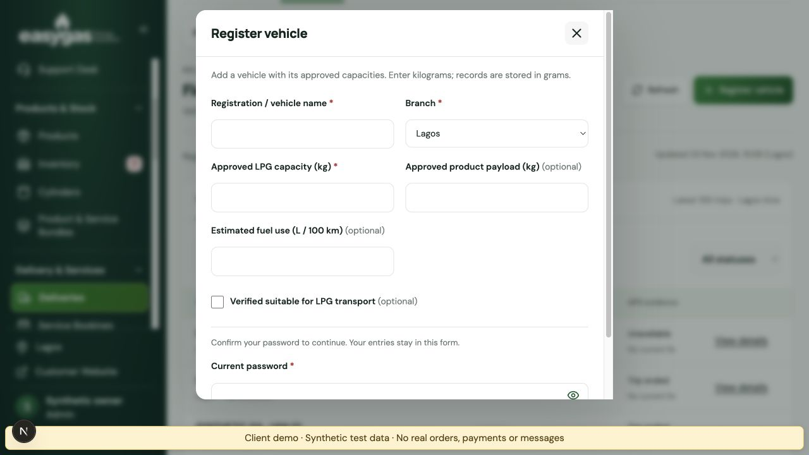

# Dispatch Centre: fleet and trips

Open **Deliveries → Fleet & stock → Fleet & trips**. Existing links to `/admin/deliveries#driver-fleet` open the same workspace.

**Dispatch overview** contains the selected-date queues, delivery KPIs, driver overview and shortcuts. Its date control applies to dispatch, not fleet history. **Order tracking** retains the existing order actions.

| Fleet & stock tab | Purpose |
| --- | --- |
| Fleet & trips | Search trip history, view registered vehicles and open trip/GPS/fuel details. |
| Product manifests | Existing physical-stock issue, acknowledgment, payload review and returns. |
| LPG custody | Existing bulk loading, meter, dispensing and reconciliation controls. |
| Route planning | Destination confirmation and road-plan recommendations; available to authorised owner/manager roles. |

The tabs separate existing workflows; they do not grant new authority or bypass an approval, inspection, current qualification, meter calibration or inventory check.

## Find a trip or vehicle

Use **Trips** for the latest 100 trip records returned by the server, ten per page. Search by vehicle label, trip ID or branch; choose Active or Ended to narrow the list. Clear filters if there are no matches. Identical vehicle names can represent different trips: compare the trip reference and start time. Earlier trips beyond the server's 100-record limit are not included in this view.

Use **Vehicles** to see branch, activity, approved LPG/product capacity and LPG suitability. Capacities display in kilograms. Active does not mean LPG-suitable: **Not verified** remains explicit. These counts describe records in your authorised scope, not a guarantee of present availability. The server rechecks a selected vehicle at trip start.

**View details** opens one trip. Odometer distance, GPS observed distance and estimated fuel usage are distinct. Fuel purchases list actual litres, cost and receipt reference separately from estimated usage. Zero remains zero; an absent approved estimate is shown explicitly. GPS observations retain recorded/received times, age, accuracy, offline delay and available history. They are not live positions. All displayed trip times use Lagos time.

## Register a vehicle

Only the business owner sees **Register vehicle**. The focused dialog requests registration/name, an active branch and approved LPG capacity. Product payload and estimated fuel use are optional. Enter capacities in **kg**, to at most three decimal places; for example **12.5 kg = 12,500 g** in existing server records.

Leave LPG suitability unchecked unless it has actually been verified. Confirm the current password and choose **Verify and register vehicle**. Incorrect passwords leave your vehicle entries intact and clear the password. A failed save keeps the dialog open for correction; it does not grant suitability or create another vehicle automatically. Pending saves block dismissal and repeat submission.

Closing an edited dialog asks whether to **Keep editing** or **Discard changes**. Escape follows the same protection; keyboard focus stays in the dialog and returns to its opening action on close.

## Driver access and trip actions

Hosted drivers use **Deliveries → Driver workspace → Home → Current trip**. Choose **Start trip** when there is no active trip; an active trip provides the existing trip management controls. Use an active, LPG-suitable vehicle in the fulfilment branch, provide the starting odometer; location consent is optional. Ask the owner to register/verify a suitable vehicle if none is eligible. The server prevents concurrent active trips for a driver or vehicle and retains custody/reconciliation checks at trip end.

Production driver sessions are delivery-only. They can read their own trip through the driver endpoint and their permitted assigned manifest/LPG records. They cannot access the management Fleet & trips summary, route planning or fuel/cash/stock management APIs. Owner, manager and finance fleet reads retain their existing branch scope; only the owner can register a vehicle after password verification. The management workspace's legacy full-session driver forms, exercised by local component tests, do not expand hosted driver authority.

## Phone, tablet and refresh behaviour

Phone forms use one column and an internally scrolling dialog. The password and save action stay clear of the demo notice; the heading/close control remains at the top. Wide record tables scroll within their panel. Light/dark colours follow the workspace theme.

**Refresh** updates fleet records; it does not change a vehicle or trip. On a failed refresh, the previous snapshot is labelled as such. A permission failure removes records, and a delayed response from a previous identity cannot restore them.

The redesign is deployed to the [client demo](https://easygas-client-demo.vercel.app/admin/deliveries#driver-fleet), verified24November2026 (Brisbane). Hosted API checks cover all seven roles, anonymous access and denied registration; isolated Safari checks cover owner navigation, registration/password fields, search recovery and dark trip detail. [Release evidence](../releases/20261124/README.md). No hosted vehicle/trip/financial/stock mutation was needed. Phone/tablet layouts retain their preceding local browser evidence; a new hosted phone/tablet or screen-reader acceptance pass is not claimed. Existing production NO-GO remains.

## Product manifests: issue stock and review capacity

Open **Deliveries → Fleet & stock → Product manifests**. The page shows active trips, units on vehicles, returns needing review and searchable manifest records. These counts cover the records returned in your authorised scope. The latest 100 manifests are displayed ten at a time; earlier records are outside this view.

Choose **Issue stock** to open one focused loading form. Select the active trip and an in-stock catalogue product, enter the units and measured packed weight in grams, and provide cylinder IDs where required, inspection evidence and a reason. Confirm your current password before saving. Stock becomes eligible for delivery only after the existing independent receipt and safety checks pass.

Choose **Request payload review** in the separate **Vehicle payload capacity** card to request a certified product-capacity change. Only vehicles on active trips appear in this summary; each vehicle is listed once. Enter capacity in grams, the measurement/certificate evidence, review reason and current password. The current capacity remains in force until the required approval completes. If no active trip exists, follow **View fleet & trips** and arrange a suitable branch trip first.

Only owner and finance roles see these two actions. Managers can inspect scoped records. Drivers retain their permitted receipt and return actions on their own records; production drivers continue to use the separate delivery-only workspace. No role gains new permissions through this redesign.

**View details** shows the exact manifest reference, serials and custody history in Lagos time. Eligible records expose **Receive return**, driver receipt/declaration or finance discrepancy review as separate dialogs. Manifest identity and version are attached automatically. Independent counting, current qualifications, stock limits and owner/finance review remain mandatory where required.

A failed password or save keeps the entered stock details. Closing an edited dialog asks whether to keep editing or discard changes, and a pending save cannot be dismissed or repeated. Phone dialogs scroll internally, with the heading and close action at the top. The password and save action remain above the client-demo notice when scrolled into view.

Published to the client demo on 24 November 2026 with the loading repair. Actual hosted empty-trip prerequisites and separated controls were checked; positive stock/payload/password and responsive cases remain locally verified with synthetic data. See the [manifest workspace matrix](../traceability/manifest-workspace-rtm.md). Existing production NO-GO remains.

## Loading delays and retry

Orders, Fleet & trips and Product manifests now load related records in batches while retaining their existing role and branch scope. The full order details remain available from the order list.

Web API reads stop waiting after 20 seconds if the response or its body stalls. The Orders records panel then shows **Loading took too long. Please try again.** Choose **Try again** to request fresh records. Reads that fail elsewhere show an error; use that page's refresh/retry control or reload the page. A timeout does not sign you out or change your permissions. An expired session still returns you to sign-in.

Moving away cancels the shared admin records read, and a delayed response from an earlier identity cannot restore its records. There is no automatic retry of a stock, order, payment or other write. If a save has an uncertain result, use its existing recovery/status workflow before repeating it.

Published and verified on the client demo on 24 November 2026. The same 24-order response improved from approximately 20.7 seconds to 1.8–2.0 seconds in the recorded hosted probes; actual speed depends on network and workload. Seven-role restrictions, foreign-record denials and order items/history were checked. [Timings and rollout evidence](../loading-performance/README.md), [traceability](../traceability/loading-performance-rtm.md). No mobile binary was created.

Current Dispatch setup: use the [single branch checklist](dispatch-setup.md) before assignment. Ready drivers appear first; expand **Blocked drivers** for exact requirements and next steps. Existing password, approval and final safety/custody checks remain.

## Assign a vehicle without driver sign-in

In **Deliveries**, choose **Assign vehicle to driver**. Owners and branch managers select a driver, available suitable vehicle and starting odometer, optionally confirm on-duty availability, then enter their own password. This starts the actual driver trip with GPS sharing off. Occupied drivers/vehicles cannot be reassigned until their existing trip is reconciled and ended. [Step-by-step guide](dispatch-setup.md#assign-a-vehicle-directly-as-an-administrator).

## Manage trips without driver sign-in

Use **Deliveries → Manage trips**, select the driver’s current trip, then choose **End trip** or **Change vehicle**. Enter the actual ending odometer; a change also requires an available suitable replacement and its separate starting reading. Verify your own password. Existing reconciliation must be clear before either action: unresolved manifests, LPG, active deliveries and held returns remain blockers with direct resolution links. Driver availability stays unchanged, and replacement GPS sharing is off. Changes are atomic; a failed replacement leaves the old trip intact. [Detailed steps](dispatch-setup.md#end-a-trip-or-change-its-vehicle-as-an-administrator).

## Admin loading and Refresh recovery

Dashboard and shared navigation now read their canonical statistics in fewer database round trips. Values, branch filters, independent checks and unavailable financial labels retain their existing meaning. A combined Dashboard read failure falls back to the original independent widget reads.

Dashboard reads have the same 20-second deadline as other admin GET requests. If the connection stalls, the page stops loading and shows **Stale / unavailable** with **Refresh** enabled. Review any retained snapshot as stale, restore connectivity and select **Refresh**. After a failed Dashboard read, automatic polling stays stopped until explicit Refresh or a filter change; normal successful updates continue. A changed branch/date must load its own snapshot, and access revocation clears protected content.

Do not repeat a sensitive stock/payment/trip action merely because a read failed; review its canonical result first. This web-only repair does not change TestFlight4 or create a mobile binary. [Verification and rollout status](../admin-loading-20261124/README.md).
