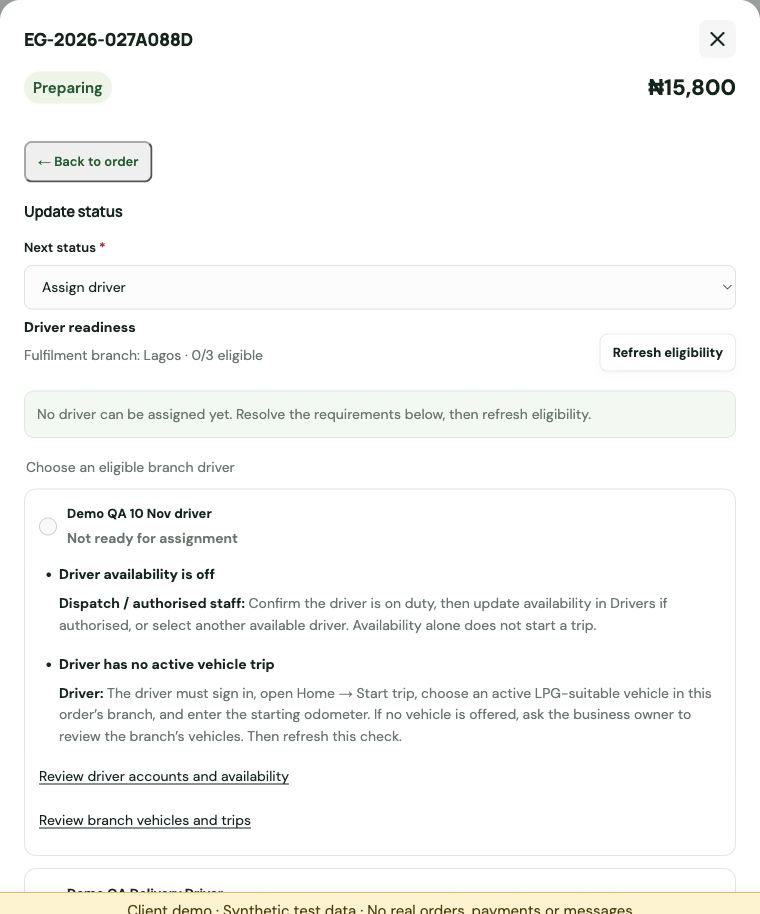
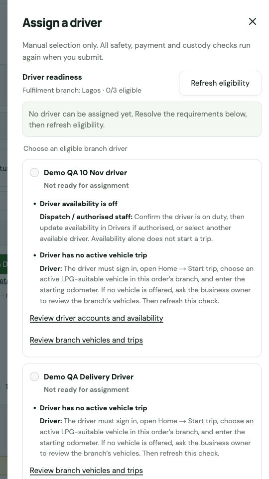
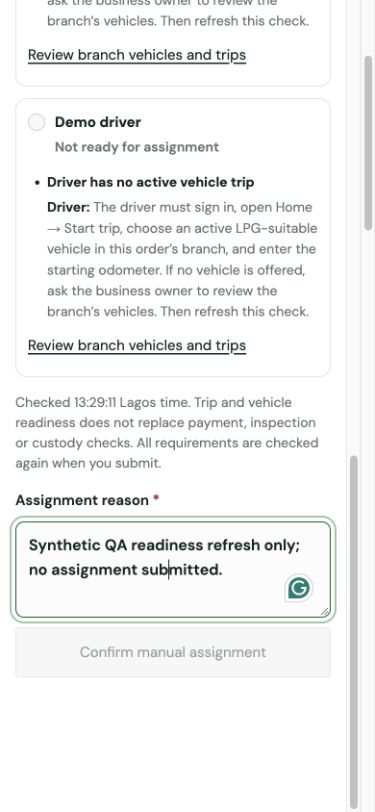
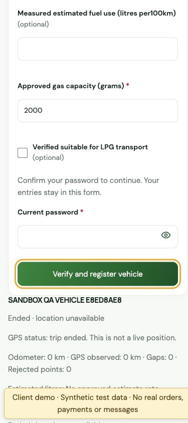

# Assigning a delivery driver

This guide supplements the historical Word/PDF manual. Use the **Orders** order-details action or **Deliveries → Assign Driver**; both show the same current server checks. Release verification is tracked in the [assignment matrix](../traceability/driver-assignment-rtm.md).

## Assign from Orders

1. Open the order, select its status action and choose **Assign driver** after preparation.
2. Read **Driver readiness**. Confirm the displayed fulfilment branch. Drivers in other branches are excluded.
3. For each blocked driver, read the exact requirement, the responsible person and the resolution steps. A blocked driver cannot be selected.
4. Resolve the issue through its normal workflow. Select **Refresh eligibility** when finished. Refresh clears the previous selection while preserving your operational note.
5. Choose an eligible driver, enter the operational note and submit. The server rechecks current payment, safety, stock/custody, driver, vehicle and order-version requirements.

## Assign or reassign from Deliveries

Open **Assign Driver** (or the reassignment action), review the same readiness cards, select an eligible driver and enter the required assignment reason. Refresh after resolving a blocker. If a requirement changes before submission, the drawer keeps the reason and displays the rejection; refresh and select again. A prior green check is a snapshot, not a guarantee or authorisation to skip final checks.

## What each blocker means

The verified client-demo screens below show a driver with **two** independent requirements: availability is off and no vehicle trip is active. Resolve both, then refresh. A duty trip is separate from the driver’s availability switch.

On a phone, scroll within the assignment panel. The confirmation stays disabled until an eligible driver is selected and the required note is supplied; the demo notice clears the action.

| Requirement | Who resolves it | Next step |
| --- | --- | --- |
| Driver has no active vehicle trip | Dispatch / driver | Use **Assign vehicle to driver** to select a suitable available branch vehicle and enter the starting odometer, then verify the admin password. Alternatively the driver uses **Home → Start trip**. Admin-created trips keep location sharing off. Then refresh eligibility. |
| Driver account is inactive | Business owner | Review the actual account in **Drivers** or use another active driver. |
| Driver availability is off | Authorised staff / dispatch | Confirm the driver is on duty and update availability in **Drivers**, or choose someone else. Availability does not start a trip. |
| Active trip belongs to a different branch | Driver / dispatch | Use a trip in the fulfilment branch. Reconcile existing custody before ending the old trip and starting another. |
| Trip vehicle is inactive | Business owner / driver | Review the vehicle or use another approved vehicle after the original trip is reconciled. |
| Vehicle is not verified for LPG transport | Business owner / driver | Review genuine suitability evidence and use a verified vehicle. Starting a trip does not establish suitability. |
| Trip vehicle belongs to a different branch | Business owner / dispatch | Review the vehicle’s branch and use an appropriate branch vehicle without transferring unresolved custody. |
| Vehicle gas capacity exceeded | Dispatch / operations | Compare the displayed required and approved kg. Demand includes this order, other assigned deliveries and extra physical LPG custody. Use another eligible vehicle or reconcile existing work/custody. Do not raise the approved limit just to clear the error. |
| This driver is already assigned | Dispatch | Keep the assignment or choose a different eligible driver for reassignment. |
| Payment, invoice, inspection or custody review | Responsible finance / qualified operations staff | Follow the specific canonical rejection. Resolve the stated review through the existing workflow, then refresh. Resolving one blocker can reveal the next order-level requirement. |

## Review vehicles as the owner

Use **Review branch vehicles and trips** on a blocked driver’s card. This opens **Deliveries → Manifests, LPG, trips & returns → Driver trips, vehicle and fuel records**. Review the branch, vehicle status, genuine LPG suitability and approved capacity. Only the business owner has the existing **Register vehicle** action. Do not create duplicate accounts or fabricated safety evidence. The owner or branch manager can now use **Deliveries → Assign vehicle to driver** to start the trip directly after password confirmation; the driver can also start their own trip. Order assignment remains a separate action.

A duty trip can cover multiple orders. Complete delivery custody and vehicle/stock/LPG reconciliation before ending it. If the list is empty, ask the business owner to review driver accounts and branch assignments. If eligibility cannot load, refresh before assigning; a failed read does not make a driver eligible.

## Continue through handover and reconciliation

The [current order-to-delivery guide](order-to-delivery.md) explains the actual driver trip, separate dispatch assignment, acknowledged manifest/LPG custody, delivery proof, handover, independent cash review and failed-delivery return/retry. If a duplicate trip is attempted, open **Manage trip** to review the current trip. A vehicle already on another trip must be reconciled or replaced by another eligible vehicle. These conflicts now give an actionable message while preserving the existing trip.

## Verify your password when registering a vehicle

Open **Deliveries → Manifests, LPG, trips & returns → Driver trips, vehicle and fuel records** as the business owner. Fill the vehicle details, enter your existing login password in **Current password**, then choose **Verify and register vehicle**. Verification and registration run through that one action.

If the password is incorrect, the form displays the error and clears only the password field. Your branch, registration label, capacities and other vehicle entries stay in place. Enter the correct password and submit again. After a successful save, the password input is removed and the form confirms it was saved.

Other shared operation forms display the same inline field if their server verification has expired. Complete verification in the original form; you do not need a separate page or to re-enter the operation details. The server still checks your role, branch and five-minute verification window. The show-password control only changes visibility and does not submit the form.

The fix was verified with one labelled synthetic QA vehicle, with LPG suitability left off. Only the labelled QA vehicle was created; existing orders, stock, ledger records, vehicles and trips were preserved. See the [verification matrix](../traceability/fleet-verification-rtm.md).

Current Dispatch setup: use the [single branch checklist](dispatch-setup.md) before assignment. Ready drivers appear first; expand **Blocked drivers** for exact requirements and next steps. Existing password, approval and final safety/custody checks remain.
