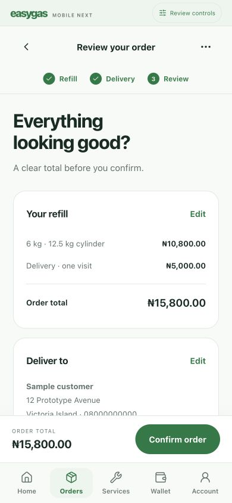

# New mobile experience review

Open the [private EasyGas mobile prototype](https://easygas-mobile-next.philipmuyiwa.chatgpt.site) using the owner account. The link is private. It is a design prototype with synthetic records; it cannot charge a card, send messages, fulfil orders or change your website data.

Choose **Review controls → Customer** to start. The review role selector exists only in this prototype; the native app continues to use secure sign-in. Review controls also offer business customer, business owner, service manager, inventory & finance, driver, technician and visitor, light/dark appearance, exception scenarios and a synthetic-data reset.

## Order gas

1. On Home, select **Order gas**. Choose cylinder capacity and gas quantity, and add another cylinder if needed. Delivery is counted once for the visit. Select **Delivery details**.
2. Check recipient, phone, area, address, date and time window. Expand optional instructions only if required. Select **Review order**.
3. Review gas, delivery and total. Edit the refill or address in place, choose card, wallet or cash where permitted, then select **Confirm order** once.
4. For card, review the disclosed sample processing fee and select **Accept total & continue**. **Simulate payment return** demonstrates in-app verification and confirmation. This performs no real transaction. Track the saved order after confirmation.

Returning without completing payment keeps the order unpaid. Use **Check this payment again** or **View saved order**; do not create another order. The expired-session scenario offers **Restore sample session and check**, preserving the order. Offline/pending/declined scenarios demonstrate recovery, not a successful charge.

The client-demo browser callback fix is deployed. In the real application, payment verification belongs to the signed-in native session. The native browser callback correction returns to EasyGas using an opaque payment intent, without sending an authentication token in the URL. Native source automatically checks status on entry/foreground; the server still decides whether payment is verified. Installed build 2 does not yet include the new native source changes.

## Find other features

Home prioritises gas ordering, service booking, wallet and the latest order. Secondary invoices, cylinders, rewards and refill planning stay available below. Bottom tabs remain stable. Account → **All workspaces**, or **More workspaces** in a screen header, opens a searchable list for the chosen role.

Each workspace separates **Overview**, **Actions** and **Activity**. Select a row to inspect records; select an action to open one focused form. Close the sheet to return to the same workspace. Required information, eligible records, role restrictions and independent approval requirements still apply. Finance forms accept naira; internal integer-kobo conversion happens once.

Drivers begin with trip readiness and a suitable trip. Technicians begin with scoped jobs and work authority; an empty eligible-appointment selector cannot start work. Owner/manager navigation prioritises orders; finance prioritises finance. Visitor mode hides customer orders and wallet balance. Business customer is a design review persona using existing customer permissions.

| Review persona | Suggested walkthrough |
| --- | --- |
| Visitor | Browse Home/services, open Wallet to confirm private balances stay hidden, then choose a signed-in review role |
| Customer | Refill → delivery → review → simulated payment → tracking; then Services, Wallet and Account |
| Business customer | Customer journey plus Quotations from All workspaces; uses the existing customer permission model |
| Business owner | Overview → today's orders → Actions; then approvals/settings, reporting and operations from Work |
| Service manager | Orders, dispatch, customer/service management and scoped staff workspaces |
| Inventory & finance | Finance priority → expenses/collections; then inventory, reconciliation, refunds and reports |
| Driver | Today → trip readiness → Start local trip; inspect assignment, pickup, arrival, handover, returns and history |
| Technician | Today/Jobs → scoped appointments → assignment/assessment → authorised work → materials/completion |

Use **Overview** to inspect an existing record before opening **Actions**. A task can remain unavailable because there is no eligible record, authority has expired or the chosen scenario blocks it. Those states are intentional; changing the review role does not grant production permissions or bypass workflow requirements.

## Loading and transitions

Normal prototype navigation has no loader. **Slow connection** demonstrates a content skeleton; **Offline** demonstrates saved context and recovery. Native source now keeps recent reads within the current session, refreshes in place, delays the loading indicator for fast reads and removes duplicate optional Home loaders. It clears private cache scope when the account/session changes. Short transitions honour reduced motion.

The prototype has been checked at phone widths 360, 390 and 414px, plus tablet portrait/landscape. Browser layout evidence does not replace installed Android/iOS, keyboard, large-text and screen-reader acceptance. All 36 families / 300 feature items remain in the traceability denominator; a visit does not mark an individual feature accepted.

No new mobile binary was created. This prototype and source work do not replace the current TestFlight/Play build or close existing production NO-GO decisions. See the [audit and remaining work](../mobile-ux-20261123/README.md) and [matrix](../traceability/mobile-ux-20261123-rtm.md).
