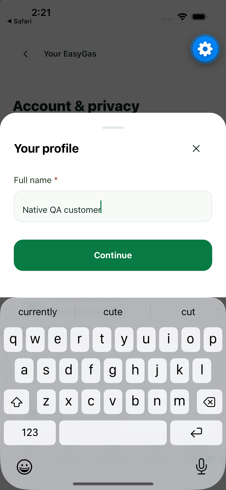
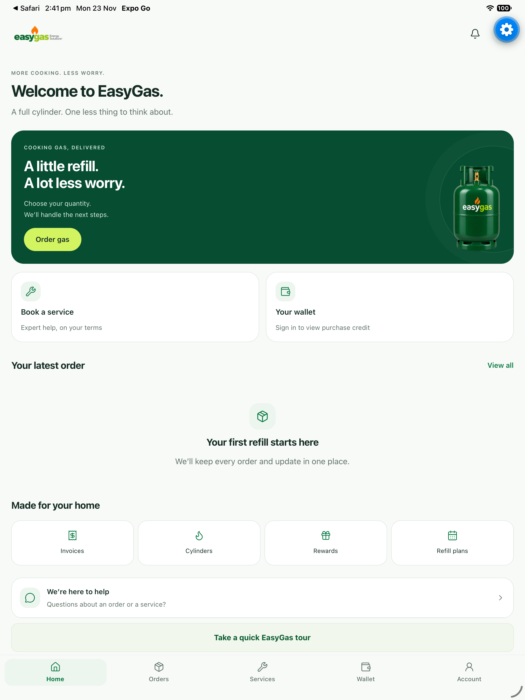
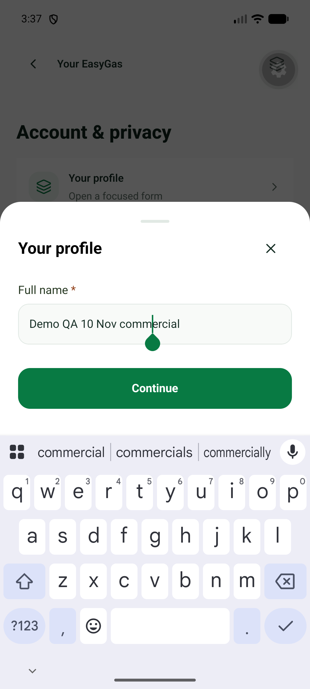
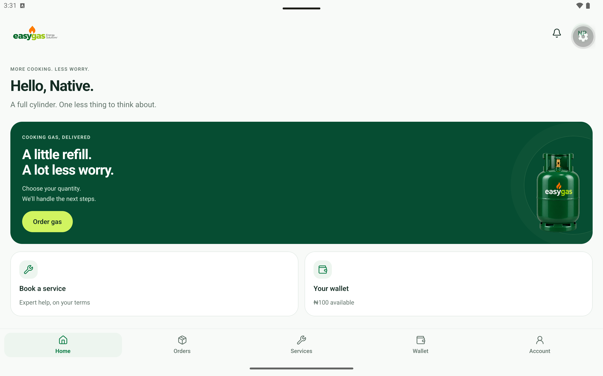
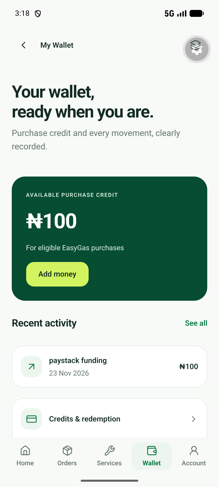

# EasyGas native Mobile Next

The approved [private design](https://easygas-mobile-next.philipmuyiwa.chatgpt.site) is now being adopted in the real React Native application. This guide describes the implemented native controls. The private prototype remains a separate synthetic design reference. Installed TestFlight/Play builds do not receive source changes automatically; this phase has not created or uploaded a new binary.

## Customer and business customer

**Home** puts Order gas first, followed by Services, Wallet and the latest actual order. Invoices, cylinders, rewards and refill plans remain below. The five bottom tabs are Home, Orders, Services, Wallet and Account. Account → All workspaces opens the searchable feature directory. A guest sees no private balance or order records.

To order gas, choose cylinder capacity and quantity, then select **Delivery details**. Check recipient, mobile number, area, street, date and time. Optional delivery directions expand only when needed. Saved addresses open in a sheet. Select **Review order**, choose an available payment method and confirm the server quotation. The application rechecks the quote before creating the order. If the price changes, review the new amount and confirm again.

The fixed footer holds the current total and one primary action. Back returns to the previous step. Signing in from checkout preserves the in-memory guest draft; private saved drafts and pending requests are encrypted and bound to the signed-in account. A failed storage check preserves existing records and stops a new submission.

If a request times out, **Retry saved request** uses the original request key and payload. The same pending request survives reopening the checkout. Check Orders before starting a different purchase. An unknown response does not mean failure or an unpaid order was deleted.

For card payment, review the order amount, processing fee and exact total. **Accept total & continue** provides the fee consent and opens the approved hosted checkout. The app verifies the opaque intent using its own signed-in session on return or foreground. A browser session is separate from the app session. Pending status never means paid. A failed or expired attempt returns to a fresh payment review; it does not silently start another charge. Saved attempts must match the exact order/invoice/service being paid. Sandbox disclosures and existing server controls remain in force.

Orders open into tracking and focused payment, visit, refund and cancellation-request sheets. **Request cancellation** creates a support request linked to the owned order; the order remains active until authorised operations confirms cancellation. Delivery codes are shown only for the owned active order and should be shared after receipt. Tracking displays actual server events and timestamped observed locations.

Products use search and category sheets. Product details keep specifications, warranty, compatibility and safety in a secondary sheet. The cart supports quantity changes and removal, followed by the same delivery/review flow. Gas products open the refill flow. Bundled products and staged appointments retain their distinct delivery, quotation, payment and completion records. A service-only linked request also retains its original key across an uncertain response.

Services show available service cards. Select a service to review current terms, eligibility and appointment availability. Bookings and quotation decisions open one appointment at a time. Wallet shows the current ledger balance and entries; **Add money** opens a separate amount/payment sheet. Refunds, credits, work authority and publication consent keep their existing business approval rules. Feedback drafts are available from All workspaces → Testimonials; submitting for review does not publish them.

## Business owner, service manager and finance

Overview presents confirmed records and values; unavailable values remain unavailable. Work opens the permitted workspace directory. Each business workspace has **Overview**, **Actions** and **Activity**. Activity uses available canonical history/movement records; it does not manufacture an audit trail where the module has none.

Select one record to inspect it. Open an action row for a focused form. Searchable record selectors, current revisions, required evidence and password verification remain part of the real workflow. Closing a sheet keeps unsubmitted entries in that form while its component remains mounted. Reopening a workspace revalidates recent data. After a write, the controller requires canonical read-back before another action; an unknown outcome is not treated as success.

Owner-only settings, approvals, staff authority, reports and readiness remain restricted. Manager and finance access stays within their existing privileges and branches. The owner is not split into invented additional admin roles. Existing independent-review controls are not removed by the redesign.

## Driver and technician

The stable bottom tabs are **Today**, **Deliveries/Jobs**, **Work** and **Profile**. Today shows actual assignments and readiness. Work groups operational actions and activity. Profile keeps personal details, security, appearance, notifications, synchronisation and support.

Drivers open Trip for trip records, LPG or Products. Start a suitable trip before accepting an eligible delivery. Vehicle suitability/capacity, branch, availability, qualifications, inspections, pickup, arrival, proof, code, cash verification and returns remain server-controlled. Trip/LPG/manifest forms open in focused sheets. A pending encrypted offline record never marks delivery complete.

Technicians open the assigned job, inspect current assessment and scope, then use the existing authorised work/material/completion controls. No eligible assignment, expired qualifications or changed work authority remain blocking states. Offline evidence stays pending until server verification. Changing roles or signing out does not discard pending custody records.

## Loading, appearance and acceptance

Recent private reads are scoped to the current account/session and revalidated. Fast navigation avoids a repeated branded loader; slower content uses a consistent delayed skeleton. Foreground revalidation, connection errors and retry actions remain explicit. Page transitions respect Reduce Motion. Transparent artwork and approved light/dark colours are shared across the app. Content remains edge-to-edge with safe-area and keyboard handling.

Current source/API/component results, representative phone/tablet passes, and the still-open broader accessibility, hosted positive purchase/replay and distribution checks are recorded in the [native adoption matrix](../traceability/mobile-native-next-rtm.md). Browser prototype screenshots are design evidence, not native device acceptance. Production NO-GO, genuine safety/provider acceptance and historical import/retention holds remain unchanged.

## Recovering linked appointments

If the app loses the response after you confirm appointments, reopen the saved checkout and select **View linked requests**, then **Retry saved request**. The same request reference recovers the original appointments. The app preserves other products in your cart. **View appointments** opens your bookings; **Track your order** opens the saved product/gas order.

The current design is visible in the development simulator. Store-installed versions remain on their previously uploaded binaries until a separate release is built and distributed. Representative role, tablet and keyboard checks now pass; remaining individual-feature/device/provider acceptance stays tracked in the native traceability matrix.

The supporting web/API changes are deployed to the [client demo](https://easygas-client-demo.vercel.app). Seven-role access and exception probes passed on both the candidate and stable demo. Successful hosted physical-product checkout still needs eligible stock; the current zero-stock catalogue correctly blocks that purchase. No hosted test order or real payment was created during these read-only checks.

## Account and keyboard checks

When signed out, Account shows one **Sign in** action plus Appearance, Policies & terms, and About & delivery. Signing out removes private balances and orders from Home.

Profile, email verification, communication preferences and privacy password checks open focused sheets. Open one action, enter the fields, then continue. Closing a sheet does not submit it. In the verified phone layout, the software keyboard leaves the active input and Continue button visible.

The actual phone journey from guest delivery details through sign-in, synthetic wallet payment and the correct order tracking is recorded in [device observations](../mobile-native-next/device-observations.json). Payment verification does not mark delivery complete.

## Verified phone and tablet layouts

The current development app has been checked with all seven representative phone roles. Business customers see their own orders; drivers see their assignments; technicians see their assigned jobs. Dismissing a driver assignment alert leaves it unacknowledged. Enter the required reason before acknowledging. Technician assessment and completion still require current server work authority.

The customer profile sheet keeps the input and Continue button above the software keyboard on the phone and in tablet portrait/landscape. Owner Inventory keeps Overview, Actions and Activity, search, filters and scoped records available in tablet landscape. At enlarged phone text sizes, the Home cylinder artwork moves below the banner copy so the text remains clear. The page scrolls while the refill total and next action remain fixed above the bottom tabs.

The recorded wallet test used disposable local synthetic data. It verifies continuity through sign-in and the correct tracking destination; it does not verify a real provider payment or physical delivery. Text size6 was checked, while maximal accessibility sizes, VoiceOver, Android runtime, physical devices and every feature/device combination remain open. The new iOS TestFlight0.1.0(3) now includes this design; Android store build2 remains older.

## Returning from sandbox payment

Use a customer or business-customer account with an authorised real email address. Reserved test domains such as `.test` are rejected before hosted checkout, even though the client demo uses synthetic purchases. Staff accounts cannot access customer payment intents. Never enter a real card for this sandbox test; use [Paystack’s official test details](https://paystack.com/docs/payments/test-payments/).

Review the amount and processing fee, then choose **Accept total & continue**. After Paystack returns, the browser should show **Continue in EasyGas** with one **Return to EasyGas app** action. The browser and app have separate sessions, so the native-return page does not ask you to sign into the website. Reopen the signed-in app if the return link cannot open it. The app checks the saved intent with the server on return/foreground; **Check again** checks that attempt rather than creating another charge.

A pending, failed or expired attempt does not mean payment succeeded. Check the saved order or wallet before trying again. A provider success is accepted only after the app’s owned-intent verification and canonical ledger read-back agree. The Android sandbox continuation completed an actual Paystack TEST payment and confirmed one ₦100 wallet credit after repeated verification. A declined attempt showed a retry message without another credit; leaving a separate checkout unpaid kept its saved attempt pending. Pending is not success: reopen EasyGas and use Check again before considering another payment.

## Android phone and tablet behaviour

The current-source Android preview uses Expo Go 58.0.5 and the client-demo backend. Its seven representative role views and phone/tablet layouts have been checked. The Android store build2 remains older and needs a separately authorised signed Android release. The latest iOS TestFlight build3 includes these changes.

Tablets can rotate between portrait and landscape. Content fills the app window, with controls inside system safe areas. Profile forms move above the docked software keyboard. Android Back first hides the keyboard; pressing Back again closes the sheet without saving. Floating keyboards can be moved with the operating system controls.

Use Account → Appearance to choose Light, Dark or System. The transparent logo remains clear in dark mode. Android phone and tablet checks include140% text scaling and gesture/three-button navigation. Slow order reads now finish before the next polling request begins, avoiding an indefinitely replaced loader.

[Provider/Android acceptance](../mobile-native-next/provider-android-acceptance.json) records8bounded passes out of9cases. The remaining installed-build/custom-scheme gate retains untested installed iOS handling and the older Android store binary. The subsequent iOS-only build authorisation does not itself verify those behaviours. Real iOS provider return, physical devices, screen readers/maximal accessibility and individual feature/device permutations remain open. The development runtime cannot accept remote push or Android background GPS on behalf of an installed release. Production remains NO-GO.

Current application source `aa5a86e` passed [GitHub release validation](https://github.com/Onaopemipo/easygasng/actions/runs/45119392929): **1,219 passed, 0 failed, 0 skipped**; web/native jobs succeeded and native export was skipped. Final documentation-only evidence update changes no application source.

## Update to iOS TestFlight 0.1.0 (3)

Open **TestFlight → EasyGas Energy Solutions → Update** using the existing approved internal Apple account. Confirm version **0.1.0 (3)**. The build is available to the same two internal testers in EasyGas Internal QA; if the invitation has not been accepted, accept the existing TestFlight invitation first.

Build3 includes the approved mobile design and loading, keyboard, orientation and payment-return source repairs. It supports iPhone and iPad and uses the existing client-demo API with synthetic data. Use Paystack TEST details only. Android remains at the earlier store build2.

Follow the saved [What to Test notes](../ios-testflight-refresh-20261123/WHAT-TO-TEST.md), especially installed return-to-app, session continuity and background recovery. Upload/Testing status does not verify those device actions. Full feature, physical-device, permissions, screen-reader and production gates remain open. [Release evidence](../ios-testflight-refresh-20261123/README.md).
