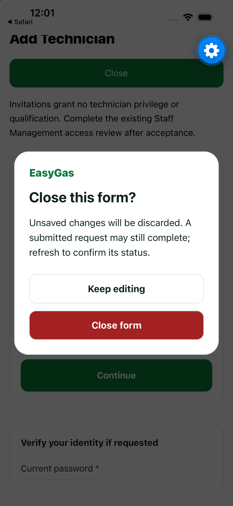
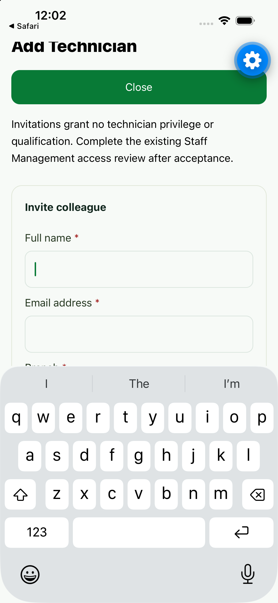
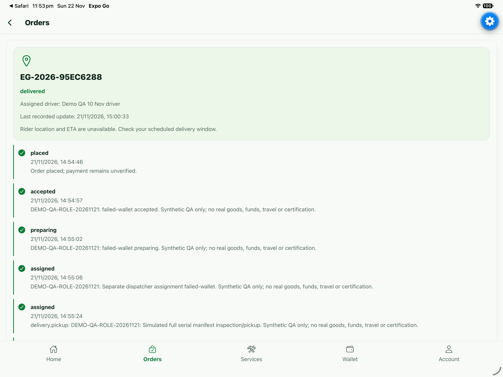

# Native mobile display

Customer/commercial, Admin, Service Manager, Inventory/finance, Driver and Technician layouts use the full available native window width. Backgrounds continue behind status and navigation areas. Text, fields and buttons retain safe spacing from the notch, home indicator and side cutouts. The web app is unchanged.

Open the native development preview normally. Use Home, Orders, Services, Wallet or Account as before. Driver and Technician keep their role-specific navigation. No full-screen toggle is needed; system bars remain visible.

Screen-sized forms and the introduction open full screen. Use their Close, Skip, Back or completion controls. Alerts and context sheets keep compact content with a backdrop covering the display. Existing permissions, password verification and approval requirements still apply.

When closing a form, the confirmation now appears **above that form**. **Keep editing** returns to your inputs; **Close form** discards unsaved changes and dismisses the form. Opening a confirmation dismisses the software keyboard. A request already submitted may still complete: refresh its status before retrying. Layout testing does not require submitting a new staff invitation.

Manager Dispatch shows **Checking dispatch access** while permissions load. Use **Retry access check** after a connection failure. If access is denied, ask the Admin to review your branch and delivery access; retry does not grant permission. Dispatch, Customers and POS now have distinct bus, people and desktop icons. An authorized view with no current jobs shows **No active deliveries**.

Scroll long pages normally. Inputs stay above the software keyboard; dismiss it before using bottom navigation. Driver sign-out asks for confirmation: **Keep working** returns to the workspace; **Sign Out** ends the session. Technician retains the warning about unsynchronised service records. Missing trip, GPS permission and availability states remain explicit; do not enable them merely to review layout.

Use the appearance control to choose Light, Dark or System where available. Representative Customer phone and Technician tablet screens were checked in dark appearance. Backgrounds and the transparent logo retain their treatment across the window. Customer Orders shows a fallback when rider location or ETA is unavailable.

Tablet content uses the available width. Customer Orders was also checked in the development runtime's landscape window with usable bottom navigation; the app's release orientation configuration has not changed.

The [acceptance report](../edge-to-edge/visual-acceptance/README.md) records **14/14 passed representative role/device cases**: all seven roles on iOS phone and iPadOS tablet, including keyboard, confirmation, loading/empty states, scrolling and logout checks. This does not certify every workflow or every screen/theme/orientation combination.

No new EasyGas mobile binary was created. Two dedicated simulators reused the cached Expo Go runtime; previously installed release apps do not acquire source changes automatically. Physical Android/iOS, provider and release-device acceptance remain separate in the [traceability matrix](../traceability/edge-to-edge-rtm.md). The production NO-GO decision remains unchanged.
