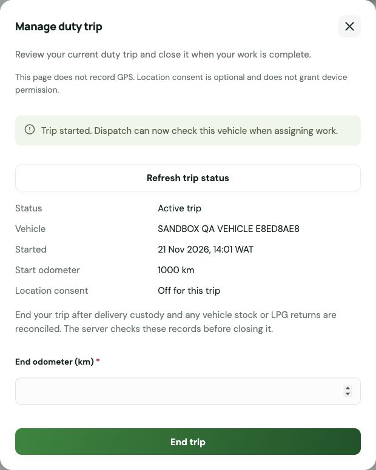
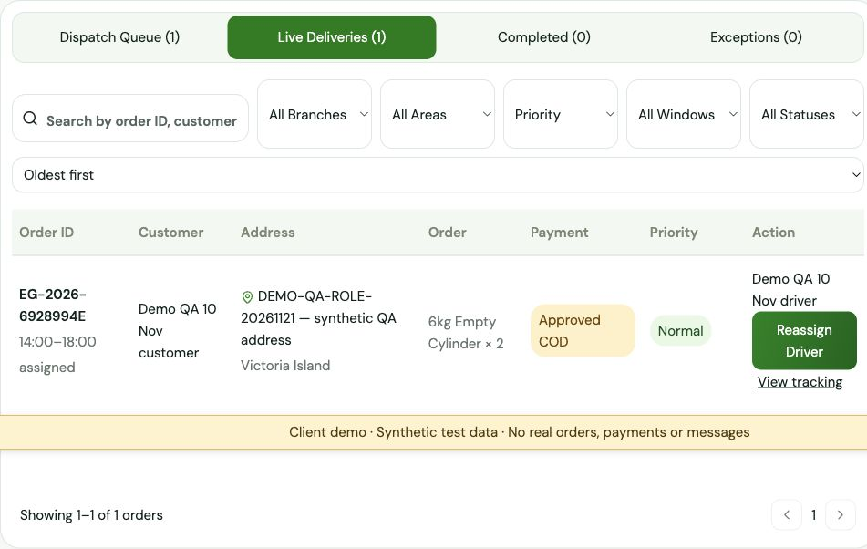
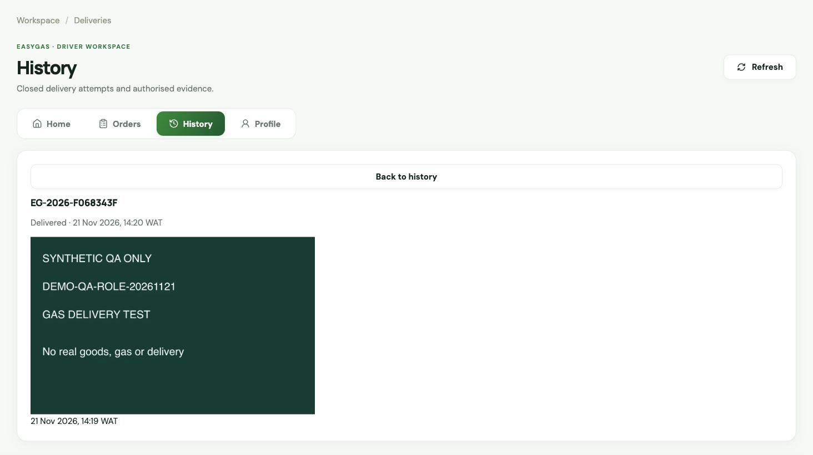
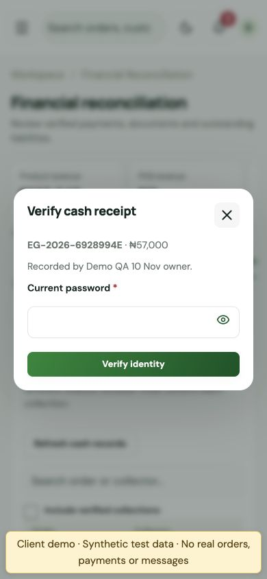
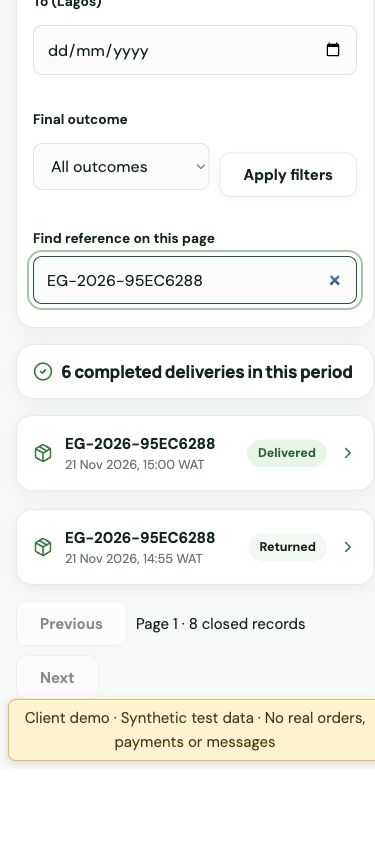
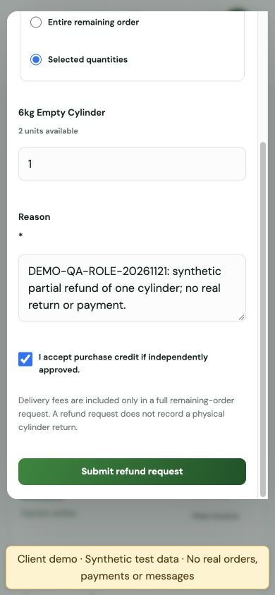
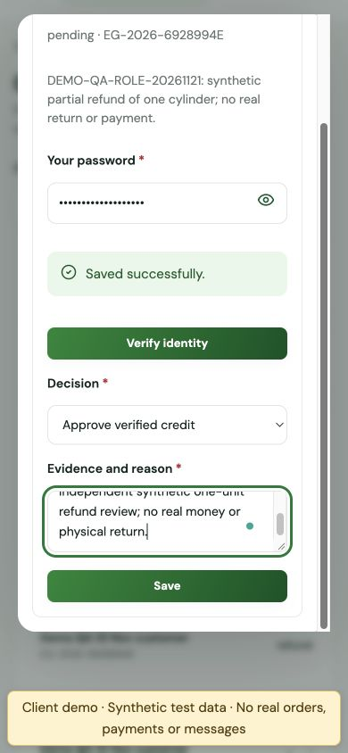

# Order to delivery: role guide

Use this guide with [driver assignment](driver-assignment.md). It describes the client-demo workflows exercised on 21 November 2026. The [acceptance matrix](../traceability/role-order-acceptance-20261121-rtm.md) distinguishes executed web checks from wider production and native acceptance. The original illustrated Word/PDF manual remains a historical edition.

## Who does what

| User | Responsibility |
| --- | --- |
| Customer / business customer | Place and pay for their own order; view delivery updates, invoice and proof; provide the private handover code; request a refund. |
| Sales / branch manager | Accept, prepare and confirm address coverage; arrange a safe reschedule after returned custody. |
| Dispatch / branch manager | Check readiness, assign an eligible driver, manage exceptions and review the delivery incident. |
| Inventory / finance | Inspect only when qualified; issue and independently receive stock/LPG custody; reconcile returns. The actual canonical role and assigned branch determine access. |
| Driver | Start their own trip, set availability, acknowledge assignment, inspect pickup, record arrival and consented evidence, then complete the handover. |
| Finance | Issue invoices; independently verify cash and purchase-credit/refund decisions; propose invoice corrections. A different authorised reviewer approves invoice corrections. |
| Business owner | Review vehicles and operational configuration and supervise authorised delivery/cash actions. Owner access does not remove independent finance/custody checks. |
| Technician | Use the technician service workspace. It does not grant delivery assignment, customer-order proof or financial-ledger access. |

Job labels can map to the same canonical role. A second label is not necessarily an independent person. The application checks the actual account ID, role and branch. Use separate existing authorised accounts when a workflow requires independent review.

## Start a driver trip and assign the order

1. Sales prepares the order and resolves its payment, invoice, stock, safety and address-coverage requirements.
2. The driver opens **Home → Start trip**. Select a suitable active vehicle in the fulfilment branch and enter the true starting odometer. Location sharing is optional; leaving it off does not request GPS.
3. Turn on **Available for dispatch**. Availability and the vehicle trip are separate requirements.
4. Dispatch opens **Assign Driver**, reads the readiness cards, refreshes after resolving blockers, selects an eligible driver and enters the assignment reason. The server checks eligibility again on submission.

If the driver already has an active trip, open **Manage trip** and use it. Before changing vehicles, receive and reconcile outstanding custody and end the existing trip. If a vehicle is already on another trip, choose another suitable vehicle or ask dispatch to reconcile that trip. Repeated clicks do not create another trip.

## Complete a delivery

1. Driver opens the assigned order and **Acknowledges assignment** with a note.
2. For bulk gas, qualified inventory issues the trip load and starting cumulative meter reading. The qualified driver independently checks and acknowledges the actual loaded mass and reading. Inspection and calibration must be current.
3. Inspect the complete pickup manifest, including every cylinder serial and gas quantity, before **Confirm inspected pickup**.
4. Select **Start delivery**, then **Confirm arrival** when actually there.
5. For gas, record the actual new cumulative meter reading and evidence. It must account for the full authorised quantity and remain within the load and meter controls.
6. Choose a proof photo, enter a description and confirm customer consent before uploading. Use only authorised, relevant evidence. A photo is specific to the current delivery attempt.
7. Ask the customer for their six-digit code. Confirm that every item and the full gas quantity were handed over, then **Complete delivery**. Keep the code private; it is not a dispatch note.

A wallet-paid delivery remains payment verified. For COD, the authorised cash handover records the amount actually received. **Collected** means cash was recorded; it is not independent verification. Finance opens **Financial Reconciliation → Cash reconciliation → Review cash receipt**, verifies identity and confirms receipt. The collector cannot independently reconcile their own collection.

After gas deliveries, declare the remaining custody accurately. An independent authorised receiver records and reconciles the return, including a genuine zero return where applicable. Outstanding custody prevents ending the trip. Enter the ending odometer only after the trip's work is resolved, then restore availability to match actual duty status.

## Failure, return and retry

Record the real failure reason rather than claiming delivery. Stock remains in driver custody until inventory independently receives the exact returned manifest. The driver cannot receive their own return. Incomplete returns, cancellation with held stock and reassignment before return are blocked.

Once custody is returned, sales reschedules and dispatch assigns a new attempt. The new attempt does not charge the wallet or reserve the same stock again. The driver repeats acknowledgement, pickup, arrival, current-attempt proof and full customer handover. Keep the first failure and return history. Dispatch resolves the related incident after the outcome and custody are genuinely resolved.

## Customer tracking, cancellation and refunds

**My Orders → View details** has three sections: **Overview**, **Delivery updates**, and **Visit & photo history**. Times are shown in Lagos time. The public **Track Order** link opens the customer's scoped order workspace.

A permitted cancellation before pickup releases the reservation. If paid from the wallet, the automatic refund happens once. An issued invoice may still require independent review: finance proposes the appropriate void/correction and a different authorised reviewer approves it. The original issued snapshot is retained.

For a delivered order, choose **Request refund → Selected quantities**, enter only the requested units, explain the reason and accept purchase credit if appropriate. Submit for review. Submission alone does not credit the wallet. Finance reviews the request separately. Approval posts one credit; rejected or replayed requests do not create extra credits. The remaining refundable quantities are enforced.

A financial refund does not return physical stock. Use the appropriate inventory return process for actual goods. Finance also proposes a credit note matching an approved refund; a different authorised reviewer approves it. The original invoice stays immutable and its effective balance reflects the approved correction.

## Common blocked actions

| Message or situation | Resolution |
| --- | --- |
| Verify your password again before this sensitive action | Enter **Current password** in the same form and choose its verification/submit action. Vehicle and operation entries remain while you correct or repeat verification. |
| No active suitable vehicle trip / unavailable driver | Resolve the specific readiness card, start the driver's own eligible trip and set duty availability; refresh dispatch. |
| Already active trip / vehicle already on a trip | Review the existing trip; reconcile before ending, or choose another eligible vehicle. |
| Order changed / stale version | Refresh the order, review its current state and retry once with current information. |
| Missing acknowledgement, pickup, arrival, metered quantity or proof | Complete the missing prerequisite in sequence. Do not substitute an old-attempt photo. |
| Qualification or meter calibration expired | Obtain genuine current evidence and independent authorised verification. Do not reuse synthetic QA evidence for real work. |
| Cash/refund/credit correction needs an independent reviewer | Use a different authorised account with the required role, branch and recent identity verification. |
| Cannot cancel or reassign held custody | Independently receive the exact return before rescheduling or cancelling. |
| Invoice requires adjustment | Complete finance proposal and independent approval; do not overwrite the issued invoice or claim a zero balance prematurely. |

The 21 November demo used explicitly approved, two-hour synthetic QA qualifications and meter renewal. These are test records, not operational certification. No real delivery, funds, GPS trip, live provider transaction or device acceptance is established by this pass. Existing production NO-GO and import/retain-all controls remain unchanged.
