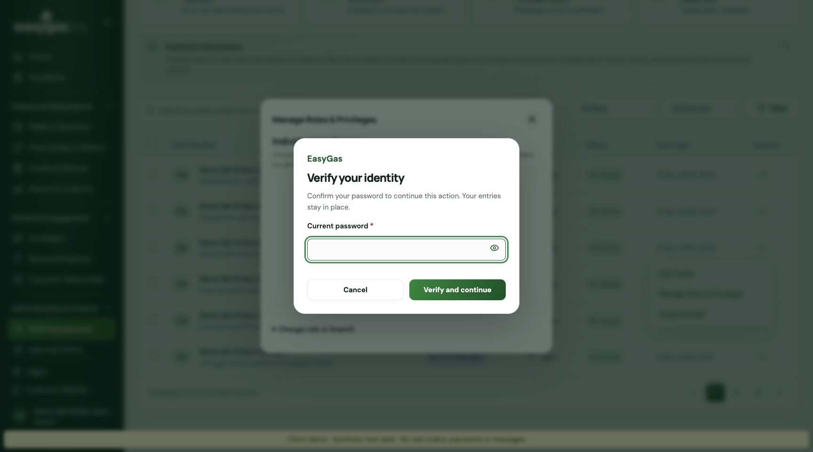
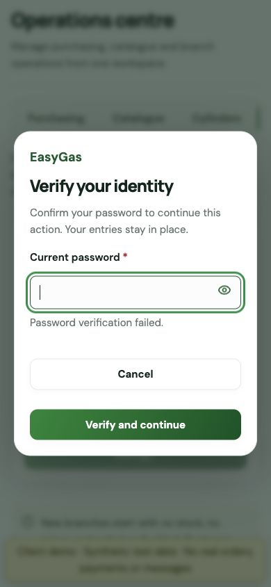

# Confirming sensitive actions with your password

EasyGas asks for your current password again when an action needs recent identity verification. Verification lasts five minutes in the current signed-in session. It confirms who is acting; the action must still satisfy your role, branch, approval and operational requirements.

Some screens, such as vehicle registration and settings changes, already show an inline Current password field. On other screens, a **Verify your identity** dialog appears when you submit an action that needs verification. Viewing individual staff privileges can also trigger it.

1. Complete the form and choose its normal action.
2. If the verification dialog opens, enter the password for the account currently signed in. Use **Show password** if needed.
3. Choose **Verify and continue**. EasyGas verifies your identity and continues the exact request you submitted. Your entered form details stay in place.
4. If the password is wrong, the dialog explains the problem, clears only the password and puts the cursor back in the password field. Enter it again. Too many failed attempts require waiting before another attempt.
5. Choose **Cancel** or press Escape to stop. Review the form before trying again; cancellation does not submit the sensitive action.

Do not switch accounts or navigate to another page while confirming an action. If your account, session or page changes, EasyGas stops continuation and asks you to refresh and review the action. If verification expires again, verify again when prompted. Do not assume a connection failure means an action failed: check the current record before repeating it.

| Message or situation | What to do |
| --- | --- |
| Password verification failed | Enter the current account password again. Your other details are retained. |
| Verification cancelled | Review your entries and choose the action again when ready. |
| Account, session or page changed | Refresh, check the account and branch, and review the current record. |
| Account has no permission / another branch | Ask the authorised person for that branch. Re-entering a password cannot grant access. |
| Qualification, approval, vehicle or meter requirement | Follow the stated operational resolution. Password confirmation cannot satisfy those requirements. |
| Version conflict / record changed | Reload the current record and review the differences before submitting. |

This applies to web Admin, Inventory/finance, Service Manager, Driver, Technician, Customer and Commercial accounts only where the server requires verification. The client demo uses synthetic data; verification does not authorise live payments, safety certification or production release.

## What the updated dialog looks like

The same compact dialog also protects sensitive reads, such as opening individual staff privileges. Confirmation completes the read; it does not change anyone’s access.

On a phone, the required field, error, Cancel and Verify and continue remain visible. The password is cleared after an unsuccessful attempt; other form entries remain in place.
