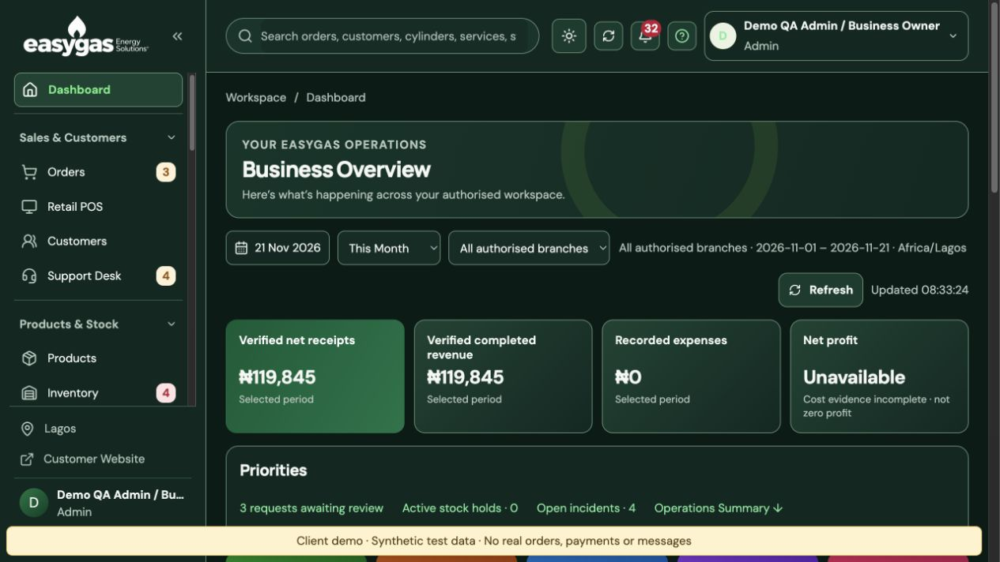

# Transparent web logos

The approved web and native wordmark bytes already match and have alpha transparency. White boxes were CSS backgrounds on the public header/footer, customer sidebar, fixed-green staff sidebar and introduction logo. This phase removes logo-only backplates and uses a white inverse rendering on dark/fixed-green surfaces, preserving original colours on light surfaces. Wordmark proportions, links, accessible names, compact icons and document artwork are retained.

Only `apps/web/app/theme.css` and `apps/web/app/customer-introduction.css` change application behaviour. No image generation or asset edits. Printed/emailed financial documents keep their original artwork and white document layout.

Local verification: 21 existing/focused source/header/introduction/artifact regressions and six original prototype checks pass; production build and sequential typecheck pass. Historical manifests remain byte-for-byte intact. Source continuation accepts only these two CSS files and rejects tampered baseline input. Hosted visual/deployment acceptance is complete.

[Matrix](../traceability/web-transparent-logo-rtm.md). Production NO-GO and unrelated acceptance gates remain; no native build/export/install or business-data changes.

## Verified client demo

Source `2731e4ee4d8027dbf0fdc4e754f2a36b96386f5f`, Ready deployment `dpl_AxiNLNdQPqtxRhhnk49NNcVUf5fW`, is live at [the client demo](https://easygas-client-demo.vercel.app). All 436 uploaded files match committed bytes. Four candidate and seven stable HTTP/source/asset checks pass; anonymous private identity access remains denied.

Thirteen actual browser observations cover public header/footer, introduction, staff and customer sidebars in light/dark themes, compact navigation and 390px phone views. All backgrounds are transparent, images load and accessible names remain. Inverse white rendering is used on dark and fixed-green staff surfaces; original colours return in light mode. Phone views have no horizontal overflow. Shared shells cover additional roles/routes; each individual page/role was not separately visited. Browser console has no errors. Both temporary demo sessions signed out; viewport and initial light preference restored.

Original images and prototype manifests/bundles remain byte-for-byte unchanged. Three retained native artifacts retain exact hashes, sizes and modification timestamps. No mobile binary/export/install or business operation was performed.

Rollback: promote previous Ready `dpl_EPFsgJFKDE2457trgZd7SoVvAUEg` in the same demo project. No schema/data/configuration rollback is needed. Keep all existing production NO-GO, provider/device and import/retention decisions.

Additional [GitHub Release validation](https://github.com/Onaopemipo/easygasng/actions/runs/44880506232) was still running at the recorded observation (native checks successful; full web regressions in progress). No full-suite success is claimed for this revision. The bounded logo acceptance above is based on completed focused/build/types/prototype and hosted visual evidence. See [observed CI state](evidence/ci-observed.json).
